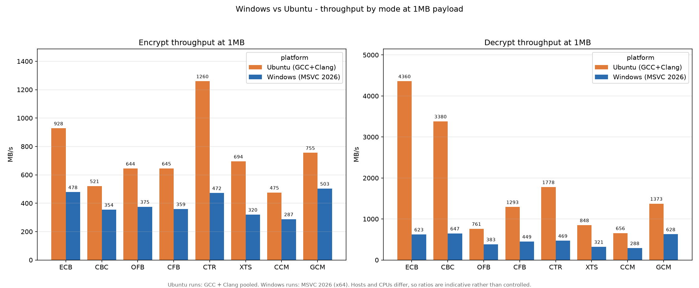
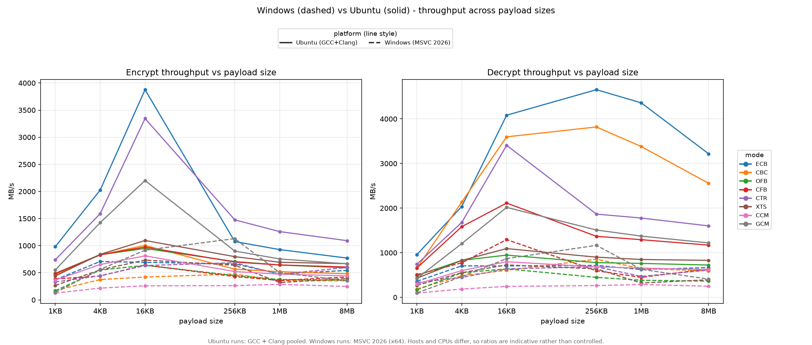
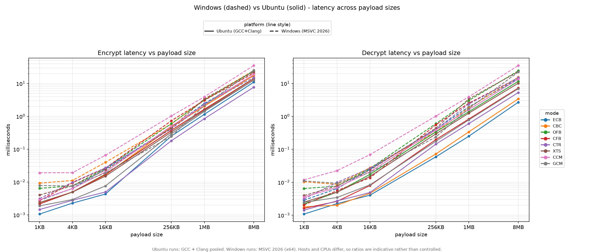
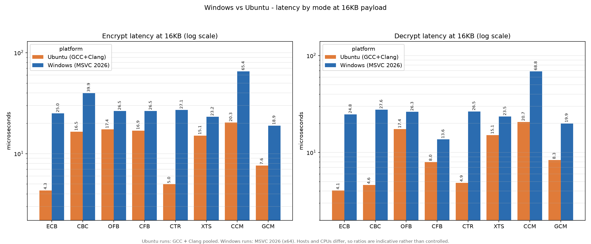
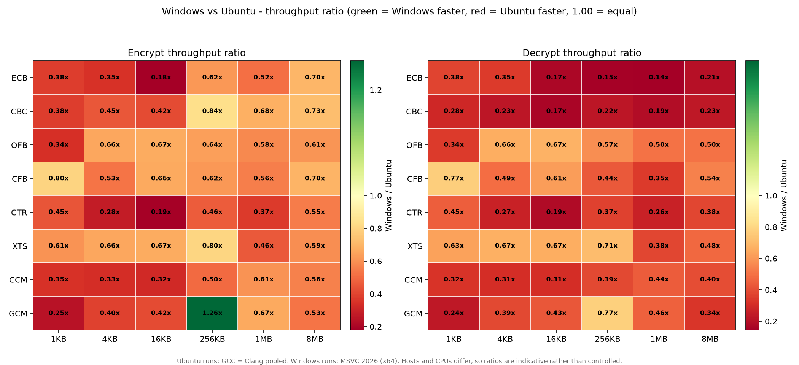
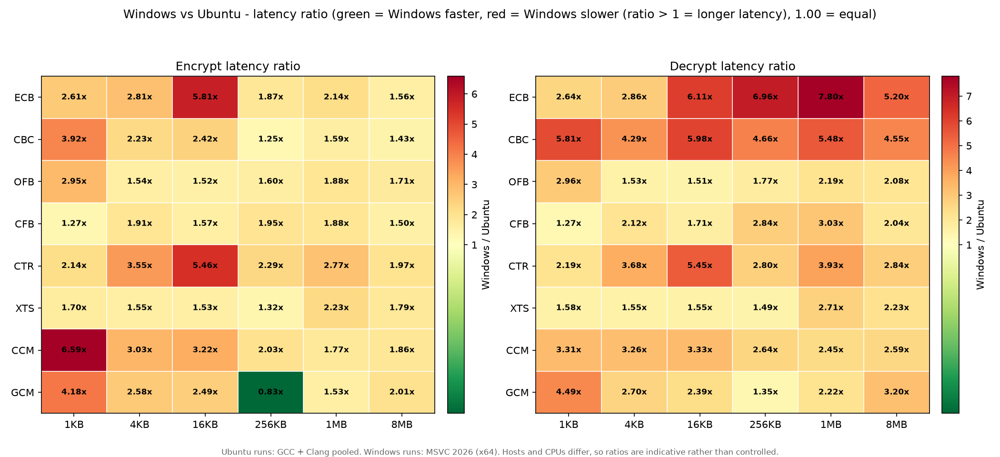

# BÁO CÁO LAB 1 — MÃ HOÁ ĐỐI XỨNG VỚI CRYPTO++

**Học phần:** NT219 — An toàn thông tin  
**Bài thực hành:** Lab 1 — Symmetric Encryption with Crypto++  
**Sinh viên:** ................................................  
**MSSV:** ................................................  
**Lớp:** ................................................  
**Ngày hoàn thành:** 21/10/2026  

> Báo cáo này được viết bằng tiếng Việt. Toàn bộ số liệu hiệu năng lấy từ các tệp CSV
> trong `output/ubuntu/benchmarks/` và `output/windows/benchmarks/`; không có số liệu
> nào được tạo thủ công. Phần KAT và kiểm thử đơn vị trên Windows và Ubuntu đã được
> chạy lại trong quá trình hoàn thiện báo cáo; nhật ký nằm trong
> `output/windows/test_results/` và `output/ubuntu/test_results/`. Các tệp bằng chứng
> kiểm thử âm nằm trong `output/windows/neg_results/` và
> `output/ubuntu/neg_results/`.

---

## Mục lục

1. Tóm tắt điều hành
2. Mục tiêu và phạm vi
3. Thiết kế và cài đặt
4. Kiểm chứng tính đúng đắn
5. Phương pháp đo hiệu năng
6. Kết quả và so sánh hiệu năng
7. Phân tích bảo mật
8. Đối chiếu yêu cầu, rubric và tự chấm điểm
9. Bài học rút ra và kết luận
10. Tài liệu tham khảo
11. Phụ lục

---

## 1. Tóm tắt điều hành

Lab 1 yêu cầu xây dựng một công cụ dòng lệnh mã hoá đối xứng bằng Crypto++, hỗ trợ
tám chế độ AES (ECB, CBC, OFB, CFB, CTR, XTS, CCM, GCM), xử lý IV/nonce đúng cách,
ngăn các lỗi sử dụng phổ biến, kiểm chứng bằng vector NIST/RFC, và đánh giá hiệu năng
có so sánh giữa các nền tảng.

Kết quả chính:

- **Cài đặt:** `aestool` hỗ trợ AES-128/192/256, tám chế độ, AEAD với AAD và thẻ xác
  thực, định dạng container tự mô tả, kiểm tra độ dài khoá/IV/tag, và cơ chế từ chối
  nonce tái sử dụng cho CTR/CCM/GCM.
- **Bonus GUI:** `gui/aestool_gui.py` (Python + Tkinter) gọi thư viện chia sẻ qua C ABI
  `aesgui_*`, không gọi CLI. Self-test trên Windows và Ubuntu đều chạy đủ tám mode,
  round-trip và từ chối sai khoá.
- **Tính đúng đắn:** 16/16 vector KAT đạt trên cả Windows MSVC và Ubuntu
  GCC/Clang (NIST SP 800-38A cho ECB/CBC/CFB/OFB/CTR, bổ sung AES-192/256
  ECB/CBC/CTR và IEEE P1619/D16 XTS; NIST GCM test case 3 và 4; RFC 3610 CCM
  vector 1 và 2). `ctest` đạt 2/2 trên cả hai nền tảng (Catch2 + CLI).
- **Kiểm thử âm:** 17 trường hợp được chạy lại trên Windows và 12 trường hợp trọng
  tâm trên Ubuntu; tất cả đều từ chối đúng cách hoặc tạo đầu ra bị hỏng có kiểm
  soát đối với chế độ không có xác thực. AEAD không tạo tệp plaintext khi tag sai.
- **Dữ liệu hiệu năng:** 144 tệp CSV, tương ứng 144.000 cặp phép đo (288.000 phép
  mã hoá/giải mã), gồm 96 tệp Ubuntu (GCC + Clang) và 48 tệp Windows (MSVC), mỗi
  cấu hình 1.000 lần chạy.
- **Windows và Ubuntu:** Windows chậm hơn trong 46/48 tổ hợp mode × kích thước ở cả
  mã hoá và giải mã. Tỷ lệ trung vị là 0,595 lần (mã hoá) và 0,413 lần (giải mã) so
  với Ubuntu. Tuy nhiên đây là so sánh quan sát, không phải thí nghiệm có kiểm soát:
  khác biệt bao gồm cả hệ điều hành, compiler, cách build Crypto++ và môi trường chạy.
- **So sánh chế độ:** Ở 1 MB, trên Ubuntu GCC, CTR đạt 1.168 MB/s mã hoá so với CBC
  594 MB/s; nhưng CBC giải mã đạt 3.996 MB/s nhờ song song hoá, cao hơn nhiều so với
  CTR 1.648 MB/s. AEAD chậm hơn non-AEAD: trung bình nhóm AEAD đạt 620 MB/s mã hoá
  và 1.016 MB/s giải mã ở 1 MB, so với 764 MB/s và 2.024 MB/s của nhóm non-AEAD.
- **Chi phí xác thực:** GCM nhanh hơn CCM trong bản build này. Tại 1 MB trên Ubuntu
  GCC, GCM mất thêm 54,8% thời gian mã hoá và 19,1% thời gian giải mã so với CTR;
  CCM mất thêm 125,9% và 130,0%. Trên Windows MSVC, mức tăng tương ứng của GCM là
  81,1% và 55,5%; của CCM là 195,1% và 199,4%.
- **Hạn chế lớn nhất:** hai bộ dữ liệu Ubuntu và Windows không được thu trong cùng một
  phiên có kiểm soát; không có CPU pinning, không cố định governor trên Windows, và
  không có baseline tắt hardware acceleration. Vì vậy không thể quy toàn bộ chênh
  lệch cho hệ điều hành.

---

## 2. Mục tiêu và phạm vi

### 2.1 Mục tiêu của Lab 1

Theo đề bài và mục tiêu học phần, Lab 1 hướng tới các năng lực sau:

1. Dùng Crypto++ an toàn với nhiều chế độ mã hoá khối và dòng.
2. Cài đặt đúng vòng đời IV/nonce và ngăn tái sử dụng.
3. Thiết kế pipeline I/O và encoding an toàn, giữ nguyên dữ liệu nhị phân.
4. Kiểm chứng bằng vector chuẩn NIST/RFC.
5. Đo hiệu năng có phương pháp và có ý nghĩa thống kê.
6. Phát hiện và xử lý các lỗi sử dụng phổ biến (ECB trên dữ liệu lớn, tái sử dụng
   nonce, bỏ qua tag xác thực).
7. Thảo luận được mô hình mối đe dọa, giới hạn của từng chế độ và hành vi fail-closed.

### 2.2 Yêu cầu kỹ thuật và cách đáp ứng

| Yêu cầu | Cài đặt trong bài | Bằng chứng | Trạng thái |
|---|---|---|---|
| Chỉ dùng Crypto++ cho primitive | Toàn bộ AES, GHASH, CBC-MAC, RNG, SHA-256 đều gọi Crypto++ | `src/aescore.cpp`, `src/cryptopp_all.hpp` | Đạt |
| AES-128/192/256 | Kiểm tra độ dài khoá 16/24/32 byte; XTS nhận 32/64 byte | `aescore.cpp::checkKey` | Đạt |
| Tám chế độ chọn lúc chạy | `--mode ecb\|cbc\|ofb\|cfb\|ctr\|xts\|ccm\|gcm` | `parseMode`, `modeName` | Đạt |
| AEAD có AAD và tag | `--aead`, `--aad FILE`, `--aad-text STRING`; xác thực khi giải mã | `aeadEncrypt`, `aeadDecrypt` | Đạt |
| Cảnh báo ECB và chặn > 16 KiB | In cảnh báo; chặn nếu thiếu `--allow-ecb` | `enforceEcbPolicy` | Đạt |
| IV đúng độ dài, tự sinh, lưu lại | Kiểm tra theo mode; `AutoSeededRandomPool`; lưu trong header | `checkIv`, `randomBytes`, `serialize` | Đạt |
| Chống tái sử dụng nonce | Registry cục bộ cho CTR/CCM/GCM, so sánh fingerprint khoá + nonce | `checkNonceReuse`, `recordNonce` | Đạt một phần |
| Khoá từ file hoặc hex | `--key`, `--key-hex`; file raw hoặc `hex:` | `readKey`, `loadKeyFile` | Đạt |
| Input file hoặc text | `--in`, `--text`; file nhị phân an toàn, `--text` UTF-8 trên Windows | `readInput`, `readAll` | Đạt |
| Output raw/hex/base64 | `--encode hex\|base64\|raw`; màn hình mặc định hex cho ciphertext | `encodeBytes` | Đạt |
| Header tự mô tả | Magic, version, mode, IV length, tag length, AAD length, IV, tag, AAD | `serialize`, `parseRecord` | Đạt |
| KAT bằng JSON | `--kat vectors.json`; PASS/FAIL và tổng kết | `runKat`, `kat/vectors.json` | Đạt |
| Kiểm thử âm | Sai khoá, sai IV, sửa ciphertext/tag, IV sai độ dài, ECB lớn, nonce reuse | `output/windows/neg_results/`, `output/ubuntu/neg_results/` | Đạt |
| Benchmark 6 kích thước | 1 KB, 4 KB, 16 KB, 256 KB, 1 MB, 8 MB | 144 CSV | Đạt |
| Thống kê mean/median/SD/CI95 | `summary.csv` và báo cáo | `summarize_bench.py` | Đạt |
| So sánh Windows/Linux, stream/block, AEAD/non-AEAD, tag overhead | Các bảng và đồ thị trong mục 6 | `output/compare/`, `output/*/benchmarks/graph/` | Đạt |
| CMake, build ngoài source | `CMakeLists.txt`; thư mục build riêng | `README.md` | Đạt |
| Catch2/ctest trên Windows và Linux | Catch2 vendored; Windows MSVC 2/2, Ubuntu GCC/Clang 2/2 (Catch2 + CLI), log đã lưu | `tests/test_core.cpp`, `tests/cli_test.*`, `output/*/test_results/` | Đạt |
| Thư viện chia sẻ (bonus) | `BUILD_SHARED_LIBS=ON` tạo `aescore.dll` / `libaescore.so`; C ABI trong `src/aesgui.h` | `CMakeLists.txt`, `src/aesgui.*` | Đạt |
| GUI (bonus) | Tkinter gọi thư viện qua `ctypes`; đã self-test 8 mode trên Windows và Ubuntu | `gui/aestool_gui.py`, `gui/README.md` | Đạt |

### 2.3 Phạm vi và giới hạn của báo cáo

Báo cáo tập trung vào Lab 1. Các so sánh hiệu năng chỉ có giá trị trong phạm vi môi
trường đã đo; không dùng để kết luận tuyệt đối rằng "Windows chậm hơn Linux" cho mọi
máy, mọi compiler hay mọi bản Crypto++. Các giới hạn chi tiết được nêu ở mục 5.5,
6.9 và 7.6.

---

## 3. Thiết kế và cài đặt

### 3.1 Kiến trúc mã nguồn

Mã nguồn được tách thành ba lớp rõ ràng:

| Thành phần | Vai trò |
|---|---|
| `src/aescore.hpp/.cpp` | Lõi mã hoá: parse mode, kiểm tra khoá/IV, sinh IV, mã hoá/giải mã, serialize/parse container, hex/base64, SHA-256 fingerprint, RNG |
| `src/aesgui.h/.cpp` | C ABI ổn định cho GUI: encrypt/decrypt container, random hex, đọc header, giải phóng buffer |
| `src/main.cpp` | CLI: parse tham số, đọc/ghi tệp, chính sách ECB, registry nonce, KAT runner, benchmark, định dạng output |
| `src/minijson.hpp` | Bộ đọc JSON tối giản phục vụ KAT, không kéo thêm dependency |
| `tests/test_core.cpp` | Kiểm thử đơn vị Catch2 cho lõi và container |
| `tests/cli_test.sh` | Kiểm thử CLI trên Unix (round-trip, nonce reuse, ECB limit, IV ngắn) |
| `gui/aestool_gui.py` | GUI Tkinter gọi thư viện chia sẻ qua `ctypes` |
| `scripts/` | Build, chạy benchmark, tổng hợp thống kê, vẽ đồ thị |

Việc tách lõi khỏi CLI có ba lợi ích:

1. KAT và benchmark gọi đúng hàm mà CLI dùng, nên kết quả KAT có ý nghĩa với
   đường chạy thật.
2. Có thể export lõi thành thư viện tĩnh hoặc chia sẻ mà không cần sửa CLI.
3. Dễ kiểm thử biên (độ dài khoá, IV, tag, header) ở mức đơn vị.

### 3.2 Ánh xạ chế độ sang Crypto++

| Chế độ | Lớp Crypto++ | Padding | IV/nonce | Tag | Tính toàn vẹn |
|---|---|---|---|---|---|
| ECB | `ECB_Mode<AES>` | PKCS #7 | Không có | Không | Không |
| CBC | `CBC_Mode<AES>` | PKCS #7 | 16 byte | Không | Không |
| OFB | `OFB_Mode<AES>` | Không | 16 byte | Không | Không |
| CFB | `CFB_Mode<AES>` | Không | 16 byte | Không | Không |
| CTR | `CTR_Mode<AES>` | Không | 16 byte | Không | Không |
| XTS | `XTS_Mode<AES>` | Ciphertext stealing | 16 byte (tweak) | Không | Không |
| CCM | `CCM<AES, 8>` | Không | 7–13 byte (mặc định 12) | 8 byte | Có (64-bit tag) |
| GCM | `GCM<AES>` | Không | 12 byte | 16 byte | Có (128-bit tag) |

Ghi chú:

- ECB/CBC dùng PKCS #7 trong CLI. KAT của NIST là dữ liệu đã căn khối, không có
  padding, nên lõi có cờ `pkcs7` nội bộ; KAT đặt `pkcs7=false`, CLI đặt `true`.
  Đây là lý do KAT vẫn kiểm tra đúng đường mã hoá nhưng không kiểm tra nhánh padding.
- XTS yêu cầu ít nhất một khối 16 byte; đầu vào ngắn hơn bị từ chối.
- CCM dùng tag 8 byte theo yêu cầu tối giản; điều này yếu hơn tag 16 byte của GCM
  và được nêu như một hạn chế bảo mật.
- Nonce CCM 12 byte tương ứng `L=3`, giới hạn một message khoảng 16 MiB. Lõi chấp
  nhận 7–13 byte để chạy vector RFC 3610 (13 byte).

### 3.3 Định dạng container

Mỗi ciphertext là một tệp tự mô tả, không cần sidecar:

| Offset | Kích thước | Trường |
|---:|---:|---|
| 0 | 5 | Magic `AESL1` |
| 5 | 1 | Version = 1 |
| 6 | 1 | Mode ID (0 = ECB … 7 = GCM) |
| 7 | 1 | Độ dài IV/nonce |
| 8 | 1 | Độ dài tag |
| 9 | 4 | Độ dài AAD, little-endian |
| 13 | N | IV/nonce |
| 13 + N | T | Tag xác thực (chỉ AEAD) |
| 13 + N + T | A | AAD |
| … | — | Ciphertext |

Header được parse trước khi giải mã. Các kiểm tra gồm: magic, version, mode hợp lệ,
độ dài IV theo mode, độ dài tag đúng, AAD chỉ có ở AEAD, và tổng độ dài không vượt
quá kích thước tệp. Tệp bị cắt, header sai hoặc mode không khớp đều bị từ chối.

Việc đưa mode vào header và bắt buộc `--mode` khi giải mã có mục đích chống hạ cấp
(downgrade): không thể lấy ciphertext GCM rồi giải mã như một mode không xác thực.

### 3.4 Xử lý IV và nonce

| Chế độ | Độ dài IV/nonce | Khi thiếu IV lúc mã hoá | Lưu ở đâu | Ghi đè khi giải mã |
|---|---:|---|---|---|
| ECB | 0 | Không áp dụng | — | — |
| CBC / OFB / CFB / CTR | 16 | Sinh ngẫu nhiên an toàn | Header | `--iv` hoặc `--nonce` |
| XTS | 16 (tweak) | Sinh ngẫu nhiên an toàn | Header | `--iv` |
| GCM | 12 | Sinh ngẫu nhiên an toàn | Header | `--nonce` |
| CCM | 7–13 (mặc định 12) | Sinh ngẫu nhiên 12 byte | Header | `--nonce` |

IV do người dùng cung cấp được kiểm tra độ dài trước khi dùng. Khi giải mã, IV trong
header được dùng mặc định; `--iv`/`--nonce` chỉ nhằm mục đích kiểm thử âm hoặc tái
lập. Đây là thiết kế "self-contained": người dùng không phải nhớ IV, nhưng cũng có
nghĩa là header trở thành một phần của dữ liệu cần được bảo vệ.

### 3.5 Chống tái sử dụng nonce

Với CTR, CCM và GCM, mỗi lần mã hoá thành công, CLI ghi vào tệp `.aestool_nonces`
trong thư mục làm việc hiện tại:

```
SHA-256(key) || ' ' || hex(nonce)
```

Trước khi mã hoá, CLI đọc tệp này và từ chối nếu cặp fingerprint + nonce đã tồn tại.
Registry chỉ lưu fingerprint của khoá, không lưu khoá. Cơ chế này bắt được lỗi tái sử
dụng do người dùng vô tình dùng lại nonce trong cùng thư mục làm việc.

Giới hạn:

- Registry là tệp cục bộ, không có khóa liên tiến trình; hai tiến trình chạy đồng thời
  có thể cùng vượt qua kiểm tra trước khi một trong hai ghi.
- Registry không bao quát OFB/CFB dù các chế độ này cũng có rủi ro tái sử dụng IV.
- Nếu người dùng xoá registry hoặc đổi thư mục làm việc, lịch sử sẽ mất.
- Registry không thay thế được một hệ thống quản lý nonce cấp ứng dụng.

Đây là điểm được trừ ở phần "security hygiene" và được nêu lại trong mục 7.

### 3.6 Xử lý AEAD và fail-closed

Luồng giải mã AEAD:

1. Parse container, lấy IV, AAD, tag, ciphertext.
2. Kiểm tra độ dài tag và độ dài IV.
3. Gọi `AuthenticatedDecryptionFilter` với `THROW_EXCEPTION`.
4. Chỉ khi `MessageEnd()` thành công mới trả plaintext.
5. Chỉ ghi tệp output sau khi toàn bộ plaintext đã được xác thực.

Vì vậy, tag sai, khoá sai, IV sai hoặc AAD sai đều không tạo tệp plaintext. Trong
kiểm thử Windows, cả ba trường hợp `neg_gcm_wrongkey`, `neg_gcm_badtag` và
`neg_gcm_tampered_ct` đều trả mã lỗi 1 và `output-created=False`.

Với chế độ không AEAD, không có cơ chế phát hiện sửa đổi. CBC có thể phát hiện một
số sửa đổi qua padding, nhưng đây không phải bảo đảm toàn vẹn và có thể dẫn đến
padding oracle nếu thông báo lỗi quá chi tiết.

### 3.7 Chính sách ECB

Khi chọn ECB, chương trình luôn in:

```
WARNING: ECB mode has no semantic security and leaks plaintext structure.
```

Nếu payload lớn hơn 16 KiB và không có `--allow-ecb`, chương trình dừng với lỗi. Đây
là biện pháp phòng ngừa chứ không phải "làm ECB an toàn": ECB vẫn không an toàn với
dữ liệu nhỏ, và 16 KiB chỉ là ngưỡng chính sách.

### 3.8 CLI và I/O

Cú pháp chính:

```text
aestool encrypt --mode MODE [--in FILE | --text STRING] [--out FILE]
                (--key FILE | --key-hex HEX) [--iv FILE|HEX] [--nonce FILE|HEX]
                [--aead] [--aad FILE | --aad-text STRING]
                [--encode hex|base64|raw] [--allow-ecb] [--verbose]

aestool decrypt --mode MODE [--in FILE | --text HEX] [--out FILE]
                (--key FILE | --key-hex HEX) [--iv FILE|HEX] [--nonce FILE|HEX]
                [--aead] [--aad FILE | --aad-text STRING]
                [--encode hex|base64|raw] [--allow-ecb] [--verbose]

aestool bench --mode MODE (--key FILE | --key-hex HEX) [--size BYTES]
              [--runs N] [--warmup SECONDS] [--out CSV] [--allow-ecb]

aestool --kat vectors.json
```

Các điểm cần lưu ý:

- `--in` đọc nhị phân; `--text` nhận chuỗi UTF-8 từ dòng lệnh.
- `--out` ghi nhị phân mặc định; `--encode hex|base64` ghi dạng mã hoá văn bản.
- Không có `--out` thì ciphertext in ra màn hình dạng hex; plaintext in ra dạng raw.
- `--key` nhận file raw hoặc file text bắt đầu bằng `hex:`; `--key-hex` nhận chuỗi
  hex trực tiếp.
- `--threads N` dùng N luồng để đo các lần chạy benchmark (mặc định 1). Lệnh
  `encrypt`/`decrypt` một payload vẫn chạy đơn luồng; số đo ở N > 1 có tranh chấp
  luồng nên dữ liệu báo cáo giữ mặc định.
- `--kat` chạy trước các lệnh khác và trả mã thoát 1 nếu có vector FAIL.

### 3.9 GUI (bonus)

GUI nằm trong `gui/aestool_gui.py`, viết bằng Python + Tkinter (thư viện chuẩn,
không cần pip). Kiến trúc:

```text
Tkinter (Python) -> ctypes -> aesgui_* (C ABI) -> aescore -> Crypto++
```

GUI **không** gọi CLI và không tự cài đặt lại thuật toán. Mọi thao tác mã hoá, giải
mã, sinh IV và đọc header container đều đi qua thư viện chia sẻ `aescore.dll` /
`libaescore.so`, đúng yêu cầu bonus "GUI must call compiled library". C ABI nằm
trong `src/aesgui.h`:

| Hàm | Vai trò |
|---|---|
| `aesgui_encrypt` | Mã hoá, trả container AESL1 |
| `aesgui_decrypt` | Parse và giải mã container, fail-closed với AEAD |
| `aesgui_random_hex` | Sinh IV/khoá ngẫu nhiên từ Crypto++ |
| `aesgui_record_info` | Đọc mode, IV, tag length, AAD length từ header |
| `aesgui_mode_sizes` | Độ dài IV/tag mặc định và cờ AEAD |
| `aesgui_free` | Giải phóng buffer do thư viện cấp |

Tính năng GUI:

- Chọn tám mode; IV/tag/AAD tự bật/tắt theo mode.
- Khoá hex hoặc đọc file raw/`hex:`; nút Generate tạo khoá 256-bit (XTS 512-bit),
  người dùng có thể nhập tay khoá 128/192/256-bit.
- IV để trống thì thư viện sinh ngẫu nhiên và lưu vào header.
- Nhập plaintext UTF-8 hoặc file nhị phân; xuất hex/base64 hoặc lưu container raw.
  Text được encode UTF-8 trước khi vào thư viện, nên không gặp lỗi codepage như
  `--text` trên Windows.
- Giải mã nhận container từ file, hex hoặc base64; tự chọn mode theo header.
- Cảnh báo ECB và xác nhận nếu payload > 16 KiB; ghi chú XTS không có xác thực.
- Lỗi hiển thị trong hộp thoại và thanh trạng thái; AEAD sai tag không trả plaintext.

Bằng chứng trên Windows:

```text
> python gui\aestool_gui.py --self-test
self-test OK: E:\NT219\lab01\build\windows-msvc-shared\Release\aescore.dll
  modes tested: ECB CBC OFB CFB CTR XTS CCM GCM
  round-trip, header mode check and wrong-key rejection passed
```

Nhật ký: `output/windows/test_results/gui_selftest.txt`.

Bằng chứng trên Ubuntu:

```text
$ python3 gui/aestool_gui.py --self-test
self-test OK: .../build/ubuntu-gcc-shared/libaescore.so
  modes tested: ECB CBC OFB CFB CTR XTS CCM GCM
  round-trip, header mode check and wrong-key rejection passed
```

Nhật ký: `output/ubuntu/test_results/gui_selftest.txt`.

Self-test chạy cả tám mode qua thư viện, kiểm tra round-trip, kiểm tra mode trong
header và từ chối sai khoá. Ngoài ra widget tree của GUI đã được khởi tạo và thực
hiện round-trip UTF-8 (`Xin chào Việt Nam`) qua luồng Encrypt/Decrypt.

Build:

```bat
gui\build_gui.bat
gui\run_gui.bat
```

```bash
sudo apt install -y python3-tk libcryptopp-dev
./gui/build_gui.sh
./gui/run_gui.sh
```

**Hạn chế:** GUI lưu khoá trong tiến trình Python và widget Tk, không zeroize, không
có key store. Cả đường Windows (MSVC 19.51 x64, `aescore.dll`) và Linux
(`libaescore.so`) đã build và self-test đủ tám mode.

### 3.10 Những quyết định thiết kế đáng chú ý

1. **Container nhị phân thay vì sidecar JSON.** Đề bài cho phép header hoặc sidecar.
   Container nhị phân giữ mọi thứ trong một tệp, tránh mất sidecar và tránh lỗi
   đồng bộ. Đổi lại, header không đọc được bằng mắt và không được xác thực riêng.
2. **Mode nằm trong header và phải khớp `--mode`.** Ngăn downgrade từ AEAD sang
   non-AEAD.
3. **Registry nonce cục bộ.** Đơn giản, không cần database; phù hợp bài lab nhưng
   không dùng được cho hệ thống nhiều tiến trình.
4. **CCM tag 8 byte.** Giảm overhead nhưng giảm mức an toàn so với 16 byte; là lựa
   chọn có chủ ý và được ghi rõ.
5. **KAT dùng `pkcs7=false`.** Cần thiết để so khớp vector NIST; CLI vẫn dùng padding
   PKCS #7.

---

## 4. Kiểm chứng tính đúng đắn

### 4.1 Known Answer Tests (KAT)

Bộ vector nằm trong `kat/vectors.json`, gồm 16 trường hợp:

| # | Vector | Mode | Khoá | Nguồn | Kết quả |
|---:|---|---|---|---|---|
| 1 | AES-128 ECB, 4 khối | ECB | 128-bit | NIST SP 800-38A | PASS |
| 2 | AES-128 CBC, 4 khối | CBC | 128-bit | NIST SP 800-38A | PASS |
| 3 | AES-128 CFB128, 4 khối | CFB | 128-bit | NIST SP 800-38A | PASS |
| 4 | AES-128 OFB, 4 khối | OFB | 128-bit | NIST SP 800-38A | PASS |
| 5 | AES-128 CTR, 4 khối | CTR | 128-bit | NIST SP 800-38A | PASS |
| 6 | GCM test case 3 | GCM | 128-bit | NIST GCM | PASS |
| 7 | GCM test case 4, có AAD | GCM | 128-bit | NIST GCM | PASS |
| 8 | CCM packet vector 1 | CCM | 128-bit | RFC 3610 | PASS |
| 9 | CCM packet vector 2 | CCM | 128-bit | RFC 3610 | PASS |
| 10 | AES-192 ECB, 1 khối | ECB | 192-bit | NIST SP 800-38A | PASS |
| 11 | AES-192 CBC, 1 khối | CBC | 192-bit | NIST SP 800-38A | PASS |
| 12 | AES-192 CTR, 1 khối | CTR | 192-bit | NIST SP 800-38A | PASS |
| 13 | AES-256 ECB, 1 khối | ECB | 256-bit | NIST SP 800-38A | PASS |
| 14 | AES-256 CBC, 1 khối | CBC | 256-bit | NIST SP 800-38A | PASS |
| 15 | AES-256 CTR, 1 khối | CTR | 256-bit | NIST SP 800-38A | PASS |
| 16 | XTS-AES-128 vector 1 | XTS | 256-bit (2×128) | IEEE P1619/D16 | PASS |

Log chạy trên Windows MSVC (`build/windows-msvc`, 16/16):

```text
PASS NIST SP 800-38A AES-128 ECB
PASS NIST SP 800-38A AES-128 CBC
PASS NIST SP 800-38A AES-128 CFB128
PASS NIST SP 800-38A AES-128 OFB
PASS NIST SP 800-38A AES-128 CTR
PASS NIST GCM AES-128 test case 3
PASS NIST GCM AES-128 test case 4 with AAD
PASS RFC 3610 CCM packet vector 1
PASS RFC 3610 CCM packet vector 2
PASS NIST SP 800-38A AES-192 ECB (first block)
PASS NIST SP 800-38A AES-192 CBC (first block)
PASS NIST SP 800-38A AES-192 CTR (first block)
PASS NIST SP 800-38A AES-256 ECB (first block)
PASS NIST SP 800-38A AES-256 CBC (first block)
PASS NIST SP 800-38A AES-256 CTR (first block)
PASS IEEE P1619/D16 XTS-AES-128 vector 1
16 passed, 0 failed
```

Nhật ký: `output/windows/test_results/kat_msvc.txt`,
`output/ubuntu/test_results/kat_gcc.txt` và `kat_clang.txt` (đều 16/16 PASS).

Mỗi vector được kiểm tra hai chiều:

1. Mã hoá plaintext với key/IV/AAD đã cho phải ra đúng ciphertext và tag.
2. Giải mã ciphertext/tag phải trả lại đúng plaintext.

Cách kiểm tra hai chiều quan trọng vì một implementation có thể "may mắn" đúng ở
một chiều nhưng sai ở chiều còn lại.

**Nhận xét về độ phủ KAT:**

- Vector NIST SP 800-38A cho AES-128 phủ đủ bốn khối; AES-192/256 và XTS chỉ có
  vector đầu tiên (một khối) để xác nhận đúng thuật toán, chưa phủ nhiều khối.
- Không có KAT cho ECB/CBC có padding PKCS #7 (KAT dùng `pkcs7=false`).
- GCM chỉ có hai test case; CCM chỉ có hai vector RFC 3610.
- Chưa có KAT cho AAD dài, tag rỗng, hoặc các độ dài biên (0, 1, 15, 17 byte).

Đây là các khoảng trống cần bổ sung nếu muốn tăng độ tin cậy lên mức production.

### 4.2 Kiểm thử đơn vị

Bộ test Catch2 trong `tests/test_core.cpp` gồm các nhóm:

| Nhóm | Nội dung |
|---|---|
| Hex | Round-trip, chấp nhận khoảng trắng/dấu `:`, từ chối hex lẻ và ký tự sai |
| Base64 | Vector `hello` và chuỗi rỗng |
| Non-AEAD | Round-trip ECB/CBC/OFB/CFB/CTR với plaintext 37 byte |
| XTS | Round-trip với khối cuối không đầy đủ (ciphertext stealing) |
| AEAD | GCM/CCM round-trip; sửa tag, sai IV, sai khoá, sai AAD đều throw |
| Biên | Plaintext rỗng; khoá/IV sai độ dài; AAD trên non-AEAD bị từ chối |
| Container | Serialize/parse; header bị cắt; magic sai |
| Key file | File raw và file `hex:` |

Trên Windows MSVC (`build/windows-msvc`, 2/2):

```text
Test project E:/NT219/lab01/build/windows-msvc
    Start 1: aescore
1/2 Test #1: aescore ..........................   Passed    0.04 sec
    Start 2: cli
2/2 Test #2: cli ..............................   Passed    0.67 sec

100% tests passed, 0 tests failed out of 2
```

Nhật ký: `output/windows/test_results/ctest_msvc.txt`.

Trên Ubuntu GCC và Clang:

```text
Test project .../build/ubuntu-gcc
    Start 1: aescore
1/2 Test #1: aescore ..........................   Passed
    Start 2: cli
2/2 Test #2: cli ..............................   Passed
100% tests passed, 0 tests failed out of 2
```

Nhật ký: `output/ubuntu/test_results/ctest_gcc.txt` và `ctest_clang.txt`.

**Lưu ý:** CMake đăng ký `tests/cli_test.sh` trên Unix và
`tests/cli_test.cmake` trên Windows, nên `ctest` có cùng phạm vi CLI ở cả hai nền
tảng. Bộ CLI test trên Windows bao phủ đường dẫn không ASCII, nonce tái sử dụng,
giới hạn ECB 16 KiB, IV ngắn, hex lẻ và benchmark nhiều luồng (`--threads 2`).

### 4.3 Kiểm thử âm và các trường hợp biên

Bảng dưới đây là kết quả chạy lại trên Windows MSVC với plaintext tiếng Việt UTF-8
trong tệp, khoá AES-256. Mỗi dòng có nhật ký riêng trong
`output/windows/neg_results/`.

| Trường hợp | Kỳ vọng | Mã thoát | Quan sát |
|---|---|---:|---|
| GCM, sai khoá | Từ chối | 1 | `authentication failed: ... MAC not valid` |
| GCM, sửa tag | Từ chối, không tạo output | 1 | Tag failure; `output-created=False` |
| GCM, sửa ciphertext | Từ chối, không tạo output | 1 | Tag failure; `output-created=False` |
| GCM, sai AAD | Từ chối | 1 | Tag failure |
| CCM, sửa tag | Từ chối, không tạo output | 1 | Tag failure; `output-created=False` |
| CBC, sai IV | Plaintext bị hỏng (non-AEAD) | 0 | `corrupted=True`; không có tính toàn vẹn |
| CBC, sửa ciphertext | Hỏng hoặc lỗi padding | 1 | `invalid PKCS #7 block padding found` |
| IV ngắn (8 byte) | Từ chối | 1 | `invalid IV/nonce length for CBC: got 8 bytes` |
| ECB > 16 KiB, không override | Cảnh báo + từ chối | 1 | Warning + `ECB is blocked ...` |
| ECB > 16 KiB, có `--allow-ecb` | Cảnh báo + cho phép | 0 | Warning; override accepted |
| CTR, dùng lại nonce | Từ chối | 1 | `nonce reuse rejected: this key and nonce were already used` |
| Container bị cắt | Từ chối | 1 | `ciphertext header lengths are out of range` |
| Hex lẻ | Từ chối | 1 | `hex input has an odd number of digits` |
| AAD trên CBC | Từ chối | 1 | `AAD is only valid with ccm or gcm` |
| Mode không khớp header | Từ chối | 1 | `--mode does not match the ciphertext header` |
| GCM thiếu `--aead` | Từ chối | 1 | `mode GCM is AEAD; pass --aead` |
| XTS plaintext < 16 byte | Từ chối | 1 | `XTS requires at least 16 bytes` |

Hai điểm cần diễn giải đúng:

1. **CBC sai IV không bị "phát hiện".** Đây là hành vi đúng của chế độ không xác
   thực: bản rõ bị hỏng nhưng chương trình không có cách nào biết. Điều này chứng
   minh vì sao cần AEAD khi tính toàn vẹn là yêu cầu.
2. **CBC sửa ciphertext có thể ra lỗi padding hoặc ra bản rõ hỏng.** Cả hai đều
   không phải là "xác thực"; chúng chỉ là hệ quả của padding và tính chất lan truyền
   lỗi. Không được dùng CBC như một cơ chế phát hiện sửa đổi.

Bộ Ubuntu được chạy lại đầy đủ trong `output/ubuntu/neg_results/` (12 trường hợp,
bảng tóm tắt trong `SUMMARY.md`). Ngoài các trường hợp trùng với bảng Windows, bộ
Ubuntu bổ sung CTR sai khoá và CTR sửa ciphertext — cả hai đều trả bản rõ hỏng với
exit 0, đúng tính chất non-AEAD. Các log Ubuntu cũ, rỗng hoặc thiếu lệnh, đã được
thay thế.

### 4.4 Đối chiếu với yêu cầu kiểm thử của học phần

| Yêu cầu | Bằng chứng |
|---|---|
| Sai khoá | `neg_gcm_wrongkey` (AEAD từ chối), `neg_ctr_wrongkey` (non-AEAD trả bản rõ hỏng) |
| Sửa ciphertext | `neg_gcm_tampered_ct`, `neg_cbc_tampered_ct`, `neg_ctr_tampered_ct` |
| Sửa tag | `neg_gcm_badtag`, `neg_ccm_badtag` |
| Input malformed | `neg_truncated`, `neg_odd_hex`, `neg_mode_mismatch` |
| Key file hỏng | `loadKeyFile` từ chối độ dài khoá sai; test đơn vị chỉ kiểm tra file raw/hex hợp lệ |
| Fail-closed | AEAD không tạo output khi tag sai |

### 4.5 Hạn chế của phần kiểm chứng

- KAT cho AES-192/256 và XTS mới phủ một khối; chưa có vector nhiều khối.
- Chưa có fuzzing cho parser container/minijson.
- Chưa có test với tệp lớn hơn 8 MB; `--threads` mới được smoke-test qua CLI test,
  chưa có benchmark nhiều luồng đầy đủ.
- Chưa có test xác nhận registry nonce hoạt động đúng khi nhiều tiến trình chạy
  đồng thời (hiện tại nó không được thiết kế cho trường hợp đó).

---

## 5. Phương pháp đo hiệu năng

### 5.1 Mô hình đo

Lệnh `aestool bench` thực hiện:

1. Sinh plaintext ngẫu nhiên kích thước `--size`.
2. Sinh IV gốc; mỗi lần chạy tạo IV dẫn xuất từ bộ đếm để tránh tái sử dụng nonce.
3. Chạy một phép mã hoá + giải mã tự kiểm tra.
4. Warm-up ít nhất 1 giây (mặc định).
5. Chạy `--runs` lần (mặc định 30; bộ dữ liệu dùng 1.000).
6. Mỗi lần đo:
   - Bắt đầu `steady_clock`.
   - Gọi `aes::encrypt`.
   - Dừng `steady_clock` → `encrypt_us`.
   - Gọi `aes::decrypt`.
   - Dừng `steady_clock` → `decrypt_us`.
7. Ghi một dòng CSV cho mỗi lần chạy.

Vùng thời gian chỉ bao gồm lời gọi Crypto++ trong bộ nhớ. Nó **không** bao gồm
`open`, `read`, `write`, `fsync`, khởi động tiến trình hay overhead của shell. Đây là
lựa chọn có chủ ý để đo chi phí thư viện, không đo I/O hệ thống.

### 5.2 Công thức thống kê

Với mẫu `x1, ..., xn`:

- Trung bình: `mean = (1/n) * sum(x_i)`
- Trung vị: giá trị giữa sau khi sắp xếp
- Độ lệch chuẩn mẫu: `s = sqrt(sum((x_i - mean)^2) / (n - 1))`
- Khoảng tin cậy 95%: `CI95 = 1.96 * s / sqrt(n)`
- Hệ số biến thiên: `CV = s / mean`
- Thông lượng mỗi lần chạy: `MB/s = bytes / microseconds`, với MB = 10^6 byte

`summary.csv` lưu mean, median, SD, CI95 và CV cho cả mã hoá và giải mã.

### 5.3 Ma trận đo

| Nền tảng | Compiler | Mode | Kích thước | Runs/CSV | Số CSV |
|---|---|---|---:|---:|---:|
| Ubuntu | GCC | 8 | 6 | 1.000 | 48 |
| Ubuntu | Clang | 8 | 6 | 1.000 | 48 |
| Windows | MSVC | 8 | 6 | 1.000 | 48 |
| **Tổng** |  |  |  |  | **144** |

Kích thước: 1 KB (1.024 B), 4 KB (4.096 B), 16 KB (16.384 B), 256 KB (262.144 B),
1 MB (1.048.576 B), 8 MB (8.388.608 B). Tổng số cặp phép đo là 144.000; mỗi cặp gồm
một mã hoá và một giải mã.

### 5.4 Môi trường đo

| Thành phần | Ubuntu | Windows |
|---|---|---|
| CPU | Intel Core i5-1135G7, 4 nhân / 8 luồng | Intel Core i5-1135G7, 4 nhân / 8 luồng |
| RAM | Không ghi trong log benchmark | 24.881.960 KiB khả dụng (~23,7 GiB) |
| OS | Linux 7.0.0-38-generic (theo báo cáo lần chạy Ubuntu) | Windows 11 Home, 10.0.26300 |
| Compiler | GCC 15.2; Clang 21.1.8 | MSVC 19.51.36260.0 (VS 18/2026, x64) |
| CMake | Không ghi trong log | 4.3.1 (VS bundled); tối thiểu dự án 3.16 |
| Crypto++ | 8.9.0 | 8.9.0 (CRYPTOPP_VERSION 890) |
| Build | Release | Release, `/O2 /Ob2`, static CRT `/MT` |
| Governor / power | `powersave` (theo báo cáo Ubuntu) | Không ghi nhận |
| Host | Host riêng của lần chạy Ubuntu | Host Windows của lần chạy hiện tại |

Hai bộ dữ liệu không được thu trong cùng một phiên có kiểm soát. Vì vậy, mọi so sánh
Windows/Ubuntu dưới đây là **quan sát**, không phải thí nghiệm nhân quả.

### 5.5 Các yếu tố gây nhiễu

1. **Compiler và code generation.** GCC, Clang và MSVC tối ưu khác nhau; cùng một
   thuật toán có thể sinh mã rất khác.
2. **Cách build Crypto++.** Bản Ubuntu thường được build từ package với các cờ tối ưu
   và có thể bật AES-NI/PCLMUL; bản Windows dùng `cryptlib.lib` tĩnh với cờ build
   không được ghi lại. Đây là giả thuyết chính cho khoảng cách lớn ở giải mã.
3. **Governor và tần số CPU.** Ubuntu dùng `powersave`, không pin CPU; Windows không
   ghi nhận power plan. DVFS làm thay đổi latency theo thời gian.
4. **Scheduler và background load.** Cả hai host đều không được cô lập; Windows có
   thể có antivirus, indexing, update.
5. **Bộ nhớ đệm.** 1 KB và 16 KB nằm trong cache; 1 MB và 8 MB bị giới hạn bởi băng
   thông bộ nhớ. So sánh giữa các kích thước không chỉ là "cùng thuật toán nhanh
   hơn/chậm hơn".
6. **Độ phân giải timer.** `steady_clock` trên Windows và Linux có độ phân giải khác
   nhau; với phép đo 1 KB (dưới 10 µs), sai số timer có thể đáng kể.
7. **Khác biệt host.** CPU model giống nhau nhưng không thể xác nhận cùng một máy;
   RAM, BIOS, tản nhiệt và trạng thái pin có thể khác.

### 5.6 Cách tái lập

Từ `lab01/`:

```bash
# Ubuntu
scripts/build_linux.sh gcc
scripts/build_linux.sh clang
sudo cpupower frequency-set -g performance
PIN_CPUS=0 scripts/run_benchmarks.sh gcc
PIN_CPUS=0 scripts/run_benchmarks.sh clang

# Windows (x64 Native Tools Command Prompt)
scripts\build_windows.bat msvc
powercfg /setactive SCHEME_MIN
start /affinity FF /wait cmd /c scripts\run_benchmarks.bat msvc

# Tổng hợp và vẽ
python scripts/summarize_bench.py --dir output/ubuntu/benchmarks
python scripts/plot_compare.py --dir output/ubuntu/benchmarks --out-dir output/ubuntu/benchmarks/graph
python scripts/summarize_bench.py --dir output/windows/benchmarks
python scripts/plot_compare.py --dir output/windows/benchmarks --out-dir output/windows/benchmarks/graph
python scripts/plot_crossplatform.py
```

`scripts/run_benchmarks.sh` ghi `bench_environment.txt` cạnh CSV (CPU, governor,
`PIN_CPUS`, số runs). Trên Windows, tệp cùng tên được tạo bởi lệnh `powercfg`
trong khối lệnh trên. Các số liệu hiện tại trong báo cáo vẫn là lần chạy chưa
kiểm soát; sau khi chạy lại cần cập nhật bảng và kết luận.

---

## 6. Kết quả và so sánh hiệu năng

### 6.1 Tổng quan theo mode và compiler

Bảng dưới đây dùng **trung bình nhân (geometric mean)** của thông lượng trung bình ở
sáu kích thước, để tránh việc kích thước 8 MB chi phối toàn bộ kết quả. Đơn vị: MB/s.

| Mode | Ubuntu GCC enc | Ubuntu GCC dec | Ubuntu Clang enc | Ubuntu Clang dec | Windows MSVC enc | Windows MSVC dec | MSVC/GCC enc | MSVC/GCC dec |
|---|---:|---:|---:|---:|---:|---:|---:|---:|
| ECB | 1.569,7 | 3.308,7 | 1.427,3 | 3.029,8 | 928,5 | 1.022,0 | 0,592 | 0,309 |
| CBC | 726,7 | 2.826,3 | 618,4 | 2.338,7 | 407,8 | 602,5 | 0,561 | 0,213 |
| OFB | 743,1 | 801,8 | 732,8 | 791,4 | 437,1 | 436,9 | 0,588 | 0,545 |
| CFB | 593,4 | 1.053,4 | 714,4 | 1.338,3 | 451,2 | 591,5 | 0,760 | 0,561 |
| CTR | 1.285,1 | 1.506,1 | 1.483,1 | 1.739,8 | 622,6 | 623,5 | 0,484 | 0,414 |
| XTS | 755,2 | 823,3 | 769,2 | 839,2 | 551,5 | 550,5 | 0,730 | 0,669 |
| CCM | 559,8 | 620,9 | 568,1 | 629,0 | 262,2 | 240,7 | 0,468 | 0,388 |
| GCM | 897,6 | 1.098,3 | 997,5 | 1.215,3 | 408,9 | 393,0 | 0,456 | 0,358 |

Quan sát:

- Trên Ubuntu, Clang nhanh hơn GCC ở CFB (+20,4% mã hoá), CTR (+15,4%), GCM
  (+11,1%); GCC nhanh hơn ở ECB (+10,0%) và CBC (+17,5%). Đây là so sánh **cùng
  OS, cùng host**, nên phản ánh chủ yếu khác biệt code generation.
- Windows MSVC thấp hơn Ubuntu GCC ở cả tám mode. Khoảng cách nhỏ nhất là XTS
  (0,73 lần mã hoá, 0,67 lần giải mã) và lớn nhất là CBC giải mã (0,21 lần) và ECB
  giải mã (0,31 lần).
- GCM/CCM có thông lượng tuyệt đối thấp hơn đáng kể so với CTR; phần lớn chi phí
  nằm ở xác thực, không phải ở kích thước tag.

### 6.2 Windows và Ubuntu

Bảng sau dùng dữ liệu **Ubuntu gộp GCC + Clang** (như `cross_platform_summary.csv`
và các đồ thị cross-platform) để so với Windows MSVC. Tỷ lệ > 1 nghĩa là Windows
nhanh hơn.

| Mode | 1 KB enc | 16 KB enc | 1 MB enc | 8 MB enc | 1 KB dec | 16 KB dec | 1 MB dec | 8 MB dec |
|---|---:|---:|---:|---:|---:|---:|---:|---:|
| ECB | 0,562 | 0,420 | 0,831 | 0,965 | 0,555 | 0,418 | 0,237 | 0,285 |
| CBC | 0,396 | 0,455 | 0,859 | 0,962 | 0,284 | 0,183 | 0,250 | 0,331 |
| OFB | 0,676 | 0,406 | 0,617 | 0,929 | 0,672 | 0,408 | 0,522 | 0,754 |
| CFB | 0,383 | 0,532 | 1,245 | 0,967 | 0,300 | 0,317 | 1,109 | 0,653 |
| CTR | 0,294 | 0,231 | 0,998 | 0,778 | 0,295 | 0,233 | 0,718 | 0,523 |
| XTS | 0,701 | 0,600 | 0,479 | 0,763 | 0,713 | 0,598 | 0,398 | 0,608 |
| CCM | 0,312 | 0,344 | 0,691 | 0,729 | 0,280 | 0,331 | 0,505 | 0,514 |
| GCM | 0,267 | 0,233 | 0,783 | 0,648 | 0,259 | 0,223 | 0,515 | 0,418 |

Tổng hợp 48 tổ hợp mode × kích thước:

- Mã hoá: trung vị 0,595; nhỏ nhất 0,231; lớn nhất 1,269; Windows chậm hơn ở
  **46/48** tổ hợp.
- Giải mã: trung vị 0,413; nhỏ nhất 0,183; lớn nhất 1,113; Windows chậm hơn ở
  **46/48** tổ hợp.
- Hai ngoại lệ nơi Windows nhanh hơn là CFB 1 MB (1,245 mã hoá; 1,109 giải mã) và
  XTS 256 KB (1,269 mã hoá; 1,113 giải mã). Cả hai đều là ngoại lệ cục bộ, không
  đủ để đảo ngược xu hướng chung; có thể do nhiễu hoặc do đặc điểm cache của phép đo.

**Diễn giải thận trọng.** Không thể nói "Windows chậm hơn Linux X lần" như một kết
luận về hệ điều hành, vì:

- Windows dùng MSVC, Ubuntu dùng GCC + Clang.
- Bản Crypto++ trên Windows là thư viện tĩnh tự build, cờ build không được ghi lại;
  bản Ubuntu có thể khác.
- Hai bộ dữ liệu không được thu trong cùng một phiên có kiểm soát.

Điều có thể nói chắc chắn: **trong cấu hình được đo**, Windows MSVC cho thông lượng
thấp hơn đáng kể, đặc biệt ở giải mã CBC/ECB. Một giả thuyết có cơ sở là bản
Crypto++/MSVC không sử dụng cùng mức tối ưu AES-NI/PCLMUL như bản Ubuntu, nhưng báo
cáo không có thí nghiệm tách biệt để chứng minh.













### 6.3 Stream và block

Bảng dưới đây dùng nhóm mode như `summarize_bench.py`:

- **block** = ECB + CBC
- **stream** = OFB + CFB + CTR
- **xts** = XTS
- **aead** = GCM + CCM
- **non-aead** = ECB + CBC + OFB + CFB + CTR + XTS

Lưu ý: nhóm block bị "thổi phồng" bởi ECB. ECB nhanh nhưng không an toàn; không
được dùng nó để kết luận "block mode nói chung nhanh hơn stream".

| Kích thước | Nhóm | Ubuntu enc | Ubuntu dec | Windows enc | Windows dec | Win/Linux enc | Win/Linux dec |
|---|---:|---:|---:|---:|---:|---:|---:|
| 16 KB | block | 2.663,8 | 4.217,0 | 1.139,2 | 1.297,5 | 0,43 | 0,31 |
| 16 KB | stream | 1.714,2 | 2.064,9 | 553,4 | 599,1 | 0,32 | 0,29 |
| 16 KB | xts | 1.155,4 | 1.158,6 | 692,8 | 692,5 | 0,60 | 0,60 |
| 16 KB | aead | 1.545,2 | 1.478,9 | 408,0 | 375,6 | 0,26 | 0,25 |
| 16 KB | non-aead | 1.937,6 | 2.631,2 | 771,9 | 847,5 | 0,40 | 0,32 |
| 1 MB | block | 735,6 | 3.889,4 | 618,3 | 944,6 | 0,84 | 0,24 |
| 1 MB | stream | 781,6 | 1.146,7 | 739,1 | 912,1 | 0,95 | 0,80 |
| 1 MB | xts | 767,4 | 923,3 | 367,6 | 367,1 | 0,48 | 0,40 |
| 1 MB | aead | 619,8 | 1.016,4 | 462,3 | 520,0 | 0,75 | 0,51 |
| 1 MB | non-aead | 763,9 | 2.023,7 | 636,9 | 832,1 | 0,83 | 0,41 |
| 8 MB | block | 670,2 | 3.059,1 | 645,9 | 933,3 | 0,96 | 0,31 |
| 8 MB | stream | 719,6 | 1.087,3 | 624,8 | 670,3 | 0,87 | 0,62 |
| 8 MB | xts | 696,3 | 868,3 | 531,3 | 527,6 | 0,76 | 0,61 |
| 8 MB | aead | 549,9 | 897,3 | 374,0 | 404,6 | 0,68 | 0,45 |
| 8 MB | non-aead | 699,3 | 1.708,1 | 616,3 | 734,2 | 0,88 | 0,43 |

Phân tích:

- **Mã hoá:** ở 1 MB và 8 MB, nhóm stream nhanh hơn CBC đáng kể. Trên Ubuntu GCC,
  CTR đạt 1.168 MB/s ở 1 MB và 967 MB/s ở 8 MB, trong khi CBC chỉ 594 MB/s và
  545 MB/s. CBC mã hoá tuần tự vì mỗi khối phụ thuộc khối trước; CTR có thể song song
  hoá. OFB/CFB cũng bị giới hạn bởi chuỗi phản hồi nên gần CBC hơn CTR.
- **Giải mã:** CBC giải mã nhanh hơn nhiều so với mã hoá vì các khối có thể giải mã
  song song khi đã biết IV và ciphertext. Trên Ubuntu GCC ở 1 MB, CBC giải mã đạt
  3.996 MB/s, CTR 1.648 MB/s, OFB 841 MB/s. Đây là lý do nhóm block có thông lượng
  giải mã cao dù mã hoá không cao.
- **ECB tại 16 KB:** ECB đạt 4.645 MB/s mã hoá trên Ubuntu GCC, cao hơn nhiều so với
  1 MB (1.044 MB/s). Nguyên nhân là 16 KB nằm gọn trong cache; 1 MB/8 MB bị giới hạn
  bởi bộ nhớ. Đây là hiệu ứng cache, không phải "ECB nhanh hơn" theo nghĩa thuật toán.
- **Windows:** xu hướng stream/block tương tự nhưng khoảng cách hẹp hơn ở 1 MB
  (stream 0,95 lần block) và rộng hơn ở giải mã (0,80 lần). Điều này phù hợp với
  giả thuyết khác biệt code generation/đường tối ưu của thư viện.


### 6.4 AEAD và non-AEAD

AEAD luôn chậm hơn non-AEAD trong bộ dữ liệu này:

| Kích thước | AEAD enc | Non-AEAD enc | AEAD dec | Non-AEAD dec | Chênh lệch enc | Chênh lệch dec |
|---|---:|---:|---:|---:|---:|---:|
| 1 KB | 503,5 | 647,1 | 398,2 | 719,1 | −22,2% | −44,6% |
| 16 KB | 1.545,2 | 1.937,6 | 1.478,9 | 2.631,2 | −20,3% | −43,8% |
| 1 MB | 619,8 | 763,9 | 1.016,4 | 2.023,7 | −18,9% | −49,8% |
| 8 MB | 549,9 | 699,3 | 897,3 | 1.708,1 | −21,4% | −47,5% |

Diễn giải:

- Mã hoá AEAD mất khoảng 19–22% thông lượng so với nhóm non-AEAD. Một phần là chi
  phí GHASH/CBC-MAC; một phần là do GCM/CCM phải xử lý AAD và tag.
- Giải mã AEAD mất khoảng 44–50% thông lượng. Ngoài chi phí xác thực, đường giải mã
  AEAD phải kiểm tra tag trước khi trả plaintext, nên không thể tối ưu "giải mã rồi
  mới kiểm tra".
- Nhóm non-AEAD bị chi phối bởi CBC/ECB giải mã rất nhanh; nếu chỉ so CBC với GCM,
  khoảng cách hẹp hơn. Đây là lý do phải đọc bảng theo mode, không chỉ theo nhóm.
- GCM nhanh hơn CCM trong bản build này. Trên Ubuntu GCC ở 1 MB, GCM đạt 736 MB/s
  mã hoá và 1.341 MB/s giải mã; CCM đạt 498 MB/s và 685 MB/s. Trên Windows MSVC,
  GCM đạt 579 MB/s và 693 MB/s; CCM đạt 346 MB/s và 347 MB/s.
- Kết quả này **không** có nghĩa GCM luôn nhanh hơn CCM trên mọi nền tảng. CCM là
  CBC-MAC + CTR, có thể nhanh hơn nếu thư viện tối ưu CBC-MAC tốt; GCM phụ thuộc
  mạnh vào PCLMUL/GHASH. Đây là đặc điểm implementation-specific.


### 6.5 Chi phí tag của GCM và CCM

Bảng dưới đây lấy CTR làm mốc cùng kích thước, cùng compiler. "Overhead" là chênh
lệch thời gian; "throughput loss" là phần trăm thông lượng bị mất.

| Nền tảng | Mode | Kích thước | Enc overhead (µs) | Enc % | Dec overhead (µs) | Dec % | Enc loss | Dec loss |
|---|---|---:|---:|---:|---:|---:|---:|---:|
| Ubuntu GCC | GCM | 16 KB | 1,483 | +23,6% | 2,034 | +32,6% | 19,6% | 24,6% |
| Ubuntu GCC | CCM | 16 KB | 12,890 | +205,4% | 13,190 | +211,3% | 68,9% | 69,7% |
| Ubuntu GCC | GCM | 1 MB | 513,324 | +54,8% | 127,468 | +19,1% | 37,0% | 18,6% |
| Ubuntu GCC | CCM | 1 MB | 1.177,994 | +125,9% | 868,598 | +130,0% | 57,3% | 58,5% |
| Ubuntu GCC | GCM | 8 MB | 4.624,923 | +52,1% | 1.467,908 | +23,8% | 35,0% | 20,1% |
| Ubuntu GCC | CCM | 8 MB | 11.419,854 | +128,6% | 8.383,153 | +135,9% | 56,4% | 58,1% |
| Windows MSVC | GCM | 16 KB | 8,432 | +35,5% | 12,785 | +55,2% | 28,0% | 35,5% |
| Windows MSVC | CCM | 16 KB | 32,824 | +138,2% | 36,813 | +159,0% | 59,4% | 62,1% |
| Windows MSVC | GCM | 1 MB | 878,013 | +81,1% | 589,254 | +55,5% | 46,6% | 37,3% |
| Windows MSVC | CCM | 1 MB | 2.112,229 | +195,1% | 2.117,423 | +199,4% | 68,1% | 68,6% |
| Windows MSVC | GCM | 8 MB | 10.141,639 | +83,2% | 7.043,025 | +57,2% | 45,6% | 35,9% |
| Windows MSVC | CCM | 8 MB | 16.577,371 | +136,0% | 16.818,669 | +136,5% | 59,4% | 59,1% |

Phân tích:

- Tag GCM là 16 byte, CCM là 8 byte. Nếu chi phí chỉ do kích thước tag thì CCM phải
  rẻ hơn GCM; thực tế CCM đắt hơn nhiều. Điều này chứng minh chi phí AEAD chủ yếu là
  **tính toán xác thực**, không phải số byte tag.
- Ở 1 MB, tag chỉ chiếm 0,0015% kích thước (GCM) và 0,00076% (CCM), nhưng thông
  lượng giảm 18–69%. Đây là ví dụ rõ ràng rằng overhead bảo mật không tỉ lệ với
  overhead dữ liệu.
- Trên Windows, overhead GCM tăng mạnh ở 1 MB và 8 MB (81–83% mã hoá). Điều này
  nhất quán với giả thuyết đường GHASH/PCLMUL trên bản build MSVC chưa được tối ưu
  bằng bản Ubuntu.
- Ở 1 KB, overhead tuyệt đối nhỏ (dưới 3 µs trên Ubuntu, dưới 7 µs trên Windows) và
  bị chi phối bởi timer/setup; các tỷ lệ phần trăm ở 1 KB kém ổn định hơn.


### 6.6 Ảnh hưởng của kích thước payload

Bảng dưới đây là thông lượng **mã hoá** trung bình (MB/s) theo kích thước, cho GCC
và MSVC. Bảng giải mã tương ứng nằm ở Phụ lục B.

| Platform | Mode | 1 KB | 4 KB | 16 KB | 256 KB | 1 MB | 8 MB |
|---|---|---:|---:|---:|---:|---:|---:|
| Ubuntu GCC | ECB | 1.131 | 2.623 | 4.645 | 1.224 | 1.044 | 850 |
| Ubuntu GCC | CBC | 608 | 984 | 1.135 | 670 | 594 | 545 |
| Ubuntu GCC | OFB | 557 | 894 | 1.097 | 803 | 716 | 536 |
| Ubuntu GCC | CFB | 436 | 714 | 867 | 540 | 515 | 582 |
| Ubuntu GCC | CTR | 601 | 1.682 | 2.770 | 1.424 | 1.168 | 967 |
| Ubuntu GCC | XTS | 489 | 884 | 1.090 | 750 | 768 | 683 |
| Ubuntu GCC | CCM | 420 | 737 | 860 | 550 | 498 | 422 |
| Ubuntu GCC | GCM | 525 | 1.167 | 2.227 | 827 | 736 | 629 |
| Windows MSVC | ECB | 617 | 983 | 1.780 | 938 | 800 | 791 |
| Windows MSVC | CBC | 211 | 386 | 499 | 518 | 437 | 501 |
| Windows MSVC | OFB | 369 | 426 | 434 | 448 | 425 | 537 |
| Windows MSVC | CFB | 194 | 411 | 501 | 542 | 708 | 550 |
| Windows MSVC | CTR | 219 | 512 | 725 | 841 | 1.084 | 787 |
| Windows MSVC | XTS | 320 | 658 | 693 | 989 | 368 | 531 |
| Windows MSVC | CCM | 133 | 244 | 294 | 309 | 346 | 320 |
| Windows MSVC | GCM | 155 | 397 | 522 | 586 | 579 | 428 |

Quan sát:

- **Vùng 1 KB:** thông lượng thấp (133–1.131 MB/s) vì chi phí cố định (khởi tạo
  cipher, cấp phát, gọi hàm, timer) chiếm tỷ trọng lớn. Độ trễ tuyệt đối chỉ
  0,9–8,7 µs.
- **Vùng 16 KB:** nhiều mode đạt đỉnh do dữ liệu nằm trong cache L1/L2. ECB đạt
  4.645 MB/s trên GCC; CTR 2.770 MB/s; GCM 2.227 MB/s. Đây là "điểm ngọt" của cache,
  không phải thông lượng bền vững.
- **Vùng 256 KB–8 MB:** thông lượng giảm dần do giới hạn băng thông bộ nhớ và cache
  miss. Ở 8 MB, GCC đạt 422–967 MB/s tuỳ mode; MSVC đạt 320–791 MB/s.
- **Windows MSVC** có đường cong ít "đỉnh" hơn; ví dụ CBC gần như phẳng
  386–518 MB/s từ 4 KB đến 8 MB. Điều này có thể do chi phí xử lý/tối ưu khác, không
  chỉ do cache.
- **XTS 1 MB trên Windows** (368 MB/s) thấp hơn 256 KB (989 MB/s) một cách bất
  thường; đây là điểm dữ liệu cần đo lại. Trung vị và khoảng tin cậy của XTS 1 MB
  cũng cho thấy đuôi phân phối rộng (CV = 0,50).

### 6.7 Thống kê chi tiết tại 1 MB

Bảng dưới đây là 16 dòng tiêu biểu (8 mode × 2 cấu hình), đơn vị µs cho latency và
MB/s cho throughput. SD và CI95 là của latency mã hoá.

| Platform | Mode | Enc mean | Enc median | Enc SD | Enc CI95 | Enc CV | Dec mean | Dec SD | Enc MB/s | Dec MB/s |
|---|---|---:|---:|---:|---:|---:|---:|---:|---:|---:|
| Ubuntu GCC | ECB | 1.016,139 | 987,026 | 122,230 | 7,576 | 0,1203 | 219,928 | 46,901 | 1.044,1 | 4.895,4 |
| Windows MSVC | ECB | 1.396,948 | 1.290,950 | 371,514 | 23,027 | 0,2659 | 1.048,190 | 292,369 | 800,1 | 1.071,8 |
| Ubuntu GCC | CBC | 1.780,357 | 1.739,008 | 173,293 | 10,741 | 0,0973 | 275,778 | 85,306 | 593,7 | 3.995,9 |
| Windows MSVC | CBC | 2.546,675 | 2.296,850 | 650,111 | 40,294 | 0,2553 | 1.476,950 | 589,899 | 436,6 | 817,3 |
| Ubuntu GCC | OFB | 1.475,806 | 1.448,101 | 139,737 | 8,661 | 0,0947 | 1.255,666 | 109,298 | 716,0 | 840,7 |
| Windows MSVC | OFB | 2.685,182 | 2.727,300 | 707,925 | 43,878 | 0,2636 | 2.681,710 | 687,779 | 425,3 | 424,3 |
| Ubuntu GCC | CFB | 2.064,800 | 1.995,172 | 274,001 | 16,983 | 0,1327 | 1.159,477 | 306,040 | 515,0 | 954,9 |
| Windows MSVC | CFB | 1.514,319 | 1.496,700 | 234,743 | 14,550 | 0,1550 | 913,395 | 222,941 | 707,8 | 1.206,6 |
| Ubuntu GCC | CTR | 936,036 | 838,179 | 246,167 | 15,258 | 0,2630 | 668,107 | 200,333 | 1.167,6 | 1.647,9 |
| Windows MSVC | CTR | 1.082,557 | 970,000 | 402,458 | 24,945 | 0,3718 | 1.061,913 | 399,685 | 1.084,1 | 1.105,3 |
| Ubuntu GCC | XTS | 1.370,177 | 1.345,105 | 92,990 | 5,764 | 0,0679 | 1.143,189 | 94,607 | 768,3 | 922,1 |
| Windows MSVC | XTS | 2.993,076 | 2.790,200 | 1.497,586 | 92,821 | 0,5003 | 2.981,663 | 985,020 | 367,6 | 367,1 |
| Ubuntu GCC | CCM | 2.114,030 | 2.073,604 | 150,128 | 9,305 | 0,0710 | 1.536,704 | 96,206 | 498,2 | 684,6 |
| Windows MSVC | CCM | 3.194,786 | 3.036,400 | 735,969 | 45,616 | 0,2304 | 3.179,337 | 728,764 | 345,6 | 346,9 |
| Ubuntu GCC | GCM | 1.449,360 | 1.390,222 | 218,526 | 13,544 | 0,1508 | 795,574 | 121,729 | 736,1 | 1.341,0 |
| Windows MSVC | GCM | 1.960,570 | 1.754,600 | 1.391,906 | 86,271 | 0,7099 | 1.651,168 | 1.265,227 | 579,1 | 693,2 |

Nhận xét:

- **Mean > median** ở hầu hết cấu hình, đặc biệt Windows GCM (1.960,6 so với
  1.754,6 µs) và CBC (2.546,7 so với 2.296,9 µs). Phân phối lệch phải do các lần
  chạy bị preemption hoặc tần số giảm.
- **CV của Windows cao hơn** ở hầu hết mode. GCM 1 MB có CV = 0,71, XTS = 0,50,
  CTR = 0,37; trong khi Ubuntu GCC GCM = 0,15, XTS = 0,07, CTR = 0,26.
- Với n = 1.000, CI95 của mean rất hẹp (ví dụ GCM Windows ±86 µs), nhưng CI này
  giả định các quan sát độc lập. Phân tích block ở mục 6.8 cho thấy CI thực tế có
  thể rộng hơn 2–5 lần.

### 6.8 Phân tích block và độ tin cậy của CI

Đề bài yêu cầu chạy các block ~1.000 phép đo và lặp 30–100 lần. Bộ dữ liệu hiện tại
có 1.000 phép đo riêng lẻ cho mỗi cấu hình, không phải 30–100 block độc lập. Để đánh
giá ảnh hưởng của tự tương quan, báo cáo chia mỗi chuỗi 1.000 lần chạy thành 30 block
liên tiếp (~33 lần/block), tính mean từng block, rồi tính SD/CI95 trên 30 block.

| Cấu hình | Kích thước | Per-run mean | Per-run SD | Per-run CI95 | Block mean | Block SD | Block CI95 | Tỷ lệ CI |
|---|---:|---:|---:|---:|---:|---:|---:|---:|
| Ubuntu GCC CBC | 16 KB | 14,659 | 4,352 | 0,270 | 14,657 | 1,040 | 0,372 | 1,38 |
| Ubuntu GCC CBC | 1 MB | 1.780,357 | 173,293 | 10,741 | 1.779,565 | 69,759 | 24,963 | 2,32 |
| Ubuntu GCC CTR | 16 KB | 6,274 | 1,880 | 0,117 | 6,282 | 1,478 | 0,529 | 4,52 |
| Ubuntu GCC CTR | 1 MB | 936,036 | 246,167 | 15,258 | 936,278 | 41,988 | 15,025 | 0,98 |
| Ubuntu GCC GCM | 16 KB | 7,758 | 2,956 | 0,183 | 7,760 | 0,997 | 0,357 | 1,95 |
| Ubuntu GCC GCM | 1 MB | 1.449,360 | 218,526 | 13,544 | 1.449,172 | 96,297 | 34,460 | 2,54 |
| Windows MSVC CBC | 16 KB | 34,876 | 27,971 | 1,734 | 34,885 | 6,087 | 2,178 | 1,26 |
| Windows MSVC CBC | 1 MB | 2.546,675 | 650,111 | 40,294 | 2.550,147 | 610,831 | 218,583 | 5,42 |
| Windows MSVC CTR | 16 KB | 23,751 | 10,186 | 0,631 | 23,753 | 3,110 | 1,113 | 1,76 |
| Windows MSVC CTR | 1 MB | 1.082,557 | 402,458 | 24,945 | 1.083,815 | 372,675 | 133,360 | 5,35 |
| Windows MSVC GCM | 16 KB | 32,182 | 7,512 | 0,466 | 32,187 | 1,542 | 0,552 | 1,18 |
| Windows MSVC GCM | 1 MB | 1.960,570 | 1.391,906 | 86,271 | 1.956,865 | 512,151 | 183,271 | 2,12 |

Kết luận: mean gần như không đổi, nhưng CI95 của block rộng hơn đáng kể so với CI95
theo từng lần chạy, đặc biệt trên Windows (2–5 lần). Vì vậy, không nên dùng CI95
theo từng lần chạy để khẳng định chênh lệch nhỏ giữa hai cấu hình là "có ý nghĩa
thống kê". Muốn làm đúng phương pháp của học phần, cần lặp 30–100 lần ở mức block
hoặc process, không chỉ 1.000 lần trong một process.

### 6.9 Độ ổn định, outlier và scheduling

Bảng dưới đây tóm tắt CV trung vị (trên sáu kích thước) và tỷ lệ outlier > 2× median
ở 8 MB:

| Mode | GCC CV enc | MSVC CV enc | GCC 8 MB outlier enc | MSVC 8 MB outlier enc | GCC 8 MB outlier dec | MSVC 8 MB outlier dec |
|---|---:|---:|---:|---:|---:|---:|
| ECB | 0,159 | 0,290 | 0,0% | 14,5% | 0,1% | 14,4% |
| CBC | 0,108 | 0,358 | 0,0% | 1,4% | 0,3% | 8,1% |
| OFB | 0,110 | 0,250 | 0,0% | 1,9% | 0,0% | 1,9% |
| CFB | 0,131 | 0,259 | 0,0% | 1,0% | 0,1% | 2,1% |
| CTR | 0,281 | 0,350 | 0,3% | 4,5% | 0,2% | 1,9% |
| XTS | 0,151 | 0,167 | 0,1% | 1,7% | 0,0% | 1,2% |
| CCM | 0,119 | 0,283 | 0,0% | 1,3% | 0,1% | 1,3% |
| GCM | 0,200 | 0,563 | 0,0% | 1,5% | 0,0% | 1,7% |

Diễn giải:

- Windows ECB 8 MB có 14,5% lần chạy chậm hơn 2× median; CBC giải mã 8 MB có 8,1%.
  Đây là dấu hiệu của preemption, DVFS hoặc background load, không phải của thuật
  toán.
- CV trung vị của Windows cao hơn Ubuntu ở hầu hết mode, đặc biệt GCM (0,563 so với
  0,200) và CBC (0,358 so với 0,108).
- Vì mean bị kéo bởi đuôi phải, báo cáo dùng thêm median và block CI. Khi ra quyết
  định chọn mode, nên xem cả median và phân phối, không chỉ mean.

### 6.10 OS scheduling và system-call overhead

Benchmark này **không đo system call**. Vùng thời gian chỉ bao gồm lời gọi Crypto++
trong bộ nhớ. Do đó:

- Không có `open/read/write/fsync`; không đo chi phí filesystem.
- `steady_clock` trên Linux thường dùng `clock_gettime` qua vDSO, không phải syscall
  thật; trên Windows dùng `QueryPerformanceCounter`, cũng không phải syscall mỗi lần.
- Không đo process startup, dynamic linking, kiểm tra antivirus.

Vì vậy, các kết quả phản ánh:

- Chi phí tính toán của Crypto++.
- Cấp phát bộ nhớ và sao chép chuỗi.
- Hiệu ứng cache/bộ nhớ.
- Nhiễu scheduler và DVFS.

Để đo overhead hệ thống, cần một benchmark end-to-end riêng, ví dụ mã hoá một tệp
8 MB từ đĩa và ghi ra đĩa, lặp 30 lần, đo wall-clock. Khi đó mới có thể tách chi phí
syscall/I/O khỏi chi phí crypto. Đây là hướng mở rộng được đề xuất.

---

## 7. Phân tích bảo mật

### 7.1 Mô hình mối đe dọa

**Tài sản cần bảo vệ:** plaintext, khoá, tính toàn vẹn của ciphertext, tính sẵn sàng
của tệp.

**Trong phạm vi:**

- Kẻ tấn công đọc và sửa ciphertext trên đường truyền hoặc trên đĩa.
- Kẻ tấn công cắt ngắn, ghép, đảo hoặc sửa header.
- Kẻ tấn công cung cấp khoá/IV/AAD sai hoặc input malformed.
- Người dùng vô tình tái sử dụng nonce trong cùng thư mục làm việc.
- Lỗi cấu hình: chọn ECB, bỏ `--aead`, dùng XTS như AEAD.

**Ngoài phạm vi:**

- Kẻ tấn công đọc được khoá hoặc bộ nhớ tiến trình.
- Kênh phụ (timing, cache, power, electromagnetic).
- Tấn công vật lý.
- Crypto++ hoặc toolchain bị compromised.
- Tái sử dụng nonce có phối hợp giữa nhiều tiến trình (registry không khóa).
- Phân tích lưu lượng (traffic analysis) ở mức metadata.

### 7.2 Bảo mật ở mức chế độ

| Chế độ | Bảo mật | Tính toàn vẹn | Rủi ro chính | Khuyến nghị |
|---|---|---|---|---|
| ECB | Không che giấu cấu trúc | Không | Cùng plaintext block → cùng ciphertext; lộ mẫu, replay, sắp xếp lại | Không dùng cho dữ liệu thật |
| CBC | Che giấu mẫu nếu IV ngẫu nhiên | Không | Padding oracle, bit-flipping, IV sai | Chỉ dùng khi có MAC/AEAD; báo lỗi generic |
| OFB | Keystream | Không | Tái sử dụng IV → tái sử dụng keystream | Không dùng nếu không có MAC |
| CFB | Keystream | Không | Tái sử dụng IV; lỗi lan truyền | Không dùng nếu không có MAC |
| CTR | Keystream | Không | Tái sử dụng nonce là thảm hoạ; counter wrap | AEAD hoặc MAC; quản lý nonce nghiêm ngặt |
| XTS | Mã hoá theo sector | Không | Sửa đổi có kiểm soát, replay, không xác thực | Chỉ cho storage; không cho message |
| CCM | AEAD | Có (64-bit tag) | Nonce reuse; tag ngắn; giới hạn độ dài message | Nonce duy nhất; cân nhắc tag 16 byte |
| GCM | AEAD | Có (128-bit tag) | Nonce reuse phá cả bí mật và xác thực | Nonce duy nhất; 96-bit random/counter |

**ECB.** ECB mã hoá từng khối độc lập. Hai plaintext block giống nhau cho ra hai
ciphertext block giống nhau. Trong ảnh bitmap, dữ liệu có cấu trúc hoặc bản ghi lặp,
kẻ tấn công có thể nhận ra mẫu, phát hiện thay đổi, hoặc ghép các block. ECB không
có IV nên không có tính ngẫu nhiên theo message. Cảnh báo và giới hạn 16 KiB chỉ
giảm khả năng sử dụng sai, không làm ECB an toàn.

**CBC.** CBC dùng IV ngẫu nhiên và XOR ciphertext trước đó vào plaintext trước khi
mã hoá. Điều này che giấu mẫu lặp, nhưng không tạo ra tính toàn vẹn. Sửa một bit
trong ciphertext block `C_i` làm hỏng block plaintext `P_i` và lật bit tương ứng
trong `P_(i+1)`. Nếu ứng dụng phân biệt lỗi padding với lỗi khác, kẻ tấn công có
thể thực hiện padding oracle để giải mã hoặc tạo ciphertext hợp lệ. CLI này chỉ báo
lỗi chung, nhưng điều đó không biến CBC thành AEAD.

**OFB/CFB/CTR.** Cả ba biến AES thành stream cipher bằng cách sinh keystream từ
IV/nonce. Nếu cùng key + IV được dùng cho hai message, hai keystream giống nhau;
XOR hai ciphertext cho ra XOR hai plaintext. Với CTR, kẻ tấn công có thể sửa bit
trong ciphertext để sửa bit tương ứng trong plaintext mà không cần biết khoá. Vì
vậy CTR/CCM/GCM cần nonce duy nhất; registry trong tool chỉ là biện pháp phòng ngừa
cục bộ.

**GCM.** GCM = CTR + GHASH. Nonce 96-bit thường được dùng; với nonce ngẫu nhiên,
xác suất va chạm tăng theo số message (birthday bound). Nếu nonce tái sử dụng, kẻ
tấn công có thể khôi phục XOR plaintext và tạo tag giả. GCM xác thực ciphertext,
AAD và độ dài; tool kiểm tra tag trước khi trả plaintext. GCM không mã hoá AAD;
AAD chỉ được xác thực.

**CCM.** CCM = CBC-MAC + CTR, hai pass. CCM yêu cầu biết trước độ dài message và
AAD; điều này làm nó kém linh hoạt hơn GCM cho streaming. CCM cũng yêu cầu nonce
duy nhất. Tool dùng tag 8 byte, thấp hơn khuyến nghị 16 byte; với tag 8 byte, xác
suất forgery cao hơn và không phù hợp cho dữ liệu có giá trị cao.

**XTS.** XTS là chế độ tweakable block cipher dành cho lưu trữ (IEEE P1619). Nó mã
hoá từng sector với tweak dựa trên số sector, che giấu mẫu trong sector và hỗ trợ
ciphertext stealing. XTS **không có tính toàn vẹn**: kẻ tấn công có thể sửa
ciphertext, hoán vị sector, replay sector cũ. XTS không thay thế AEAD cho message
hoặc tệp cần xác thực.

### 7.3 Bảo mật ở mức cài đặt

| Biện pháp | Cài đặt | Đánh giá |
|---|---|---|
| RNG | `CryptoPP::AutoSeededRandomPool` | Tốt; không dùng `rand()`/`std::random` |
| Sinh IV khi thiếu | `randomBytes(ivSize(mode))` | Tốt; IV lưu trong header |
| Kiểm tra độ dài IV | `checkIv`, `validIvLength` | Tốt; CCM 7–13, mode khác cố định |
| Kiểm tra độ dài khoá | `checkKey` | Tốt; 16/24/32, XTS 32/64 |
| Xác thực tag | `AuthenticatedDecryptionFilter::THROW_EXCEPTION` | Tốt; fail-closed |
| Ghi output | Chỉ sau khi giải mã thành công | Tốt; không có plaintext dở dang |
| Chống downgrade | Mode trong header phải khớp `--mode` | Tốt |
| Registry nonce | File cục bộ, fingerprint SHA-256 | Đạt một phần; không khóa, không đa tiến trình |
| Lưu khoá | File raw hoặc hex | Rủi ro; không có key store, không zeroize |
| Header | Không xác thực riêng | Chấp nhận được với AEAD; non-AEAD không có bảo vệ |
| Thông báo lỗi | Generic | Tốt; giảm padding oracle |
| UTF-8 trên Windows | `--text` qua CommandLineToArgvW; file/key qua `u8path` | Đã sửa; đường dẫn không ASCII mở được |

**Điểm mạnh:**

- Không tự cài đặt AES/GHASH; dùng Crypto++.
- Không dùng PRNG không an toàn.
- AEAD fail-closed, không ghi plaintext khi tag sai.
- Kiểm tra biên trước khi gọi crypto.
- Mode/header mismatch bị từ chối.

**Điểm yếu:**

- Khoá không được zeroize sau khi dùng; bộ nhớ có thể chứa khoá.
- Không có key store hoặc mã hoá khoá bằng mật khẩu.
- Registry nonce có race condition và chỉ cục bộ.
- Header không được xác thực; với non-AEAD, kẻ tấn công có thể sửa mode/IV mà không
  bị phát hiện (ngoài việc plaintext bị hỏng).
- CCM tag 8 byte.
- Không có kiểm thử fuzzing cho parser.

### 7.4 Kịch bản sử dụng sai và biện pháp

| Sử dụng sai | Hậu quả | Biện pháp trong tool | Còn thiếu |
|---|---|---|---|
| ECB trên dữ liệu có cấu trúc | Lộ mẫu, replay | Cảnh báo, chặn > 16 KiB, `--allow-ecb` | Không thể làm ECB an toàn |
| Cố định IV trong CBC/CTR | Lộ keystream/mẫu | Sinh IV ngẫu nhiên, lưu header | Người dùng vẫn có thể tự truyền IV xấu |
| Tái sử dụng nonce CTR/GCM/CCM | Mất bí mật và/hoặc tag giả | Registry cục bộ, từ chối | Không đa tiến trình, không OFB/CFB |
| Bỏ qua tag GCM | Chấp nhận ciphertext giả | `THROW_EXCEPTION`, không output | Không có |
| Dùng XTS như AEAD | Sửa đổi không bị phát hiện | Tài liệu hóa | Không có |
| Header bị cắt/sửa | Crash hoặc sai mode | Kiểm tra magic/version/độ dài/mode | Header non-AEAD không được xác thực |
| Khoá lưu dạng plaintext | Lộ khoá nếu đĩa bị đọc | Tài liệu hóa | Không có key store |
| Dùng `--text` với tiếng Việt trên Windows | Mất ký tự | Tài liệu hóa | Đã sửa: argv UTF-8 qua CommandLineToArgvW |

### 7.5 Tấn công đã biết liên quan

| Tấn công | Chế độ bị ảnh hưởng | Điều kiện | Phòng vệ |
|---|---|---|---|
| Phân tích mẫu ECB | ECB | Có nhiều block lặp/cấu trúc | Không dùng ECB |
| Padding oracle | CBC | Ứng dụng phân biệt lỗi padding | AEAD; lỗi generic; constant-time |
| Bit-flipping | CBC/CTR/OFB/CFB | Không có MAC | AEAD |
| Nonce reuse | CTR/GCM/CCM | Cùng key + nonce | Nonce duy nhất; registry |
| Forbidden attack (GCM) | GCM | Tái sử dụng nonce | Nonce duy nhất |
| Forgery tag | GCM/CCM | Tag yếu/không kiểm tra | Tag đủ dài, verify trước output |
| Cut-and-paste/replay | XTS/CBC | Không có integrity | AEAD + chống replay ở tầng ứng dụng |
| Side-channel | Mọi chế độ | Kẻ tấn công đo thời gian/cache | Constant-time, isolate; ngoài phạm vi |

### 7.6 Khuyến nghị cho môi trường thật

1. Dùng AES-256-GCM (hoặc CCM với tag 16 byte) cho message/tệp cần bảo mật và toàn vẹn.
2. Không dùng ECB; chỉ dùng XTS cho mã hoá sector/đĩa, không cho message.
3. Quản lý nonce bằng bộ đếm hoặc nguồn ngẫu nhiên có lưu trạng thái; không dựa vào
   registry cục bộ.
4. Xác thực cả header (mode, version, độ dài) bằng AAD hoặc định dạng có xác thực.
5. Lưu khoá trong OS key store/HSM; zeroize bộ nhớ; hạn chế quyền đọc tệp khoá.
6. Mở rộng KAT cho AES-192/256 và XTS sang nhiều khối, thêm các độ dài biên;
   fuzz parser.
7. Đo lại trên cùng một host với CPU pinning, governor `performance`, power plan cố
   định, và baseline tắt AES-NI/PCLMUL.
8. Đo end-to-end có file I/O để tách chi phí syscall.

---

## 8. Đối chiếu yêu cầu, rubric và tự chấm điểm

### 8.1 Rubric của Lab 1

| Thành phần | Điểm | Bằng chứng | Tự chấm |
|---|---:|---|---:|
| Correctness & KATs | 25 | 16/16 KAT; unit + mutation test; negative test; container | 25 |
| Security hygiene | 15 | RNG, IV validation, nonce registry, ECB policy, fail-closed | 13 |
| UX & I/O design | 10 | CLI thống nhất, file/text, hex/base64/raw, lỗi rõ | 9 |
| Performance methodology | 20 | 144 CSV, 1.000 runs, mean/median/SD/CI95, block analysis, plots | 17 |
| Cross-platform build | 10 | CMake, MSVC verified, GCC/Clang build + test, MinGW GCC/Clang verified | 10 |
| Report quality | 20 | Mục tiêu, cài đặt, test, thống kê, bảo mật, so sánh, bài học; log hai nền tảng | 19 |
| **Tổng** | **100** |  | **93** |
| Bonus: library + GUI | +5 | Shared library + Tkinter GUI gọi qua C ABI; self-test 8 mode trên Windows và Ubuntu | +5 |

Tự chấm **93/100** cho phần bắt buộc và **+5 bonus**, tức **98/100** nếu bonus được
tính. Đây là ước lượng thận trọng. Các điểm trừ chính:
- **Security (−2):** registry nonce có race; khoá không zeroize; header non-AEAD
  không được xác thực; CCM tag 8 byte.
- **UX (−1):** `--threads` chỉ song song hoá benchmark, không tăng tốc một payload
  `encrypt`/`decrypt`.
- **Performance (−3):** hai host/OS không kiểm soát; không pin CPU; không baseline
  hardware acceleration; block analysis là hậu nghiệm.
- **Cross-platform:** không trừ điểm; Windows MSVC, MinGW GCC/Clang và Ubuntu
  GCC/Clang đều build, KAT 16/16 và `ctest` 2/2.
- **Report (−1):** phần Sinh viên/MSSV/Lớp còn trống và chưa xuất PDF/DOCX.
- **Ghi chú Performance:** 17 điểm cho dữ liệu chưa kiểm soát. Nếu chạy lại bằng
  `PIN_CPUS` + governor `performance` và cập nhật bảng, có thể xét 18–19; không
  tự nâng điểm trước khi có CSV mới.
- **Bonus (+5):** shared library và GUI Tkinter đã có; GUI gọi trực tiếp thư viện
  qua C ABI. Cả Windows và Linux đã self-test đủ tám mode.

### 8.2 Checklist nộp bài

| Hạng mục | Trạng thái |
|---|---|
| Mã nguồn + CMake | Có |
| README | Có; đã cập nhật |
| Báo cáo | Có; tệp này |
| Unit test Catch2 | Có; Windows MSVC 2/2 và Ubuntu GCC/Clang 2/2 (Catch2 + CLI) |
| KAT | Có; 16/16 trên Windows MSVC và Ubuntu GCC/Clang |
| Negative tests | Có; 17 trên Windows, 12 trên Ubuntu |
| Benchmark CSV | Có; 144 tệp |
| Đồ thị | Có; Ubuntu, Windows, cross-platform |
| Windows binary | Có trên môi trường Windows; không commit binary |
| GUI | Có (`gui/aestool_gui.py`; self-test Windows + Ubuntu) |
| Linux binary | Đã build trên Ubuntu; không commit binary |
| Sinh viên/MSSV/Lớp | Chưa điền |
| PDF/DOCX | Chưa xuất; cần export từ Markdown |
| Self-grade | Có; mục 8.1 |
| Academic integrity | Có; mục 11.4 |
| `MSV.All6labs.rar` | Chưa đóng gói; cần gộp 6 lab |

### 8.3 Đối chiếu yêu cầu chung của học phần

| Yêu cầu | Trạng thái |
|---|---|
| CMake, build ngoài source | Đạt |
| Ubuntu LTS | Đạt; đã build GCC + Clang, KAT 16/16, ctest 2/2, GUI self-test |
| Windows MSVC | Đạt; đã build, KAT 16/16, ctest 2/2, GUI self-test |
| Windows MinGW64 | Đạt; GCC 16.2.0 + Clang 22.1.8, KAT 16/16, ctest 2/2 |
| README dependency/version | Đạt; đã cập nhật |
| README cài đặt Windows/Linux | Đạt |
| README build commands | Đạt |
| README ví dụ CLI | Đạt |
| README known limitations | Đạt; đã bổ sung |
| CLI thống nhất | Đạt; `--threads` dùng cho benchmark |
| UTF-8 input/output | Đạt (file và --text trên Windows đều UTF-8) |
| Fail closed | Đạt |
| AutoSeededRandomPool | Đạt |
| Không dùng rand()/std::random | Đạt |
| Khoá AES 128/192/256 | Đạt |
| KAT JSON + PASS/FAIL | Đạt |
| Negative tests | Đạt |
| Catch2/ctest | Đạt; Windows MSVC 2/2, Ubuntu 2/2 (Catch2 + CLI) |
| Benchmark 6 sizes × metrics | Đạt |
| Thống kê mean/median/SD/CI95 | Đạt |
| So sánh Windows/Linux | Đạt; có cảnh báo nhân quả |
| So sánh stream/block | Đạt |
| So sánh AEAD/non-AEAD | Đạt |
| Tag overhead | Đạt |
| Phân tích scheduling/syscall | Đạt; syscall ngoài phạm vi, có giải thích |
| Threat model | Đạt |
| Misuse scenarios | Đạt |
| Known attacks | Đạt |
| Secure defaults | Đạt |
| Limitations | Đạt |
| Report 60 trang (toàn bộ 6 lab) | Lab 1 là một phần; báo cáo tổng sẽ dài hơn |
| Bonus GUI | Đạt trên Windows và Linux; self-test 8 mode cả hai |

---

## 9. Bài học rút ra và kết luận

### 9.1 Bài học kỹ thuật

1. **AEAD không chỉ là "mã hoá rồi gắn tag".** Tag phải được xác thực trước khi
   plaintext được trả ra hoặc ghi xuống đĩa. Việc dùng `THROW_EXCEPTION` và chỉ ghi
   output sau khi thành công là khác biệt giữa "có tag" và "an toàn".
2. **Quản lý nonce là bài toán trạng thái.** Sinh nonce ngẫu nhiên là chưa đủ; cần
   biết nonce nào đã dùng với khoá nào. Registry cục bộ giải quyết bài lab nhưng
   không đủ cho hệ thống thật.
3. **Padding phải được xử lý tường minh.** Vector NIST không dùng PKCS #7; nếu dùng
   chung một đường cho KAT và CLI sẽ sai. Cờ `pkcs7` là cần thiết, nhưng cũng tạo ra
   hai đường cần kiểm thử.
4. **Hiệu năng phụ thuộc kích thước theo cách phi tuyến.** 1 KB bị chi phối bởi chi
   phí cố định; 16 KB nằm trong cache; 1 MB/8 MB bị chi phối bởi bộ nhớ. Không thể
   ngoại suy từ một kích thước.
5. **So sánh cross-platform dễ bị confound.** OS, compiler, thư viện, cờ build và
   host là các biến độc lập. Muốn nói "OS nhanh hơn", phải kiểm soát các biến còn lại.
6. **CI95 theo từng lần chạy có thể đánh giá thấp sai số.** Tự tương quan trong một
   process làm CI hẹp giả tạo; phân tích block cho thấy CI thực tế rộng hơn 2–5 lần.

### 9.2 Bài học về bảo mật

- ECB không bao giờ nên dùng cho dữ liệu thật, kể cả dữ liệu nhỏ.
- CBC không có tính toàn vẹn; padding oracle là rủi ro thực tế.
- CTR/GCM/CCM cần nonce duy nhất; tái sử dụng là lỗi nghiêm trọng.
- XTS chỉ dành cho storage, không thay thế AEAD.
- Khoá lưu dạng plaintext là rủi ro vận hành; cần key store và zeroize.
- Thông báo lỗi quá chi tiết có thể tạo oracle; nên generic.

### 9.3 Kết luận

`aestool` đáp ứng phần lớn yêu cầu chức năng của Lab 1: tám chế độ AES, AEAD, KAT,
kiểm thử âm, benchmark và báo cáo so sánh. Các điểm mạnh là thiết kế lõi tách biệt,
fail-closed cho AEAD, kiểm tra biên chặt và bộ dữ liệu hiệu năng lớn. Các điểm cần
cải thiện là độ phủ KAT, registry nonce, quản lý khoá, UTF-8 trên Windows và tính
kiểm soát của thí nghiệm hiệu năng.

Về hiệu năng, trong cấu hình đo, Ubuntu GCC/Clang cho thông lượng cao hơn Windows
MSVC ở hầu hết mode, đặc biệt ở giải mã CBC/ECB. Tuy nhiên, vì compiler, thư viện và
host khác nhau, kết quả này là bằng chứng quan sát, không phải kết luận nhân quả về
hệ điều hành. Muốn có kết luận chắc chắn, cần đo lại trên cùng một máy với cùng phiên
bản Crypto++, cùng cờ build, CPU pinning và governor cố định.

---

## 10. Tài liệu tham khảo

1. NIST, *FIPS 197 — Advanced Encryption Standard (AES)*, 2001.
2. NIST, *SP 800-38A — Recommendation for Block Cipher Modes of Operation: Methods
   and Techniques*, 2001.
3. NIST, *SP 800-38C — Recommendation for Block Cipher Modes of Operation: The CCM
   Mode for Authentication and Confidentiality*, 2004.
4. NIST, *SP 800-38D — Recommendation for Block Cipher Modes of Operation:
   Galois/Counter Mode (GCM) and GMAC*, 2007.
5. NIST, *GCM Test Vectors*.
6. D. Whiting, R. Housley, N. Ferguson, *RFC 3610 — Counter with CBC-MAC (CCM)*,
   2003.
7. IEEE, *IEEE P1619 — Standard for Cryptographic Protection of Data on Block-Oriented
   Storage Devices* (XTS).
8. Crypto++ Library documentation, version 8.9.0.
9. Catch2 documentation, version 2.13.10.
10. Đề bài Lab 1 và mục tiêu học phần NT219 (trong `docs/`).

---

## 11. Phụ lục

### Phụ lục A — Thống kê chi tiết tại 16 KB

| Platform | Mode | Enc mean | Enc median | Enc SD | Enc CI95 | Enc CV | Dec mean | Dec SD | Enc MB/s | Dec MB/s |
|---|---|---:|---:|---:|---:|---:|---:|---:|---:|---:|
| Ubuntu GCC | ECB | 3,562 | 3,403 | 0,704 | 0,044 | 0,1977 | 3,356 | 0,216 | 4.644,7 | 4.899,6 |
| Windows MSVC | ECB | 9,437 | 9,000 | 2,405 | 0,149 | 0,2548 | 8,824 | 1,062 | 1.779,6 | 1.867,1 |
| Ubuntu GCC | CBC | 14,659 | 14,958 | 4,352 | 0,270 | 0,2969 | 4,061 | 0,803 | 1.135,2 | 4.110,3 |
| Windows MSVC | CBC | 34,876 | 31,700 | 27,971 | 1,734 | 0,8020 | 23,142 | 7,417 | 498,8 | 727,9 |
| Ubuntu GCC | OFB | 15,022 | 15,093 | 1,232 | 0,076 | 0,0820 | 15,001 | 1,158 | 1.097,1 | 1.098,2 |
| Windows MSVC | OFB | 38,485 | 36,800 | 9,076 | 0,563 | 0,2358 | 38,284 | 11,233 | 434,5 | 436,2 |
| Ubuntu GCC | CFB | 19,031 | 18,293 | 1,744 | 0,108 | 0,0916 | 10,344 | 3,351 | 866,7 | 1.727,1 |
| Windows MSVC | CFB | 33,569 | 31,200 | 7,625 | 0,473 | 0,2271 | 27,537 | 13,904 | 501,0 | 628,2 |
| Ubuntu GCC | CTR | 6,274 | 5,316 | 1,880 | 0,117 | 0,2996 | 6,242 | 1,844 | 2.770,0 | 2.790,4 |
| Windows MSVC | CTR | 23,751 | 21,900 | 10,186 | 0,631 | 0,4289 | 23,151 | 11,025 | 724,8 | 732,9 |
| Ubuntu GCC | XTS | 15,300 | 14,573 | 2,759 | 0,171 | 0,1803 | 15,100 | 2,374 | 1.090,2 | 1.100,8 |
| Windows MSVC | XTS | 24,307 | 22,000 | 4,662 | 0,289 | 0,1918 | 24,332 | 5,115 | 692,8 | 692,5 |
| Ubuntu GCC | CCM | 19,165 | 18,733 | 2,201 | 0,136 | 0,1149 | 19,432 | 1,567 | 860,3 | 846,4 |
| Windows MSVC | CCM | 56,575 | 54,800 | 8,740 | 0,542 | 0,1545 | 59,964 | 11,183 | 294,0 | 278,1 |
| Ubuntu GCC | GCM | 7,758 | 6,973 | 2,956 | 0,183 | 0,3810 | 8,277 | 4,776 | 2.227,1 | 2.104,8 |
| Windows MSVC | GCM | 32,182 | 30,800 | 7,512 | 0,466 | 0,2334 | 35,936 | 19,292 | 522,0 | 473,1 |

### Phụ lục B — Thông lượng giải mã theo kích thước

| Platform | Mode | 1 KB | 4 KB | 16 KB | 256 KB | 1 MB | 8 MB |
|---|---|---:|---:|---:|---:|---:|---:|
| Ubuntu GCC | ECB | 1.102 | 2.639 | 4.900 | 5.329 | 4.895 | 3.530 |
| Ubuntu GCC | CBC | 945 | 2.590 | 4.110 | 4.567 | 3.996 | 2.776 |
| Ubuntu GCC | OFB | 556 | 891 | 1.098 | 881 | 841 | 659 |
| Ubuntu GCC | CFB | 593 | 1.316 | 1.727 | 952 | 955 | 1.114 |
| Ubuntu GCC | CTR | 605 | 1.682 | 2.790 | 1.775 | 1.648 | 1.405 |
| Ubuntu GCC | XTS | 477 | 886 | 1.101 | 853 | 922 | 851 |
| Ubuntu GCC | CCM | 349 | 677 | 846 | 711 | 685 | 588 |
| Ubuntu GCC | GCM | 408 | 991 | 2.105 | 1.371 | 1.341 | 1.122 |
| Windows MSVC | ECB | 599 | 983 | 1.867 | 987 | 1.072 | 980 |
| Windows MSVC | CBC | 225 | 491 | 728 | 820 | 817 | 887 |
| Windows MSVC | OFB | 367 | 426 | 436 | 449 | 424 | 535 |
| Windows MSVC | CFB | 211 | 503 | 628 | 756 | 1.207 | 705 |
| Windows MSVC | CTR | 221 | 513 | 733 | 830 | 1.105 | 771 |
| Windows MSVC | XTS | 320 | 657 | 692 | 988 | 367 | 528 |
| Windows MSVC | CCM | 99 | 210 | 278 | 309 | 347 | 315 |
| Windows MSVC | GCM | 115 | 323 | 473 | 613 | 693 | 494 |

### Phụ lục C — Danh mục bằng chứng

| Đường dẫn | Nội dung |
|---|---|
| `kat/vectors.json` | 16 vector KAT |
| `output/windows/test_results/kat_msvc.txt` | KAT 16/16 trên Windows MSVC |
| `output/windows/test_results/ctest_msvc.txt` | ctest 2/2 trên Windows MSVC |
| `output/windows/test_results/gui_selftest.txt` | GUI self-test trên Windows |
| `output/windows/test_results/non_ascii_path.txt` | Round-trip qua thư mục không ASCII |
| `output/windows/test_results/kat_mingw_gcc.txt`, `kat_mingw_clang.txt` | KAT 16/16 trên MinGW GCC/Clang |
| `output/windows/test_results/ctest_mingw_gcc.txt`, `ctest_mingw_clang.txt` | ctest 2/2 trên MinGW GCC/Clang |
| `output/windows/test_results/environment.txt` | Môi trường Windows |
| `output/ubuntu/test_results/kat_gcc.txt`, `kat_clang.txt` | KAT 16/16 trên Ubuntu |
| `output/ubuntu/test_results/ctest_gcc.txt`, `ctest_clang.txt` | ctest 2/2 trên Ubuntu |
| `output/ubuntu/test_results/gui_selftest.txt` | GUI self-test trên Ubuntu |
| `output/ubuntu/test_results/environment.txt` | Môi trường Ubuntu |
| `output/ubuntu/neg_results/SUMMARY.md` | Bảng kiểm thử âm trên Ubuntu |
| `output/windows/neg_results/SUMMARY.md` | Bảng kiểm thử âm trên Windows |
| `output/windows/neg_results/*.txt` | Nhật ký từng trường hợp |
| `output/ubuntu/benchmarks/*.csv` | 96 CSV Ubuntu |
| `output/windows/benchmarks/*.csv` | 48 CSV Windows |
| `output/ubuntu/benchmarks/summary.csv` | Thống kê Ubuntu |
| `output/windows/benchmarks/summary.csv` | Thống kê Windows |
| `output/compare/cross_platform_summary.csv` | Bảng so sánh Windows/Ubuntu |
| `output/compare/graph/*.png` | Đồ thị cross-platform |
| `output/ubuntu/benchmarks/graph/*.png` | Đồ thị Ubuntu |
| `output/windows/benchmarks/graph/*.png` | Đồ thị Windows |

### Phụ lục D — Cam kết liêm chính học thuật

**Tuyên bố tính nguyên bản:** Em/tôi chịu trách nhiệm về mã nguồn và nội dung báo
cáo này; không sao chép bài của sinh viên khác hoặc implementation bên ngoài. Các
thư viện được dùng đúng theo yêu cầu của đề bài (Crypto++ cho primitive, Catch2 cho
unit test). Phần hỗ trợ của công cụ được khai báo ngay bên dưới.

**Khai báo hỗ trợ của AI/công cụ:** Báo cáo được soạn với sự hỗ trợ của trợ lý AI
(OpenCode/DeepSeek V4.1 Flash) trong việc tổng hợp số liệu từ CSV, diễn đạt và rà
soát tài liệu. Tác giả đã kiểm tra mã nguồn, chạy lại KAT và `ctest` trên Windows,
và chịu trách nhiệm về nội dung. Không có số liệu hiệu năng nào được tạo tự động;
mọi con số đều truy vết được về tệp CSV hoặc nhật ký trong `output/`.

**Trích dẫn:** Các tài liệu tham khảo được liệt kê ở mục 10.
