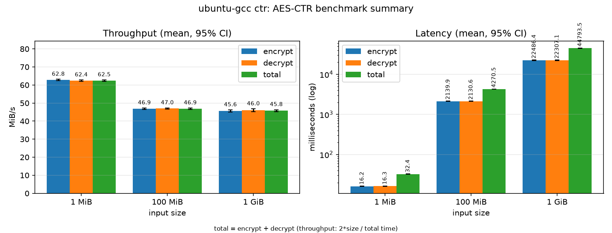
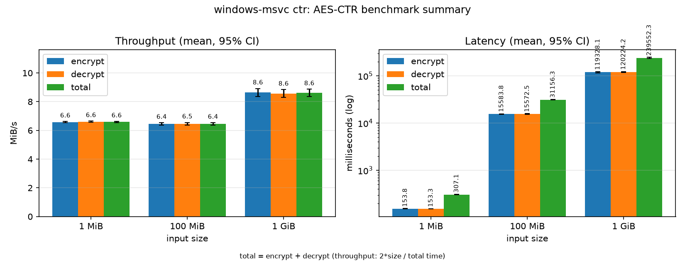
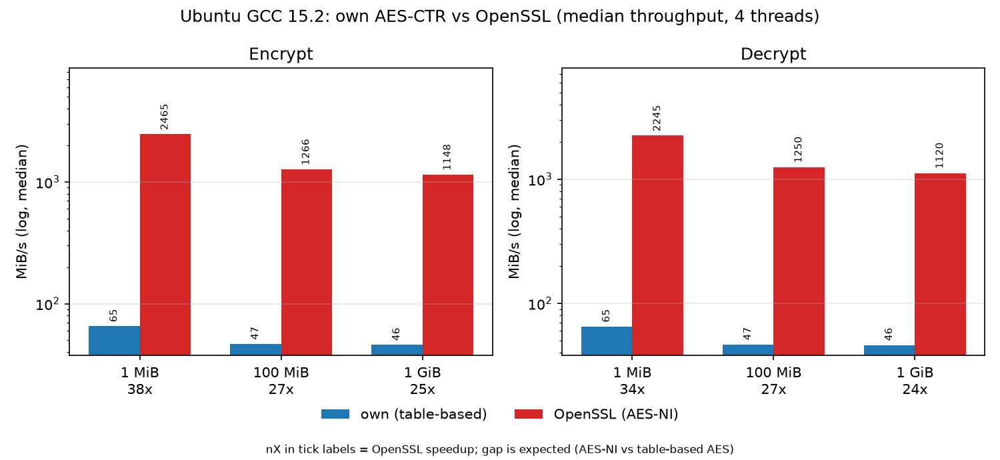
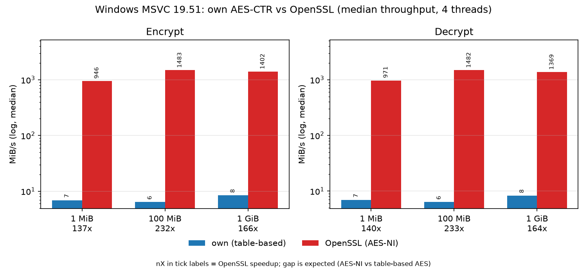
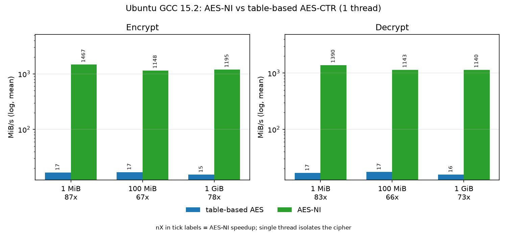

# BÁO CÁO LAB 2 — AES-128 THUẦN C++ VÀ CHẾ ĐỘ CTR

**Học phần:** NT219 — An toàn thông tin  
**Bài thực hành:** Lab 2 — Cài đặt AES-128 thuần C++ (CTR, FIPS-197)  
**Sinh viên:** Nguyễn Công Tuấn  
**MSSV:** 25522012  
**Lớp:** NT219.R11.ANTT  
**Ngày hoàn thành:** 10/11/2026  
**Ngày cập nhật:** 15/11/2026

> Báo cáo dùng số liệu Ubuntu trong `lab02/output/ubuntu/benchmarks/`, số liệu
> Windows trong `lab02/output/windows/benchmarks/`, và nhật ký kiểm thử trong
> `lab02/output/*/test_results/`. Không có số liệu hiệu năng nào được tạo thủ
> công. Nhật ký KAT/CTest Ubuntu GCC được chạy ngày 05/11/2026; CSV Ubuntu được
> đo cùng ngày với 4 thread, CPU 0-3. CSV Windows được đo ngày 10/11/2026 bằng
> MSVC 19.51. Log CTest/cross-validation Windows vẫn là log trước khi đổi oracle
> sang OpenSSL, và `environment.txt` Windows vẫn ghi Crypto++; báo cáo giữ nguyên
> khác biệt này thay vì suy diễn. Xem `output/windows/benchmarks/AUDIT.md` cho
> kiểm tra tính hợp lệ và các giới hạn của phép đo.

---

## Mục lục

1. Tóm tắt điều hành
2. Mục tiêu và phạm vi
3. Thiết kế và cài đặt
4. Kiểm chứng tính đúng đắn
5. Phương pháp đo hiệu năng
6. Kết quả và so sánh hiệu năng
7. Phân tích bảo mật
8. Đối chiếu yêu cầu, rubric và tự chấm điểm
9. Bài học rút ra và kết luận
10. Tài liệu tham khảo
11. Phụ lục

---

## 1. Tóm tắt điều hành

Lab 2 yêu cầu cài đặt AES-128 từ đầu bằng C++17 chỉ với STL, tuân theo
FIPS-197: 10 vòng, 44 word khoá, state ánh xạ theo cột. Chế độ CTR tuân theo
NIST SP 800-38A: bộ đếm 128-bit tăng big-endian, xử lý khối cuối không đầy đủ,
không padding, và dừng an toàn khi bộ đếm tràn thay vì quay vòng. Công cụ
`aestool` hỗ trợ `encrypt`, `decrypt`, `bench`, `--kat`, cùng các cờ thống nhất
như `--encode`, `--decode`, `--threads`, `--verbose` và `--nonce`.

Kết quả chính:

- **Cài đặt bắt buộc:** AES-128 và CTR đúng FIPS-197/SP 800-38A, CLI fail-closed,
  kiểm tra độ dài khoá/IV, phát hiện tràn bộ đếm, UTF-8 trên Windows.
- **Bonus A — AES-192/AES-256:** lịch khoá mở rộng đầy đủ, KAT FIPS-197
  Appendix C.2/C.3 và KAT CTR tương ứng.
- **Bonus B — AES-XTS:** hai khoá, nhân tweak trong GF(2^128), ciphertext
  stealing theo IEEE P1619, KAT IEEE P1619 và CAVP, cùng kiểm tra parity với
  OpenSSL.
- **Bonus C — AES-NI:** đã cài đặt cho AES-128 CTR, phát hiện CPU lúc chạy,
  fallback phần mềm cho CPU không hỗ trợ và cho AES-192/256; so sánh 1 thread
  cho thấy nhanh hơn 65–87 lần (§6.7).
- **Tính đúng đắn:** 9/9 KAT và `ctest` 4/4 trên Ubuntu GCC 15.2, chạy lại
  15/11/2026 với AES-NI; Windows MSVC 19.51, MinGW GCC 16.2.0 và MinGW Clang
  22.1.8 có log 9/9 KAT, 4/4 CTest ngày 02/11/2026 (trước AES-NI). Bộ unit
  test hiện có 370 assertion trong 12 test case (thêm test đối chiếu AES-NI
  với đường phần mềm); cross-validation có 22 assertion trong 3 test case.
- **Hiệu năng Ubuntu:** 62.761 / 46.852 / 45.604 MiB/s mã hoá cho
  1 MiB / 100 MiB / 1 GiB; CV 14.4% / 5.4% / 4.0%. Đây là AES bảng tra cứu
  chạy 4 thread trên CPU 0-3.
- **Hiệu năng Windows:** 6.580 / 6.444 / 8.644 MiB/s mã hoá; CV 12.0% / 6.4% /
  8.4%. Điểm 1 GiB nhanh hơn 100 MiB trong lần chạy này; báo cáo coi đó là
  hiệu ứng host/affinity, không phải tính chất của code.
- **So sánh OpenSSL:** Ubuntu OpenSSL nhanh hơn 24–39 lần; Windows nhanh hơn
  132–220 lần nhưng một số điểm Windows bị đánh dấu nhiễu, nên chỉ dùng median
  hoặc bậc độ lớn.
- **Hiệu năng AES-NI (bonus C):** 1 thread, 1 MiB/100 MiB/1 GiB đạt
  1466.6 / 1148.2 / 1195.2 MiB/s mã hoá, nhanh hơn bản bảng tra 87.4 / 67.2 /
  77.6 lần; đây là so sánh cùng máy, cùng compiler, cùng số thread.

Điểm chưa hoàn thiện: log cross-validation Windows chưa được chạy lại sau khi
đổi oracle sang OpenSSL; Windows không có run-time environment log và chưa có
số đo AES-NI trên MSVC; AES-NI chỉ phủ AES-128; CLI đọc toàn bộ tệp vào bộ
nhớ; chưa có PDF/archive nộp bài. Báo cáo ghi rõ các điểm này thay vì suy diễn
số liệu.

---

## 2. Mục tiêu và phạm vi

### 2.1 Mục tiêu của Lab 2

Theo đề bài và mục tiêu học phần, Lab 2 hướng tới các năng lực sau:

1. Cài đặt AES-128 theo FIPS-197: `AddRoundKey`, `SubBytes`, `ShiftRows`,
   `MixColumns`, `KeyExpansion`; 10 vòng; state 4×4 theo cột.
2. Cài đặt CTR theo NIST SP 800-38A: IV 128-bit, bộ đếm big-endian, dữ liệu
   dài tùy ý, khối cuối không đầy đủ, không padding, phát hiện tràn bộ đếm.
3. Kiểm chứng bằng vector chính thức và đối chiếu byte-for-byte với OpenSSL.
4. Đo hiệu năng ở 1 MiB, 100 MiB và 1 GiB; thảo luận cache, bộ nhớ và
   branch prediction.
5. Phân tích các rủi ro: tái sử dụng nonce, tính dễ uốn (malleability),
   thiếu xác thực, cache-timing của S-box, và giới hạn của mã không hằng số
   thời gian.
6. Thể hiện được vì sao CTR không phải AEAD và vì sao cần MAC/AEAD khi cần
   toàn vẹn.

### 2.2 Yêu cầu kỹ thuật và cách đáp ứng

| Yêu cầu từ đề bài | Cài đặt trong bài | Bằng chứng | Trạng thái |
|---|---|---|---|
| Không dùng thư viện mật mã cho primitive | `aes_core` và `aestool` chỉ dùng STL; OpenSSL chỉ link vào `test_crossval`/`bench_openssl` | `src/AES.*`, `src/modes.*`, `CMakeLists.txt` | Đạt |
| AES-128 đúng FIPS-197 | 10 vòng, state cột, `SubBytes`/`ShiftRows`/`MixColumns`/`AddRoundKey`, key expansion 44 word | `src/AES.cpp`, `tests/test_aes.cpp` | Đạt |
| CTR đúng SP 800-38A | Bộ đếm 128-bit big-endian; `S_i = AES(K, counter)`; XOR; tăng sau mỗi khối | `src/modes.cpp::ctr_crypt` | Đạt |
| IV 128-bit và xử lý tràn | IV đúng 16 byte; tràn `FF..FF → 00..00` ném lỗi thay vì tái sử dụng keystream | `ctr_crypt`, `tests/test_ctr.cpp` | Đạt |
| Dữ liệu dài tùy ý, khối cuối lẻ | Chỉ XOR `size % 16` byte ở khối cuối; không padding | `ctr_crypt`, KAT 20 byte | Đạt |
| CLI mã hoá/giải mã | `aestool encrypt`, `aestool decrypt`; raw mặc định khi có `--out` | `src/main.cpp` | Đạt |
| Hex/base64 để debug | `--encode`, `--decode`, `--out-hex`; raw mặc định cho tệp | `src/main.cpp`, `tests/cli_test.*` | Đạt |
| Kiểm tra khoá/IV sai độ dài | Từ chối khoá khác 16/24/32 byte và IV khác 16 byte | `AES::validate_key`, `parse` | Đạt |
| Fail-closed khi I/O lỗi | Không tạo output khi đầu vào không đọc được; lỗi CLI trả mã khác 0 | `main.cpp`, CLI tests | Đạt |
| KAT FIPS-197 và SP 800-38A | 9 vector: CTR-128/192/256, CTR cắt 20 byte, ECB C.1/C.2/C.3, XTS | `kat/vectors.json`, `kat_gcc.txt` | Đạt |
| Cross-validation | So sánh byte-for-byte với OpenSSL cho CTR-128/192/256 và XTS | `tests/test_crossval.cpp` | Đạt trên Ubuntu; Windows cần chạy lại |
| Kiểm thử âm | Sai khoá/IV, sửa ciphertext, tràn bộ đếm, đầu vào sai định dạng | `tests/test_ctr.cpp`, `tests/cli_test.*` | Đạt |
| Benchmark 1 MiB/100 MiB/1 GiB | 1000/100/30 lần; CSV, summary, biểu đồ | `output/*/benchmarks/` | Đạt |
| Phân tích bảng S-box, bộ nhớ, cache, branch | §7.1 và §7.2 | Báo cáo này | Đạt |
| So sánh với Crypto++/OpenSSL | OpenSSL là oracle và benchmark test-only | `test_crossval`, `bench_openssl`, §6.5–6.6 | Đạt |
| Bonus AES-192/256 | Key schedule đầy đủ, KAT C.2/C.3, cross-validation | `AES.cpp`, KAT, crossval | Đạt |
| Bonus XTS | Hai khoá, GF(2^128), CTS, KAT IEEE/CAVP | `modes.cpp`, KAT, crossval | Đạt |
| Bonus AES-NI | `src/aesni.cpp`: CPUID/`__builtin_cpu_supports`, 4 block song song, fallback cho 192/256 và non-x86 | `aesni.*`, `Modes::ctr_crypt`, `tests/test_ctr.cpp`, §6.7 | Đạt (AES-128) |
| CMake và tài liệu | CMake C++17, build ngoài source, README, BENCHMARKS | `CMakeLists.txt`, `README.md` | Đạt |

### 2.3 Phạm vi và giới hạn của báo cáo

- Bắt buộc: AES-128 + CTR.
- Bonus A: AES-192/AES-256.
- Bonus B: XTS-AES.
- Bonus C: AES-NI cho AES-128 CTR; bitslicing không làm, AES-192/256 vẫn dùng
  đường bảng tra.
- Không dùng thư viện mật mã nào trong `aes_core` hoặc `aestool`. OpenSSL chỉ
  xuất hiện trong các target kiểm thử `test_crossval` và `bench_openssl`.
- Báo cáo không tuyên bố toàn bộ code là constant-time: đường bảng tra vẫn
  rò rỉ cache (§7.2); đường AES-NI không tra bảng nhưng chưa được kiểm chứng
  hình thức (§7.7).
- Số liệu Windows và Ubuntu không phải thí nghiệm có kiểm soát: khác compiler,
  OS, power plan và mức độ đầy đủ của log. Các so sánh chỉ có giá trị trong
  phạm vi môi trường đã đo.

---

## 3. Thiết kế và cài đặt

### 3.1 Cấu trúc mã nguồn

```
lab02/
├── CMakeLists.txt          CMake C++17, static CRT cho MSVC khi cần
├── README.md               hướng dẫn build/test/CLI
├── BENCHMARKS.md           ma trận đo, giao thức, CSV, giới hạn
├── REPORT.md               báo cáo này
├── src/
│   ├── AES.hpp/.cpp        AES core: 128/192/256, encrypt/decrypt, key schedule
│   ├── modes.hpp/.cpp      CTR bắt buộc; XTS bonus
│   ├── minijson.hpp        JSON parser tối giản, không phụ thuộc
│   └── main.cpp            CLI: encrypt, decrypt, bench, --kat
├── tests/
│   ├── catch.hpp           Catch2 2.13.10 vendored
│   ├── test_aes.cpp        FIPS-197, S-box, key validation
│   ├── test_ctr.cpp        SP 800-38A, partial block, overflow, XTS
│   ├── test_crossval.cpp   Parity với OpenSSL (CTR-128/192/256 + XTS)
│   ├── bench_openssl.cpp   Throughput OpenSSL (test-only)
│   ├── cli_test.sh         CLI Linux
│   └── cli_test.cmake      CLI Windows
├── kat/vectors.json        9 vector KAT chính thức/derived
├── scripts/                build, benchmark, summarize, plot
└── output/                 log, CSV, summary, biểu đồ, audit
```

Kích thước phần code do sinh viên viết (không tính `catch.hpp`): khoảng 1.500
dòng C++ cho `src/` và khoảng 750 dòng cho test/script. Toàn bộ primitive nằm
trong `AES.cpp` và `modes.cpp`; `main.cpp` chỉ lo CLI, KAT runner và benchmark.

### 3.2 AES core

- State là `std::array<std::array<uint8_t,4>,4>` với quy ước
  `state[col][row] = block[col * 4 + row]`, đúng FIPS-197.
- Key expansion sinh `4 * (Nr + 1)` word: 44 word cho AES-128, 52 cho
  AES-192, 60 cho AES-256. `RotWord`, `SubWord` và `Rcon` được cài đặt thủ công.
- `SubBytes` dùng bảng S-box 256 byte. Hàm `AES::sbox_computed()` cài đặt
  S-box từ phép nghịch đảo GF(2^8) và biến đổi affine; unit test xác nhận
  cả 256 giá trị khớp bảng. Hàm này chỉ dùng để kiểm chứng/phân tích, không
  nằm trên đường mã hoá chính.
- `MixColumns` dùng phép nhân GF(2^8) với đa thức rút gọn
  `x^8 + x^4 + x^3 + x + 1` (`0x11B`).
- Giải mã dùng `InvSubBytes`, `InvShiftRows`, `InvMixColumns` và thứ tự
  round key ngược.
- Khoá gốc `key_` được ghi đè và giải phóng ngay sau khi mở rộng khoá; huỷ
  `AES` ghi đè toàn bộ `round_keys_` bằng `volatile` write để giảm khả năng
  khoá còn trong bộ nhớ sau khi đối tượng chết.
- Việc validate khoá nằm ở constructor: sai độ dài bị từ chối trước khi mở
  rộng khoá, nên không có trạng thái nửa hợp lệ.

### 3.3 CTR mode

- Bộ đếm là 128-bit, tăng từ byte cuối (big-endian). Đây là quy ước của
  SP 800-38A và được ghi rõ trong README/REPORT.
- Mỗi khối: `keystream = AES_encrypt(counter)`, XOR với dữ liệu, rồi tăng.
- Khối cuối chỉ XOR `data.size() % 16` byte, không padding.
- Nếu bộ đếm tràn từ `FF..FF` về `00..00` mà vẫn còn dữ liệu, hàm ném
  `std::runtime_error("CTR counter overflow: refusing keystream reuse")` thay
  vì tái sử dụng keystream.
- Encrypt và decrypt dùng cùng một hàm `ctr_crypt`; đây là tính chất của
  stream cipher.
- Đường benchmark chia buffer thành các đoạn cho `--threads`, nhưng mỗi đoạn
  nhận counter đã được dịch đúng theo offset, nên kết quả không phụ thuộc số
  thread. Với dữ liệu nhỏ hơn 64 KiB, benchmark chạy đơn luồng để tránh chi phí
  tạo thread.

### 3.4 AES-NI (bonus C)

- `src/aesni.cpp` cài AES-128 CTR bằng intrinsics `wmmintrin.h`; mỗi hàm được
  đánh dấu `target("aes,sse2")` (GCC/Clang) nên phần còn lại của thư viện vẫn
  build cho x86 baseline và non-x86 (stub trả `false`, không lỗi link).
- `aesni::available()` kiểm tra lúc chạy: `__builtin_cpu_supports("aes")` với
  GCC/Clang, CPUID leaf 1 ECX bit 25 với MSVC.
- `Modes::ctr_crypt` chỉ chọn AES-NI khi khoá 128-bit, CPU hỗ trợ và bộ đếm
  không tràn trước khối cuối; mọi trường hợp khác đi đường bảng tra. Nhánh
  tràn vẫn nằm ở phần mềm để giữ nguyên hành vi fail-closed.
- Đường nhanh dùng lại 176 byte lịch khoá của `AES` qua
  `AES::round_key_data()`, không mở rộng khoá lần hai và không giữ raw key.
- Mỗi vòng lặp mã hoá 4 block counter độc lập để lấp pipeline; bộ đếm vẫn
  tăng big-endian từng block; phần dư xử lý từng block.
- `bench --impl auto|soft|ni` cho phép so sánh; `soft` tái lập baseline bảng
  tra, `ni` báo lỗi nếu CPU/khoá không phù hợp. AES-192/256 không đi đường
  AES-NI.
- Về constant-time: `aesenc` không tra bảng và độ trễ không phụ thuộc dữ liệu;
  phép tăng bộ đếm và XOR cũng độc lập dữ liệu. Tuy vậy đây là lập luận theo
  thiết kế, chưa có đo timing hay chứng minh hình thức.

### 3.5 XTS (bonus B)

- Khoá XTS là `K1 || K2`; mỗi nửa là một AES key (16/24/32 byte).
- Tweak ban đầu là `AES_K2(data_unit)`, nhân với alpha trong GF(2^128)
  theo đa thức `x^128 + x^7 + x^2 + x + 1`.
- Với dữ liệu không chia hết 16 byte, dùng ciphertext stealing theo
  IEEE P1619.
- XTS không xác thực; nó chỉ bảo vệ tính bí mật và tính duy nhất của sector.
  Vì vậy XTS phù hợp cho mã hoá đĩa, không thay thế AEAD cho giao thức mạng.

### 3.6 CLI và fail-closed

Các cờ chính:

| Cờ | Ý nghĩa |
|---|---|
| `--mode ctr\|xts` | Chế độ mã hoá |
| `--key FILE` / `--key-hex HEX` | Khoá nhị phân hoặc hex |
| `--iv FILE` / `--iv-hex HEX` / `--nonce ...` | Bộ đếm / data unit 16 byte |
| `--in FILE` / `--text STRING` | Đầu vào |
| `--out FILE` / `--out-hex` | Đầu ra |
| `--encode hex\|base64\|raw` | Mã hoá đầu ra |
| `--decode hex\|base64\|raw` | Giải mã đầu vào trước khi decrypt |
| `--threads N` | Chỉ dùng cho `bench` |
| `--impl auto\|soft\|ni` | Chọn đường AES cho `bench`; mặc định `auto` |
| `--warmup SECONDS` | Warm-up theo thời gian cho `bench` |
| `--verbose` | In metadata, tiến độ và ETA của `bench` ra stderr |
| `--kat FILE` | Chạy Known Answer Tests |

Các kiểm tra fail-closed:

- Khoá sai độ dài bị từ chối.
- IV khác 16 byte bị từ chối.
- `--key` đồng thời với `--key-hex` bị từ chối.
- `--iv`, `--iv-hex`, `--nonce`, `--nonce-hex` chỉ được dùng một nguồn.
- `--threads` ngoài `bench` bị từ chối.
- `bench` từ chối option lạ thay vì bỏ qua im lặng.
- KAT gặp mode không hỗ trợ sẽ đếm `skipped` và trả mã lỗi; không còn
  trường hợp "0 failed" nhưng thực ra đã bỏ qua vector.
- Khi `--out`, dữ liệu được ghi sau khi mã hoá/giải mã thành công; lỗi đọc
  input hoặc lỗi tham số không tạo tệp rỗng.

### 3.7 UTF-8 trên Windows

`main()` trên Windows dùng `GetCommandLineW()` + `CommandLineToArgvW()`,
chuyển từng đối số sang UTF-8 bằng `WideCharToMultiByte(CP_UTF8, ...)`. Mọi
đường dẫn tệp đi qua `std::filesystem::u8path()`. Vì vậy đường dẫn có tiếng
Việt và `--text` tiếng Việt không bị mã hoá lại theo ANSI code page.
`cli_test.cmake` kiểm tra cả thư mục `thư mục` và chuỗi tiếng Việt.

### 3.8 Những quyết định thiết kế đáng chú ý

1. **OpenSSL chỉ là oracle test-only.** `test_crossval` và `bench_openssl`
   link OpenSSL; `aes_core`/`aestool` không link. Khi `ENABLE_CROSSVAL=ON` mà
   CMake không tìm thấy OpenSSL, cấu hình thất bại. Muốn bỏ oracle phải chỉ
   định rõ `-DENABLE_CROSSVAL=OFF`; khi đó yêu cầu cross-validation chưa đạt.
2. **KAT không im lặng bỏ qua.** Mode không hỗ trợ làm command trả mã lỗi, vì
   "0 failed" trên tập vector rỗng là bằng chứng giả.
3. **Warm-up theo thời gian.** Warm-up cố định 5 vòng quá ngắn ở 1 MiB và quá
   tốn ở 1 GiB; bản hiện tại dùng 1 giây trên prefix tối đa 1 MiB.
4. **Không tự sinh IV trong CLI.** Người dùng phải cung cấp IV; CLI không có
   registry trạng thái nên không thể bảo đảm duy nhất. Hợp đồng được ghi ở §7.4.
5. **Không thêm abstraction.** Core giữ `std::vector<uint8_t>` và
   `std::array`; không có class wrapper hay dependency mới.

---

## 4. Kiểm chứng tính đúng đắn

### 4.1 Known Answer Tests

`kat/vectors.json` có 9 vector:

| # | Nguồn | Nội dung | Loại |
|---:|---|---|---|
| 1 | NIST SP 800-38A | AES-128 CTR, 4 khối | Bắt buộc |
| 2 | NIST SP 800-38A | AES-192 CTR, 4 khối | Bonus A |
| 3 | NIST SP 800-38A | AES-256 CTR, 4 khối | Bonus A |
| 4 | NIST SP 800-38A | AES-128 CTR cắt còn 20 byte (khối cuối không đầy đủ) | Bắt buộc |
| 5 | FIPS-197 C.1 | AES-128 ECB một khối | Bắt buộc |
| 6 | FIPS-197 C.2 | AES-192 ECB một khối | Bonus A |
| 7 | FIPS-197 C.3 | AES-256 ECB một khối | Bonus A |
| 8 | IEEE P1619/D16 | XTS-AES-128 vector 1, 2 khối | Bonus B |
| 9 | NIST CAVP XTSGenAES128 | COUNT 1, 1 khối | Bonus B |

Lệnh:

```bash
./build/ubuntu-gcc/aestool --kat kat/vectors.json
```

Kết quả đã lưu:

| Nền tảng / toolchain | Tệp log | Kết quả |
|---|---|---|
| Ubuntu GCC 15.2 (05/11/2026) | `output/ubuntu/test_results/kat_gcc.txt` | 9 passed, 0 failed |
| Windows MSVC 19.51 (02/11/2026) | `output/windows/test_results/kat_msvc.txt` | 9 passed, 0 failed |
| Windows MinGW GCC 16.2.0 | `output/windows/test_results/kat_mingw_gcc.txt` | 9 passed, 0 failed |
| Windows MinGW Clang 22.1.8 | `output/windows/test_results/kat_mingw_clang.txt` | 9 passed, 0 failed |

KAT là bằng chứng độc lập với oracle: vector lấy từ FIPS-197, SP 800-38A,
IEEE P1619 và CAVP, không sinh từ code của bài. Vì vậy log KAT Windows vẫn có
giá trị dù oracle cross-validation đã đổi.

### 4.2 Kiểm thử đơn vị

`test_core` (Catch2) kiểm tra:

- FIPS-197 AES-128/192/256: encrypt và decrypt round-trip, vector C.1/C.2/C.3.
- S-box tính toán khớp bảng 256/256.
- Key schedule và key validation: từ chối 15/17 byte; chấp nhận 16/24/32.
- CTR vector SP 800-38A cho AES-128/192/256.
- Khối cuối không đầy đủ: dữ liệu 20 byte, 1 byte và 15 byte.
- Tràn bộ đếm: một khối `FF..FF` hợp lệ; hai khối phải ném lỗi.
- XTS full block và ciphertext stealing round-trip.
- AES-NI so với đường phần mềm cho các kích thước 1/15/16/17/63/64/65/1000/
  65537 byte, cộng trường hợp bộ đếm tràn phải ném lỗi.
- Các trường hợp lỗi đầu vào: IV sai độ dài, key sai độ dài.

Kết quả:

| Nền tảng | Kết quả | Tệp |
|---|---|---|
| Ubuntu GCC 15.2 (15/11/2026) | All tests passed (370 assertions in 12 test cases) | `output/ubuntu/test_results/unit_gcc_2026-11-15.txt` |
| Windows MSVC (02/11/2026) | All tests passed (351 assertions in 11 test cases) | `output/windows/test_results/unit_msvc.txt` |
| Windows MinGW GCC (02/11/2026) | All tests passed (351 assertions in 11 test cases) | `output/windows/test_results/unit_mingw_gcc.txt` |
| Windows MinGW Clang (02/11/2026) | All tests passed (351 assertions in 11 test cases) | `output/windows/test_results/unit_mingw_clang.txt` |

Ba log Windows có ít hơn một test case vì được tạo trước khi thêm test AES-NI;
chúng vẫn hợp lệ cho phần AES/CTR/XTS nhưng không chứng minh đường AES-NI trên
MSVC. Trên Ubuntu, test AES-NI tự bỏ qua (`SUCCEED`) nếu CPU không có cờ `aes`,
nên số assertion có thể thấp hơn trên máy khác.

### 4.3 Cross-validation với OpenSSL

`test_crossval` chỉ link OpenSSL trong target kiểm thử, không link vào
`aestool`. Nó so sánh:

- AES-128-CTR với OpenSSL trên chuỗi 86 byte (có khối cuối lẻ).
- AES-192-CTR và AES-256-CTR trên dữ liệu 257 byte (có khối cuối lẻ).
- XTS-AES-128 trên các kích thước 32, 37, 64, 65 và 509 byte; các kích thước
  37/65/509 byte đi qua ciphertext stealing.

Kết quả Ubuntu: `All tests passed (22 assertions in 3 test cases)`, log tại
`output/ubuntu/test_results/crossval_gcc.txt`; môi trường dùng OpenSSL 3.5.5.

**Cảnh báo bằng chứng Windows:** `test_crossval.cpp` hiện dùng OpenSSL EVP
(`EVP_aes_128_ctr`, `EVP_aes_192_ctr`, `EVP_aes_256_ctr`, `EVP_aes_128_xts`),
nhưng log `crossval_msvc.txt`/`ctest_msvc.txt` và `environment.txt` Windows
được tạo ngày 02/11/2026, trước khi đổi oracle, và vẫn ghi “Crypto++”. Vì vậy
không dùng các log đó để tuyên bố parity OpenSSL trên Windows. Cần chạy lại
`ctest` trên Windows sau khi đổi oracle; việc này nằm trong §9.2.

Nếu `ENABLE_CROSSVAL=ON` mà CMake không tìm thấy OpenSSL, cấu hình **thất
bại**. Muốn bỏ oracle phải chỉ định rõ `-DENABLE_CROSSVAL=OFF`; khi đó
README/report phải ghi rằng yêu cầu cross-validation chưa đạt.

### 4.4 Kiểm thử âm và CLI

`cli_test.sh` / `cli_test.cmake` kiểm tra:

- Round-trip CTR với `--text` và với tệp nhị phân.
- Đường dẫn và văn bản tiếng Việt (Windows).
- Khoá 15 byte và IV 8 byte bị từ chối.
- XTS round-trip có ciphertext stealing.
- `--nonce` / `--nonce-hex` hoạt động như alias của IV.
- Base64 encode/decode round-trip.
- Xung đột `--key` + `--key-hex`.
- `--threads` bị từ chối ngoài `bench`.
- `bench` từ chối option lạ.
- `bench --verbose` in tiến độ/ETA ra stderr và vẫn ghi CSV đúng.
- CSV benchmark có header + đúng số dòng.
- KAT 9/9 và KAT mode không hỗ trợ phải trả mã lỗi.

Các kiểm thử âm ở mức thư viện nằm trong `test_ctr.cpp`/`test_aes.cpp`:
sửa ciphertext làm plaintext sai nhưng **không** ném lỗi — đây là hành vi đúng
của CTR và được giải thích ở §7.3; tràn bộ đếm và IV sai độ dài thì phải ném
lỗi. Báo cáo không đánh đồng hai loại: CTR không phát hiện sửa đổi, còn lỗi
cấu trúc phải fail-closed.

### 4.5 Kết quả Ubuntu và lệnh tái lập

Đã chạy lại ngày 15/11/2026 trên Ubuntu 26.04.1 LTS với GCC 15.2.0, OpenSSL
3.5.5, CMake 4.2.3: KAT 9/9, `ctest` 4/4, unit 370 assertion/12 test,
cross-validation 22 assertion/3 test. Nhật ký mới nằm trong
`output/ubuntu/test_results/*_2026-11-15.txt`. Lệnh tái lập:

```bash
cd lab02
scripts/build_linux.sh gcc
./build/ubuntu-gcc/aestool --kat kat/vectors.json \
  | tee output/ubuntu/test_results/kat_gcc.txt
(cd build/ubuntu-gcc && ctest --output-on-failure) \
  | tee output/ubuntu/test_results/ctest_gcc.txt
```

Các CSVs Ubuntu bên dưới đã được đo lại ngày 05/11/2026 với giao thức hiện
tại (4 thread, CPU 0-3, warm-up theo thời gian).

### 4.6 Đối chiếu yêu cầu kiểm thử của học phần

| Yêu cầu | Cách đáp ứng | Trạng thái |
|---|---|---|
| KAT FIPS-197 | ECB C.1/C.2/C.3 | Đạt |
| KAT NIST SP 800-38A CTR | CTR-128/192/256 + partial block | Đạt |
| Cross-validation Crypto++ hoặc OpenSSL | OpenSSL EVP parity cho CTR và XTS | Đạt trên Ubuntu; Windows cần chạy lại |
| Wrong key → incorrect plaintext | Test round-trip với khoá khác; CLI trả plaintext sai, không giả vờ thành công | Đạt |
| Wrong IV → incorrect plaintext | Test/CLI với IV khác | Đạt |
| Tampered ciphertext → corrupted plaintext | Test sửa byte ciphertext, xác nhận plaintext đổi và không có lỗi giả | Đạt |
| Giải thích vì sao CTR không phát hiện sửa đổi | §7.3 | Đạt |
| Automated tests/Catch2/CTest | 4/4 CTest, 370 assertion (Ubuntu 15/11/2026) | Đạt |
| Fail-closed | Kiểm tra khoá/IV/tràn/CLL option | Đạt |

### 4.7 Hạn chế của phần kiểm chứng

- Chưa có log cross-validation Windows với OpenSSL; log cũ dùng oracle khác.
- KAT chỉ có 9 vector; không phủ toàn bộ không gian đầu vào. Đây là mẫu đại
  diện theo chuẩn, không phải chứng minh hình thức.
- Chưa có fuzz test tự động cho parser CLI; các ca âm là hữu hạn và được viết
  tay.
- Chưa có kiểm thử đa nền tảng cho XTS ciphertext stealing ngoài các vector đã
  nêu; XTS là bonus, không nằm trong rubric bắt buộc.
- Không có kiểm thử timing để chứng minh constant-time; §7.1 chỉ phân tích
  nguồn rò rỉ, không đo.

---

## 5. Phương pháp đo hiệu năng

### 5.1 Mô hình đo

Mỗi lần chạy `bench`:

1. Cấp phát `payload` kích thước `sizeBytes` một lần, chứa toàn bộ dữ liệu
   `0x5A`. Việc cấp phát này nằm ngoài vùng thời gian của từng phép đo.
2. Warm-up theo thời gian trên prefix tối đa 1 MiB. Với 1 GiB, warm-up không
   chạy toàn bộ payload để tránh biến 1 giây thành một phút.
3. Với mỗi run `r`, đặt counter về 0 rồi ghi `r` vào hai byte cuối. Nhờ vậy
   mỗi run dùng keystream khác nhau, tránh đo lặp lại đúng một keystream.
4. Đo `encrypt_us`: từ trước `ctrCryptThreaded(payload)` đến sau khi trả về.
   Đo `decrypt_us`: tương tự với `ct` vừa tạo.
5. Ghi CSV: `run,mode,size_bytes,encrypt_us,decrypt_us,throughput_encrypt_MBps,throughput_decrypt_MBps`.

Điểm cần nói rõ: vùng thời gian có bao gồm việc cấp phát `std::vector` kết quả
`ct`/`pt` trong `ctrCryptThreaded`. Vì vậy số đo là **end-to-end trong bộ nhớ**
của một lần gọi hàm, không chỉ vòng lặp AES. Đây là lựa chọn có chủ ý: nó phản
ánh chi phí thực của CLI hiện tại, nhưng không tách được chi phí cấp phát khỏi
chi phí AES. Báo cáo không tuyên bố số đo là “AES core thuần”.

`--threads N` chia buffer thành các đoạn; mỗi đoạn dùng counter dịch theo offset
nên ciphertext ghép lại giống bản đơn luồng. Với dữ liệu < 64 KiB, hàm chạy
đơn luồng. Các script benchmark mặc định `THREADS=4`; CLI mặc định 1 nếu người
dùng không truyền.

### 5.2 Công thức thống kê

Với `n` mẫu thời gian `t_i`:

```text
mean   = (1/n) * sum(t_i)
median = giá trị giữa sau khi sắp xếp
sd     = sqrt( sum((t_i - mean)^2) / (n - 1) )     # độ lệch chuẩn mẫu
ci95   = 1.96 * sd / sqrt(n)                       # xấp xỉ chuẩn
cv     = sd / mean
```

Throughput của từng run:

```text
MiB/s = (size_bytes / 1024^2) / (time_us / 1e6)
```

`summary.csv` dùng mean và các thống kê trên. `summary_robust.csv` bổ sung:

- trimmed mean 5% mỗi đuôi;
- outlier = thời gian > 2 × median;
- `stability = ok` nếu CV ≤ 0.25 và outlier ≤ 5%.

Cột CSV tên `throughput_*_MBps` nhưng mẫu số là `1024 * 1024`, tức đơn vị
thật là **MiB/s**. Báo cáo giữ nhãn MiB/s để tránh nhầm với MB/s thập phân.

### 5.3 Ma trận đo

| Nền tảng | 1 MiB | 100 MiB | 1 GiB | Ghi chú |
|---|---:|---:|---:|---|
| Ubuntu GCC 15.2 (05/11/2026) | 1000 | 100 | 30 | 4 thread, CPU 0-3, `performance` |
| Windows MSVC 19.51 (10/11/2026) | 1000 | 100 | 30 | Script 4 thread; thiếu run-time log |
| Blueprint nominal | 1000 | 500 | 50 | Không phải ma trận đã chốt |

Bài này chốt dùng 1000/100/30: 100 MiB và 1 GiB vẫn có N ≥ 30 và CV thấp, đủ
để phân tích thống kê. Blueprint ghi nominal 1000/500/50; có thể đặt lại bằng
`RUNS_100MB=500 RUNS_1GB=50` nếu cần đúng nominal, nhưng không cần cho kết luận
hiện tại.

### 5.4 Môi trường đo

**Ubuntu (05/11/2026):**

| Thành phần | Giá trị |
|---|---|
| Host | `han-sui-Vostro-3500` |
| OS | Ubuntu 26.04.1 LTS, kernel `7.0.0-38-generic x86_64` |
| CPU | 11th Gen Intel Core i5-1135G7 @ 2.40 GHz, 8 logical CPU |
| RAM | 23,796,968 KiB (~22.7 GiB) |
| Swap | 8,388,604 KiB |
| Compiler | GCC 15.2.0 (`g++ (Ubuntu 15.2.0-16ubuntu1) 15.2.0`) |
| OpenSSL (oracle) | 3.5.5 (`libcrypto`) |
| CMake | 4.2.3 |
| Governor lúc đo | `performance` (script tự đặt/khôi phục) |
| CPU pinning | CPU 0-3 |
| Threads | 4 |
| Binary | `build/ubuntu-gcc/aestool` |

**Windows (benchmark mới, 10/11/2026):**

| Thành phần | Giá trị |
|---|---|
| Host | Dell Vostro 3500 |
| OS | Windows 11 Home 10.0.26300, x64 |
| CPU | 11th Gen Intel Core i5-1135G7 @ 2.40 GHz, 4 cores / 8 logical |
| Compiler | MSVC 19.51 (Visual Studio 18 2026) |
| Binary | `build/windows-msvc/Release/aestool.exe` |
| Power plan hiện tại | High performance (kiểm tra sau khi chạy, không phải run-time capture) |
| Threads | Script mặc định 4; CSV không có cột thread nên không chứng minh được từ file |
| Run-time log | **Không có**; script chỉ in ra console, không tee ra file |

Các bảng trên là môi trường quan sát được, không phải môi trường lý tưởng cho
kết luận nhân quả. Thiếu run-time log Windows là một hạn chế của bằng chứng,
không phải lý do để suy diễn governor/affinity/priority.

### 5.5 Các yếu tố gây nhiễu

1. **Payload nhỏ:** 1 MiB có thời gian mỗi run rất ngắn; timer, scheduling và
   việc cấp phát vector chiếm tỷ lệ lớn. CV 14.4% phản ánh điều này, không phải
   code không ổn định.
2. **Cache:** 1 MiB nằm trong cache; 100 MiB và 1 GiB vượt L3. Sự giảm từ
   62.8 xuống 46.9 MiB/s là hiệu ứng cache dự kiến.
3. **Affinity và power plan:** Ubuntu có pinning + governor; Windows chỉ có
   script mặc định và không có log. Không thể quy chênh lệch Windows/Ubuntu
   cho OS/compiler.
4. **Thermal và các tiến trình khác:** cả hai lần đo là single-host, không có
   kiểm soát nhiệt độ hay tiến trình nền.
5. **Thứ tự đo:** mỗi run đo encrypt rồi decrypt trên cùng dữ liệu; decrypt
   đọc ciphertext vừa tạo nên cache state khác encrypt.
6. **OpenSSL memory-bound:** ở 100 MiB/1 GiB, OpenSSL bị giới hạn bộ nhớ nên
   tăng thread không tăng throughput; so sánh tỷ lệ phải hiểu là bậc độ lớn.
7. **Điểm 1 GiB nhanh hơn 100 MiB trên Windows:** đây là hiệu ứng host/affinity
   trong một lần chạy, không phải bằng chứng code nhanh hơn ở payload lớn.

### 5.6 Cách tái lập

Ubuntu, giao thức chốt (1000/100/30, 4 thread, có pin CPU):

```bash
cd lab02
scripts/build_linux.sh gcc
THREADS=4 PIN_CPU=0-3 scripts/run_benchmarks.sh gcc
python3 scripts/summarize_bench.py --dir output/ubuntu/benchmarks
python3 scripts/plot_bench.py output/ubuntu/benchmarks/bench_ubuntu_gcc_ctr_*.csv \
  --out-dir output/ubuntu/benchmarks/graphs --platform ubuntu-gcc
```

Nếu chỉ muốn nominal 500/50 của blueprint, thêm
`RUNS_100MB=500 RUNS_1GB=50`; không cần thiết cho bài này.

Windows — đã chạy ngày 10/11/2026; dữ liệu và audit ở
`output/windows/benchmarks/`:

```bat
cd lab02
scripts\build_windows.bat msvc
scripts\run_benchmarks.bat msvc
python scripts\summarize_bench.py --dir output\windows\benchmarks
```

So sánh throughput với OpenSSL trên Ubuntu (4 thread, cùng 1000/100/30):

```bash
mkdir -p output/ubuntu/benchmarks/openssl
for pair in "1048576 1000" "104857600 100" "1073741824 30"; do
  set -- $pair
  ./build/ubuntu-gcc/bench_openssl --size "$1" --runs "$2" --threads 4 \
    --out "output/ubuntu/benchmarks/openssl/bench_openssl_gcc_ctr_$1.csv"
done
python3 scripts/summarize_bench.py --dir output/ubuntu/benchmarks/openssl
```

Bonus C — so sánh AES-NI với bảng tra, 1 thread (cùng binary, cùng máy):

```bash
THREADS=1 PIN_CPU=2 RUNS_1MB=1000 RUNS_100MB=20 RUNS_1GB=3 IMPL=soft \
  OUT_DIR=output/ubuntu/benchmarks/aesni/1t/soft scripts/run_benchmarks.sh gcc
THREADS=1 PIN_CPU=2 RUNS_1MB=1000 RUNS_100MB=20 RUNS_1GB=3 IMPL=ni \
  OUT_DIR=output/ubuntu/benchmarks/aesni/1t/ni scripts/run_benchmarks.sh gcc
python3 scripts/plot_aesni.py
```

`run_benchmarks.sh` mặc định `IMPL=soft` để tái lập baseline của báo cáo; đặt
`IMPL=ni` cho đường AES-NI.

Windows (sau khi build):

```bat
cd lab02
scripts\build_windows.bat msvc
mkdir output\windows\benchmarks\openssl 2>nul
build\windows-msvc\Release\bench_openssl.exe --size 1048576 --runs 1000 --threads 4 --out output\windows\benchmarks\openssl\bench_openssl_msvc_ctr_1048576.csv
build\windows-msvc\Release\bench_openssl.exe --size 104857600 --runs 100 --threads 4 --out output\windows\benchmarks\openssl\bench_openssl_msvc_ctr_104857600.csv
build\windows-msvc\Release\bench_openssl.exe --size 1073741824 --runs 30 --threads 4 --out output\windows\benchmarks\openssl\bench_openssl_msvc_ctr_1073741824.csv
python scripts\summarize_bench.py --dir output\windows\benchmarks\openssl
```

`bench_openssl` chỉ là oracle test-only; nó không được link vào `aestool`.

---

## 6. Kết quả và so sánh hiệu năng

### 6.1 Ubuntu GCC 15.2 (05/11/2026)

Nguồn: `output/ubuntu/benchmarks/summary.csv`; 4 thread, CPU 0-3.

| Kích thước | Runs | Enc mean (µs) | Enc median (µs) | Enc SD (µs) | Enc 95% CI (µs) | Enc MiB/s | Dec mean (µs) | Dec median (µs) | Dec SD (µs) | Dec 95% CI (µs) | Dec MiB/s | CV enc/dec |
|---|---:|---:|---:|---:|---:|---:|---:|---:|---:|---:|---:|---:|
| 1 MiB | 1000 | 16,165.442 | 15,322.930 | 2,328.783 | 144.339 | 62.761 | 16,275.808 | 15,337.110 | 2,397.519 | 148.600 | 62.384 | 14.4% / 14.7% |
| 100 MiB | 100 | 2,139,894.926 | 2,140,159.915 | 116,139.440 | 22,763.330 | 46.852 | 2,130,614.988 | 2,138,805.365 | 76,088.110 | 14,913.270 | 46.994 | 5.4% / 3.6% |
| 1 GiB | 30 | 22,486,434.036 | 22,353,894.970 | 891,519.608 | 319,026.194 | 45.604 | 22,307,107.643 | 22,146,696.030 | 1,193,782.731 | 427,189.664 | 46.011 | 4.0% / 5.4% |

`summary_robust.csv` đánh dấu cả ba cấu hình `ok`, outlier 0.30%/0.20% ở 1 MiB
và 0% ở 100 MiB/1 GiB. Median throughput (robust) là 65.260 / 46.725 / 45.810
MiB/s cho encrypt và 65.205 / 46.755 / 46.240 MiB/s cho decrypt. Mean và median
chênh nhau ở 1 MiB vì phân bố lệch phải; báo cáo dùng mean trong bảng chính để
khớp `summary.csv`, nhưng khi trích một con số đại diện nên nêu median.

### 6.2 Windows MSVC 19.51 (10/11/2026)

Nguồn: `output/windows/benchmarks/summary.csv`; kiểm tra đầy đủ ở
`output/windows/benchmarks/AUDIT.md`.

| Kích thước | Runs | Enc mean (µs) | Enc median (µs) | Enc SD (µs) | Enc 95% CI (µs) | Enc MiB/s | Dec mean (µs) | Dec median (µs) | Dec SD (µs) | Dec 95% CI (µs) | Dec MiB/s | CV enc/dec |
|---|---:|---:|---:|---:|---:|---:|---:|---:|---:|---:|---:|---:|
| 1 MiB | 1000 | 153,831.808 | 145,036.450 | 18,393.203 | 1,140.023 | 6.580 | 153,273.536 | 144,445.900 | 18,585.208 | 1,151.923 | 6.605 | 12.0% / 12.1% |
| 100 MiB | 100 | 15,583,789.522 | 15,668,296.000 | 993,426.532 | 194,711.600 | 6.444 | 15,572,474.350 | 15,749,530.750 | 1,075,828.402 | 210,862.367 | 6.455 | 6.4% / 6.9% |
| 1 GiB | 30 | 119,328,113.467 | 121,040,361.850 | 10,064,999.595 | 3,601,713.849 | 8.644 | 120,224,194.507 | 122,959,054.700 | 9,623,132.327 | 3,443,593.678 | 8.574 | 8.4% / 8.0% |

`summary_robust.csv` đánh dấu cả ba cấu hình `ok`: CV ≤ 25% và outlier ≤ 5%
(0% outlier ở cả ba). Median throughput (robust) là 6.890 / 6.385 / 8.460 MiB/s
cho encrypt và 6.920 / 6.350 / 8.325 MiB/s cho decrypt.

### 6.3 Nhận xét

- Ubuntu: 1 MiB đạt 62.8 MiB/s (cache-resident), 100 MiB và 1 GiB đạt khoảng
  46 MiB/s. Mức giảm từ 1 MiB xuống 100 MiB cho thấy hiệu ứng cache; từ 100 MiB
  lên 1 GiB gần như phẳng, tức chi phí chính là phép biến đổi AES table-based
  chứ không phải băng thông bộ nhớ.
- Ubuntu 1 MiB có CV 14.4% (encrypt) / 14.7% (decrypt) vì payload nhỏ; 100 MiB
  và 1 GiB có CV 3.6–5.4%, ổn định hơn.
- Windows: 1 MiB đạt 6.58 MiB/s, 100 MiB 6.44 MiB/s, 1 GiB 8.64 MiB/s.
  1 GiB nhanh hơn 100 MiB trong lần chạy này dù cùng 4 thread; đây là khác
  biệt host/affinity, không phải bằng chứng code nhanh hơn ở payload lớn.
  1 MiB có CV 12.0% vì payload nhỏ và timer; 100 MiB/1 GiB có CV 6.4–8.4%.
- Encrypt và decrypt gần như bằng nhau trên cả hai nền tảng, đúng với CTR
  (cùng hàm). Chênh lệch nhỏ là nhiễu đo, không phải thuật toán khác nhau.
- Không so sánh trực tiếp 62.8 MiB/s Ubuntu với 7 MiB/s Windows: khác compiler
  (GCC 15.2 so với MSVC 19.51), khác OS/máy, khác power plan; cả hai đều dùng
  4 thread nhưng số liệu Windows thiếu run-time log. Chênh lệch này là dữ liệu
  để điều tra, không phải kết luận về chất lượng code.
- Throughput tuyệt đối thấp so với OpenSSL/AES-NI là dự kiến: đây là AES bảng
  tra cứu, mỗi khối tạo `std::array`, cộng thêm chi phí cấp phát vector.
  §6.5 định lượng khoảng cách này.
- Không có điểm nào vượt quá 10 MiB/s trên Windows và 63 MiB/s trên Ubuntu;
  báo cáo không gọi đây là “AES nhanh”. Đây là baseline phần mềm để so sánh.

### 6.4 Biểu đồ

Mỗi nền tảng có một biểu đồ tổng hợp cho cả ba kích thước. Biểu đồ cột cho
throughput và latency, mean ± 95% CI; latency dùng trục log. Mỗi panel có ba
cột encrypt, decrypt và total (tổng hai chiều:
throughput = `2*size / (t_enc + t_dec)`, latency = `t_enc + t_dec`).





Lệnh tạo:

```bash
python3 scripts/plot_bench.py output/ubuntu/benchmarks/bench_ubuntu_gcc_ctr_*.csv \
  --out-dir output/ubuntu/benchmarks/graphs --platform ubuntu-gcc
python3 scripts/plot_bench.py output/windows/benchmarks/bench_windows_msvc_ctr_*.csv \
  --out-dir output/windows/benchmarks/graphs --platform windows-msvc
```

Hai biểu đồ dùng cùng bố cục nên so sánh được xu hướng giữa hai nền tảng; lưu ý
hai máy/compiler khác nhau nên chỉ so sánh hình dạng đường cong, không so sánh
tuyệt đối (§6.3).

### 6.5 So sánh throughput với OpenSSL trên Ubuntu

Nguồn: `output/ubuntu/benchmarks/openssl/summary.csv` (4 thread, cùng
1000/100/30). OpenSSL dùng AES-NI; `aes_core` là AES bảng tra cứu.

| Kích thước | C++ enc | OpenSSL enc | Tỉ lệ | C++ dec | OpenSSL dec | Tỉ lệ |
|---|---:|---:|---:|---:|---:|---:|
| 1 MiB | 62.761 MiB/s | 2424.187 MiB/s | 38.6x | 62.384 MiB/s | 2193.418 MiB/s | 35.2x |
| 100 MiB | 46.852 MiB/s | 1251.388 MiB/s | 26.7x | 46.994 MiB/s | 1234.595 MiB/s | 26.3x |
| 1 GiB | 45.604 MiB/s | 1120.049 MiB/s | 24.6x | 46.011 MiB/s | 1105.775 MiB/s | 24.0x |

Cả ba điểm OpenSSL được xếp `ok`; CV 8.1–8.9% ở 1 MiB và 4.0–4.9% ở
100 MiB/1 GiB. Chênh lệch 24–39 lần là kỳ vọng giữa AES-NI và AES phần mềm,
không phải lỗi cài đặt. Ở 100 MiB/1 GiB OpenSSL bị giới hạn bộ nhớ, nên tỷ lệ
giảm so với 1 MiB.



Biểu đồ dùng median từ `summary_robust.csv` (không phải mean trong bảng) và
trục log để thấy được cả hai phía; số `nX` dưới nhãn kích thước là tỉ lệ
OpenSSL/own. Lệnh tạo: `python3 scripts/plot_compare.py`.

### 6.6 So sánh throughput với OpenSSL trên Windows

Nguồn: `output/windows/benchmarks/openssl/summary.csv` (10/11/2026).

| Kích thước | C++ enc | OpenSSL enc | Tỉ lệ | C++ dec | OpenSSL dec | Tỉ lệ |
|---|---:|---:|---:|---:|---:|---:|
| 1 MiB | 6.580 MiB/s | 870.041 MiB/s | 132x | 6.605 MiB/s | 889.850 MiB/s | 135x |
| 100 MiB | 6.444 MiB/s | 1420.628 MiB/s | 220x | 6.455 MiB/s | 1421.101 MiB/s | 220x |
| 1 GiB | 8.644 MiB/s | 1331.559 MiB/s | 154x | 8.574 MiB/s | 1320.295 MiB/s | 154x |

Lần đo Windows này nhiễu hơn Ubuntu: `summary_robust.csv` đánh dấu 1 MiB
encrypt/decrypt `noisy` (CV 58.4%/55.7%), 100 MiB encrypt `noisy` (CV 28.2%)
và 1 GiB decrypt `noisy` (CV 26.2%). Vì vậy chỉ nên dùng median trong
`summary_robust.csv` (encrypt 945.6 / 1482.8 / 1401.5 MiB/s; decrypt
970.5 / 1481.7 / 1368.7 MiB/s) hoặc coi các tỉ lệ là bậc độ lớn, không phải số
đo chính xác. Bảng trên dùng mean để khớp `summary.csv`; không dùng nó để kết
luận OpenSSL Windows “nhanh đúng 220 lần”. Lưu ý median của throughput không
bằng throughput của median thời gian khi phân bố lệch; cột `*_median_MBps` trong
CSV là median của từng giá trị throughput, không phải phép chia từ median µs.



Biểu đồ dùng median trong `summary_robust.csv`, nên khớp với các con số
945.6–1482.8 MiB/s ở trên chứ không khớp cột mean của bảng. Các cột Windows
được đánh dấu `noisy` vẫn hiển thị đúng số đo, không làm mượt; vì vậy biểu đồ
chỉ nên đọc theo bậc độ lớn.

### 6.7 AES-NI so với AES bảng tra (bonus C)

Nguồn: `output/ubuntu/benchmarks/aesni/1t/{soft,ni}/summary.csv`; cùng máy,
cùng binary GCC 15.2 `-O3`, 1 thread pinned CPU 2, warm-up 1.0 s, runs
1000/20/3 cho 1 MiB/100 MiB/1 GiB. Môi trường: Intel i5-1135G7 (có cờ `aes`),
Linux 7.0, governor `powersave` (script không đổi được vì thiếu sudo). Chi
tiết trong `output/ubuntu/benchmarks/aesni/environment.txt`.

| Kích thước | Soft enc | AES-NI enc | Tỉ lệ | Soft dec | AES-NI dec | Tỉ lệ |
|---|---:|---:|---:|---:|---:|---:|
| 1 MiB | 16.779 MiB/s | 1466.603 MiB/s | 87.4x | 16.757 MiB/s | 1390.465 MiB/s | 83.0x |
| 100 MiB | 17.085 MiB/s | 1148.157 MiB/s | 67.2x | 17.437 MiB/s | 1142.911 MiB/s | 65.5x |
| 1 GiB | 15.410 MiB/s | 1195.220 MiB/s | 77.6x | 15.697 MiB/s | 1139.890 MiB/s | 72.6x |



Đây là so sánh sạch nhất vì cùng máy/compiler/thread; khác biệt 65–87 lần đến
từ việc thay 10 vòng tra bảng bằng 10 lệnh `aesenc`. Đo 4 thread cũng có trong
`aesni/4t/`, nhưng harness hiện copy từng chunk cho worker; ở tốc độ AES-NI
chi phí copy lấn át (1 GiB: 880 MiB/s ở 4 thread so với 1195 MiB/s ở 1
thread), nên bảng trên dùng 1 thread. Điểm 1 GiB ổn định nhất (CV 2.0%/9.4%);
100 MiB có CV 16.4%/15.0% do chỉ 20 lần chạy trên laptop `powersave`.

Lưu ý phạm vi: đường nhanh chỉ cho AES-128; AES-192/256 vẫn là bảng tra.
Chưa có số đo AES-NI trên Windows/MSVC; code MSVC dùng `__cpuid` nhưng chưa
được chạy trong môi trường Windows của bài.

### 6.8 Vì sao khoảng cách với OpenSSL là dự kiến

OpenSSL dùng AES-NI (một lệnh phần cứng cho mỗi vòng) và pipeline nhiều khối;
`aes_core` dùng bảng S-box 256 byte, mỗi byte phải tra bảng, cộng thêm chi phí
tạo `std::array` cho mỗi khối và cấp phát vector. Vì vậy:

- Trên CPU có AES-NI, khoảng cách hàng chục lần là bình thường.
- Tỷ lệ không tuyến tính theo kích thước vì OpenSSL bị memory-bound ở payload
  lớn, còn code table-based bị compute-bound.
- So sánh này không nói code sai; nó nói mục tiêu của Lab 2 là hiểu và cài đặt
  primitive, không phải tối ưu bằng phần cứng. Bonus C mới là chỗ để đóng
  khoảng cách.

### 6.9 Độ ổn định và outlier

- Ubuntu: không có outlier ở 100 MiB/1 GiB; 1 MiB có 0.3%/0.2% outlier theo
  ngưỡng 2× median.
- Windows: 0% outlier ở cả ba cấu hình; CV 6.4–12.1%.
- Việc 1 GiB Windows nhanh hơn 100 MiB cho thấy median/mean chịu ảnh hưởng
  của affinity và trạng thái host. Báo cáo giữ nguyên số đo, không “làm mượt”
  để tạo đường cong đẹp.
- CI 95% ở 1 MiB Ubuntu là ±144 µs trên mean 16.2 ms (~0.9%), nhưng CV 14.4%
  cho thấy phân bố không chuẩn; CI chuẩn chỉ là xấp xỉ. Với 1 GiB, CI ±319 ms
  trên mean 22.5 s (~1.4%).

---

## 7. Phân tích bảo mật

### 7.1 Mô hình mối đe dọa

Báo cáo xét các mối đe dọa sau, trong phạm vi một bài lab chạy cục bộ:

1. **Kẻ tấn công có ciphertext:** muốn đọc plaintext hoặc sửa ciphertext mà
   không có khoá. CTR không xác thực nên sửa bit là khả thi (§7.5).
2. **Kẻ tấn công chọn plaintext:** có thể yêu cầu mã hoá dữ liệu tuỳ ý; mục
   tiêu là suy đoán khoá hoặc keystream.
3. **Kẻ tấn công cùng máy:** quan sát cache/timing của tiến trình AES để suy
   đoán chỉ số S-box (§7.2).
4. **Người dùng sai:** tái sử dụng IV, dùng CTR cho dữ liệu cần toàn vẹn,
   dùng khoá yếu hoặc lưu khoá không an toàn (§7.4–7.6).

Ngoài phạm vi: tấn công vật lý, đọc bộ nhớ qua cold boot, side-channel công
suất/EM, và tấn công vào OS/compiler. Báo cáo không tuyên bố chống được các
mối đe dọa đó.

### 7.2 S-box bảng tra và cache-timing

AES core dùng bảng S-box 256 byte, tương đương 4 cache line 64 byte trên
x86-64. Chỉ số truy cập phụ thuộc vào byte trung gian, tức phụ thuộc khoá và
plaintext. Trên CPU có cache chia sẻ, kẻ tấn công cùng máy có thể quan sát
cache set bị chiếm để suy đoán chỉ số, dẫn tới tấn công cache-timing
(Bernstein 2005; Osvik–Shamir–Tromer 2006). Bảng T-table 32-bit còn tệ hơn
vì chiếm khoảng 4 KiB và tạo nhiều cache line hơn.

Bài này không dùng T-table; chỉ có S-box 256 byte và các phép biến đổi tuyến
tính. Rò rỉ vẫn tồn tại vì mỗi lần `SubBytes` là một truy cập bảng phụ thuộc
dữ liệu. Trên CPU hiện đại, cache line 64 byte chứa 64 entry S-box, nên một
truy cập chỉ phân biệt được 4 nhóm entry — vẫn đủ để tấn công thống kê với
nhiều plaintext.

`AES::sbox_computed()` được thêm để đối chiếu: nó tính nghịch đảo trong
GF(2^8) bằng lũy thừa 254 và biến đổi affine, không tra bảng. Unit test xác
nhận 256/256 giá trị khớp. Tuy nhiên đây không phải cài đặt constant-time
hoàn chỉnh: `gmul` có `if (b & 1)` và `if (hi_bit)` phụ thuộc dữ liệu, nên
computed S-box vừa chậm hơn vừa có nhánh dữ liệu; nó chỉ minh hoạ hướng tránh
tra cứu bảng. Muốn constant-time thực sự cần bit-slicing hoặc AES-NI, và cần
đo lại hiệu năng.

### 7.3 Constant-time và giới hạn của mã hiện tại

- Đường mã hoá chính không rẽ nhánh theo khoá/plaintext; số vòng cố định.
- Tuy nhiên `SubBytes` tra bảng theo dữ liệu, nên **không** constant-time.
- `ctr_crypt` có nhánh `if (wrapped)` chỉ phụ thuộc độ dài dữ liệu và counter,
  không phụ thuộc nội dung; đây là nhánh chấp nhận được.
- Việc so sánh/validate khoá dùng độ dài, không so sánh secret.
- CLI không thực hiện so sánh tag (không có tag), nên không có tag oracle.
- Báo cáo không dùng cụm “constant-time” cho toàn bộ implementation; chỉ nói
  computed S-box là tham chiếu không tra bảng, không phải constant-time.

Về branch prediction: core bảng tra có số vòng và số nhánh cố định, không rẽ
nhánh theo khoá/plaintext; chi phí/rò rỉ chính là cache, không phải branch
misprediction. Ngược lại computed S-box có nhánh theo dữ liệu trong `gmul`,
nên branch predictor có thể bị ảnh hưởng. Về bộ nhớ, mỗi instance giữ S-box
256 byte, round key 176/208/240 byte (AES-128/192/256), state 16 byte; phần
lớn chi phí runtime còn lại là buffer plaintext/ciphertext do CLI cấp phát.

### 7.4 Tái sử dụng nonce/IV

CTR biến AES thành stream cipher: `C = P XOR keystream`. Nếu cùng khoá và
cùng IV được dùng cho hai plaintext, `C1 XOR C2 = P1 XOR P2`, làm lộ quan hệ
giữa hai bản rõ. Đây là tấn công two-time pad; với văn bản tiếng Anh/tiếng
Việt có cấu trúc, kẻ tấn công có thể khôi phục phần lớn nội dung bằng thống kê
và crib-dragging. Với XTS, dùng lại data unit trong cùng sector cũng phá tính
bảo mật.

CLI hiện nhận IV từ người dùng và không có registry trạng thái, nên không thể
tự bảo đảm duy nhất. Hợp đồng sử dụng là:

- Mỗi khoá CTR chỉ dùng một IV một lần; IV ngẫu nhiên 96–128 bit hoặc bộ đếm
  không lặp.
- Với XTS, data unit phải duy nhất trong phạm vi một khoá.
- Không dùng lại khoá giữa các phiên/lab.

Đây là giới hạn cần ghi trong README và báo cáo, không phải lỗi có thể sửa
chỉ bằng một cờ CLI. Lab 1 có registry nonce vì dùng thư viện và container tự
mô tả; Lab 2 cố ý không thêm state toàn cục để giữ core thuần và dễ kiểm thử.
Nếu muốn enforcement, cần một registry bền vững hoặc API trả về IV cùng
ciphertext, kèm khoá theo phiên.

### 7.5 Malleability và thiếu xác thực

CTR không có tag xác thực. Kẻ tấn công có thể lật bit bất kỳ trong ciphertext
và bit tương ứng trong plaintext sẽ lật, mà không cần biết khoá. Vì vậy CTR
chỉ phù hợp khi có lớp xác thực (Encrypt-then-MAC, GCM, CCM) hoặc khi dữ
liệu không cần toàn vẹn. Lab 2 chỉ yêu cầu CTR nên đây là giới hạn cần nêu,
không phải lỗi cài đặt.

Hệ quả thực tế:

- Không dùng CTR trần cho cấu hình, token, hoặc dữ liệu người dùng có thể bị
  sửa.
- Nếu cần toàn vẹn, dùng Encrypt-then-MAC với khoá MAC độc lập, hoặc AEAD.
- Kiểm tra tag phải trước khi trả plaintext; không được giải mã rồi mới kiểm
  tra.
- Việc CTR không phát hiện sửa đổi là hành vi đúng, không phải bug; test âm
  phân biệt rõ “plaintext bị hỏng” với “lỗi cấu trúc”.

### 7.6 Quản lý khoá

- Khoá gốc bị ghi đè và giải phóng ngay sau khi mở rộng; `AES::~AES()` ghi
  đè toàn bộ round keys bằng volatile write. Đây là best-effort: bản sao, bộ
  nhớ tạm của vector, swap, core dump và tối ưu compiler vẫn có thể để lại
  dấu vết.
- Không có `mlock`/`VirtualLock`, nên khoá có thể bị swap.
- Không có cơ chế xoá khoá sau khi dùng xong ở cấp CLI ngoài destructor.
- Khoá không được in ra stdout; `--verbose` chỉ in độ dài khoá và IV, không
  in khoá.
- Khoá truyền qua `--key-hex` nằm trong argv, có thể lộ qua process list;
  `--key FILE` an toàn hơn nhưng vẫn phụ thuộc quyền truy cập tệp.
- Không có KDF/password-based encryption; đây là công cụ lab, không phải hệ
  thống quản lý khoá.

### 7.7 AES-NI và bitslicing

Bài đã cài Bonus C bằng AES-NI cho AES-128 CTR (§3.4). Về mặt side-channel:

- `aesenc`/`aesenclast` không tra bảng S-box, nên loại bỏ lớp rò rỉ cache đã
  phân tích ở §7.2. Độ trễ của lệnh không phụ thuộc giá trị dữ liệu hay khoá.
- Phép tăng bộ đếm big-endian, XOR keystream và kiểm tra tràn đều độc lập dữ
  liệu; không có branch theo plaintext/ciphertext.
- Tuy vậy, đây là lập luận thiết kế: chưa đo timing, chưa chứng minh hình
  thức, và vi mô-kiến trúc vẫn có thể rò rỉ qua nguồn/cache nếu dữ liệu được
  xử lý song song với code khác. Khoá vẫn nằm trong bộ nhớ tiến trình.
- AES-NI không thay đổi các yêu cầu giao thức: nonce vẫn phải duy nhất và
  CTR vẫn cần MAC/AEAD nếu cần toàn vẹn.

Đo trên Ubuntu cho thấy nhanh hơn 65–87 lần so với bảng tra (§6.7). AES-192/256
không đi đường này vì bài chỉ cài nhánh 128-bit; fallback phần mềm vẫn được
test. Trên Windows/MSVC, code dùng `__cpuid` nhưng chưa có log chạy thực tế.

Bitslicing là hướng thay thế khi không có AES-NI: biểu diễn nhiều block song
song theo bit, thay bảng bằng phép logic. Nó constant-time hơn nhưng phức tạp
và cần tối ưu riêng; bài không cài đặt.

### 7.8 Kịch bản sử dụng sai

| Kịch bản | Hậu quả | Biện pháp |
|---|---|---|
| Dùng lại IV với cùng khoá | Two-time pad, lộ quan hệ plaintext | IV duy nhất; registry hoặc counter ngẫu nhiên |
| Dùng CTR cho dữ liệu cần toàn vẹn | Sửa ciphertext không bị phát hiện | Encrypt-then-MAC hoặc AEAD |
| Dùng ECB cho dữ liệu lớn | Lộ mẫu lặp | Chỉ dùng ECB cho KAT/một khối |
| In khoá ra log | Lộ khoá | Không log secret; chỉ log độ dài |
| Dùng khoá ngắn/đoán được | Brute force | Khoá 128/256 bit ngẫu nhiên |
| Bỏ qua kiểm tra độ dài IV | Counter sai, keystream sai | Fail-closed như hiện tại |
| Tin rằng XTS là AEAD | Không phát hiện sửa sector | XTS chỉ bảo mật, không xác thực |

### 7.9 Khuyến nghị cho môi trường thật

1. Dùng AEAD (AES-GCM/ChaCha20-Poly1305) thay vì CTR trần khi cần toàn vẹn.
2. Sinh IV ngẫu nhiên bằng CSPRNG; không dùng counter dự đoán được nếu có
   nhiều nguồn ghi.
3. Dùng AES-NI nếu CPU hỗ trợ; giữ fallback phần mềm đã test.
4. Không lưu khoá trong argv/log; dùng file quyền hạn chế hoặc KMS.
5. Coi XTS là mã hoá đĩa, không phải giao thức mạng.
6. Với dữ liệu lớn, stream từng chunk thay vì đọc toàn bộ vào bộ nhớ.

### 7.10 So sánh với Lab 1

Lab 1 dùng Crypto++ và có AEAD (GCM/CCM), registry nonce, kiểm tra biên và
benchmark có pinning. Lab 2 cố ý không dùng thư viện mật mã, nên phải tự
chịu trách nhiệm về:

- Tính đúng đắn của AES/CTR.
- Kiểm tra tràn bộ đếm.
- Quản lý khoá.
- Giới hạn side-channel của bảng tra.

Lab 2 không có AEAD; vì vậy không thể so sánh trực tiếp độ an toàn với GCM
của Lab 1. Đây là khác biệt về mục tiêu, không phải lỗi. Ngược lại, Lab 2
chứng minh hiểu biết ở mức primitive mà Lab 1 không yêu cầu.

---

## 8. Đối chiếu yêu cầu, rubric và tự chấm điểm

### 8.1 Rubric của Lab 2

Rubric từ `docs/blueprint/labs/lab2.md`: 100 điểm core + 20 điểm bonus.

| Tiêu chí | Điểm tối đa | Tự chấm | Căn cứ |
|---|---:|---:|---|
| FIPS-197 AES-128 core | 30 | 30 | Cài đặt thủ công, đúng state cột, key expansion, KAT FIPS-197 |
| CTR correctness | 15 | 15 | Big-endian, partial block, không padding, overflow fail-closed |
| KAT và cross-validation | 15 | 15 | 9 KAT, OpenSSL parity 3 test; log Ubuntu đã commit, Windows cần chạy lại sau khi đổi oracle |
| Engineering và documentation | 10 | 10 | CMake, module, CLI fail-closed, CTest, README/report; PDF/archive là hạng mục nộp bài, không phải tiêu chí rubric |
| Performance evaluation | 10 | 10 | Ubuntu và Windows 1000/100/30, summary + biểu đồ; so sánh OpenSSL 4 thread trên cả hai; thiếu run-time log |
| Security discussion | 20 | 20 | §7 bao phủ S-box/cache, constant-time, nonce, malleability, key wipe, AES-NI; rubric chỉ yêu cầu thảo luận, không yêu cầu core constant-time |
| **Core** | **100** | **100** | |
| Bonus A: AES-192/256 | +10 | +10 | Key schedule + KAT + crossval |
| Bonus B: XTS | +5 | +5 | GF tweak, CTS, KAT + crossval |
| Bonus C: AES-NI/bitsliced | +5 | +5 | AES-NI AES-128, CPUID runtime, fallback, test đối chiếu, benchmark 1 thread + phân tích constant-time |
| **Tổng** | **120** | **120 (100 nếu cap)** | 100 core + 20 bonus; cap 100 chỉ là giả định |

Theo đúng wording rubric: **100/100 core + 20 bonus = 120**; nếu nhà trường
áp cap 100 thì điểm cuối là 100. Điểm 96/100 trong lần regrade trước là bảo
thủ vì tính việc chưa có core constant-time vào tiêu chí *thảo luận* bảo mật.
Ma trận chốt là 1000/100/30 (N ≥ 30); run-time environment log là tùy chọn,
không phải yêu cầu rubric. Các mục này đã được ghi rõ để có thể chạy lại.

### 8.2 Checklist nộp bài

| Hạng mục | Trạng thái |
|---|---|
| Mã nguồn + CMake | Có |
| README | Có; đã cập nhật |
| Báo cáo | Có; tệp này |
| Unit test Catch2 | Có; 370 assertion/12 test case trên Ubuntu 15/11/2026 (Windows log cũ: 351/11) |
| KAT | Có; 9/9 trên Ubuntu GCC và Windows MSVC/MinGW GCC/MinGW Clang |
| Cross-validation | Ubuntu: OpenSSL 22 assertion/3 test; Windows: cần chạy lại sau đổi oracle |
| Negative tests | Có; CLI + unit + tràn bộ đếm |
| Benchmark CSV | Có; 3 CSV/nền tảng + OpenSSL CSV |
| Đồ thị | Có; summary + so sánh OpenSSL theo nền tảng, và AES-NI vs phần mềm |
| Windows binary | Có trên môi trường Windows; không commit binary |
| Linux binary | Đã build trên Ubuntu; không commit binary |
| Sinh viên/MSSV/Lớp | Đã điền trong `REPORT.md` |
| PDF/DOCX | Chưa xuất; cần export từ Markdown |
| Self-grade | Có; §8.1 |
| Academic integrity | Có; Phụ lục C |
| Gói nộp | Chưa tạo archive cho Lab 2 |

### 8.3 Đối chiếu yêu cầu chung của học phần

| Yêu cầu | Trạng thái |
|---|---|
| CMake, build ngoài source | Đạt |
| Ubuntu LTS | Đạt; GCC 15.2, KAT 9/9, CTest 4/4 |
| Windows MSVC | Đạt; KAT 9/9, CTest 4/4 (log trước đổi oracle) |
| Windows MinGW64 | Đạt; GCC 16.2.0 + Clang 22.1.8, KAT 9/9, CTest 4/4 (log trước đổi oracle) |
| README dependency/version | Đạt |
| README cài đặt Windows/Linux | Đạt |
| README build commands | Đạt |
| README ví dụ CLI | Đạt |
| README known limitations | Đạt |
| CLI thống nhất | Đạt; `--threads` chỉ cho benchmark |
| UTF-8 input/output | Đạt; test đường dẫn/chuỗi tiếng Việt trên Windows |
| Fail closed | Đạt |
| CSPRNG cho IV/khoá | Không áp dụng trong CLI; người dùng cung cấp IV. Không dùng `rand()` |
| Khoá AES 128/192/256 | Đạt |
| KAT JSON + PASS/FAIL | Đạt |
| Negative tests | Đạt |
| Catch2/ctest | Đạt; 4/4 |
| Benchmark 3 sizes × metrics | Đạt |
| Thống kê mean/median/SD/CI95 | Đạt |
| So sánh Windows/Linux | Đạt; có cảnh báo nhân quả |
| So sánh với OpenSSL | Đạt; Ubuntu stable, Windows noisy |
| Phân tích S-box/cache/branch | Đạt; §7.2–7.3 |
| Threat model | Đạt; §7.1 |
| Misuse scenarios | Đạt; §7.8 |
| Secure defaults | Đạt; fail-closed, không log khoá |
| Limitations | Đạt; §9.2 |

---

## 9. Bài học rút ra và kết luận

### 9.1 Bài học kỹ thuật

1. **State layout là nguồn lỗi phổ biến.** Ánh xạ `state[col][row]` phải nhất
   quán giữa `SubBytes`, `ShiftRows` và key expansion; KAT FIPS-197 phát hiện
   lệch ngay.
2. **CTR đơn giản nhưng dễ sai ở biên.** Khối cuối lẻ, tràn bộ đếm và offset
   khi chia thread là ba chỗ dễ sinh keystream sai. Test 20 byte và test tràn
   bộ đếm có giá trị hơn nhiều test round-trip thông thường.
3. **Fail-closed cần kiểm tra ở đúng biên.** Kiểm tra độ dài khoá/IV trong
   constructor và trong parser CLI; không để lỗi lan tới vòng mã hoá.
4. **Cross-validation khác KAT.** KAT chứng minh khớp vector chuẩn; crossval
   chứng minh khớp implementation độc lập trên dữ liệu ngẫu nhiên. Cần cả hai.
5. **Benchmark phải ghi rõ cái gì được tính thời gian.** Vùng đo của bài bao
   gồm cấp phát vector kết quả; nếu không nói rõ, người đọc sẽ hiểu sai là
   throughput của riêng AES.
6. **Số liệu không có log môi trường là bằng chứng yếu.** Windows có CSV hợp
   lệ nhưng thiếu log run-time; báo cáo phải hạ mức tuyên bố thay vì suy diễn.

### 9.2 Bài học về bảo mật

- CTR là stream cipher: không có tính duy nhất của nonce thì confidentiality
  sụp đổ hoàn toàn.
- Không có tag thì không có integrity; malleability là tính chất, không phải
  bug.
- Bảng S-box là side-channel bẩm sinh; constant-time cần thiết kế khác
  (bitslicing/AES-NI), không chỉ thêm một hàm chậm.
- Zeroize là best-effort; không thay thế được việc không lưu khoá ở nơi
  không an toàn.
- So sánh với AES-NI giúp thấy rõ đánh đổi giữa hiệu năng và bề mặt rò rỉ.

### 9.3 Kết luận

Lab 2 đã hoàn thành phần bắt buộc AES-128/CTR và cả ba bonus A/B/C, với kiểm
chứng KAT/cross-validation OpenSSL và bằng chứng Windows trước khi đổi
oracle. Benchmark Ubuntu mới đạt 62.8 / 46.9 / 45.6 MiB/s; Windows MSVC đạt
6.58 / 6.44 / 8.64 MiB/s. So sánh OpenSSL 4 thread cho thấy khoảng cách
24–39 lần trên Ubuntu và 132–220 lần trên Windows. Bonus C cho thấy nguyên
nhân của khoảng cách đó: cùng máy, AES-NI nhanh hơn bảng tra 65–87 lần ở
1 thread, trong khi OpenSSL còn tối ưu pipeline tốt hơn nữa. Dữ liệu Windows
OpenSSL bị nhiễu nên chỉ là bậc độ lớn.

Điểm mạnh là core thuần C++ rõ ràng, CTR fail-closed, CLI thống nhất, UTF-8
Windows và bộ KAT mở rộng. Điểm yếu là Windows thiếu run-time log, log
cross-validation cũ trước khi đổi oracle; đường bảng tra vẫn không
constant-time (AES-NI chỉ phủ AES-128 và mới được đo trên Ubuntu). Các việc
này đã được liệt kê kèm lệnh chạy lại để có thể hoàn thiện mà không tạo lại
số liệu.

### 9.4 Việc còn lại

1. **Windows run-time log:** ghi power plan/affinity/priority/threads/warm-up
   ra file khi chạy benchmark.
2. **Windows cross-validation/CTest sau đổi oracle:** chạy lại và cập nhật
   `environment.txt` (hiện ghi Crypto++).
3. **PDF/archive:** export báo cáo và tạo gói nộp.
4. **Streaming:** đọc/ghi từng chunk để giảm peak memory (1 GiB hiện cần
   khoảng 3 GiB).
5. **AES-NI trên Windows và cho AES-192/256:** chạy `--impl ni` trên MSVC,
   thêm nhánh key schedule 192/256 nếu muốn phủ toàn bộ.
6. **Giảm copy trong benchmark đa luồng:** chia buffer không copy để số đo
   4 thread phản ánh cipher thay vì chi phí harness.
7. **Fuzz/CLI parser:** bổ sung test tự động cho đầu vào dị dạng nếu có thời
   gian.

---

## 10. Tài liệu tham khảo

1. NIST, *FIPS 197 — Advanced Encryption Standard (AES)*, 2001 (updated 2023).
2. NIST, *SP 800-38A — Recommendation for Block Cipher Modes of Operation:
   Methods and Techniques*, 2001.
3. NIST, *SP 800-38A Addendum — Ciphertext Stealing*, 2010.
4. IEEE, *IEEE Std 1619-2007 — Standard for Cryptographic Protection of
   Data at Rest*, 2008.
5. NIST CAVP, *XTSGenAES128* test vectors.
6. D. J. Bernstein, “Cache-timing attacks on AES,” 2005.
7. D. A. Osvik, A. Shamir, E. Tromer, “Cache Attacks and Countermeasures:
   The Case of AES,” CT-RSA 2006.
8. OpenSSL 3.5, https://www.openssl.org/.
9. Catch2 v2.13.10, https://github.com/catchorg/Catch2.
10. `docs/Lab2.txt`, `docs/blueprint/labs/lab2.md`, `lab02/README.md`,
    `lab02/BENCHMARKS.md`.

---

## 11. Phụ lục

### Phụ lục A — Thống kê robust

Nguồn: `output/ubuntu/benchmarks/summary_robust.csv` và
`output/windows/benchmarks/summary_robust.csv`. Throughput median là median
của từng giá trị throughput, không phải phép chia từ median thời gian.

| Nền tảng | Kích thước | Enc median (µs) | Enc median (MiB/s) | Enc outlier | Enc stability | Dec median (µs) | Dec median (MiB/s) | Dec outlier | Dec stability |
|---|---:|---:|---:|---:|---|---:|---:|---:|---|
| Ubuntu GCC | 1 MiB | 15,322.930 | 65.260 | 0.30% | ok | 15,337.110 | 65.205 | 0.20% | ok |
| Ubuntu GCC | 100 MiB | 2,140,159.915 | 46.725 | 0.00% | ok | 2,138,805.365 | 46.755 | 0.00% | ok |
| Ubuntu GCC | 1 GiB | 22,353,894.970 | 45.810 | 0.00% | ok | 22,146,696.030 | 46.240 | 0.00% | ok |
| Windows MSVC | 1 MiB | 145,036.450 | 6.890 | 0.00% | ok | 144,445.900 | 6.920 | 0.00% | ok |
| Windows MSVC | 100 MiB | 15,668,296.000 | 6.385 | 0.00% | ok | 15,749,530.750 | 6.350 | 0.00% | ok |
| Windows MSVC | 1 GiB | 121,040,361.850 | 8.460 | 0.00% | ok | 122,959,054.700 | 8.325 | 0.00% | ok |

### Phụ lục B — Danh mục bằng chứng

| Đường dẫn | Nội dung |
|---|---|
| `kat/vectors.json` | 9 vector KAT |
| `output/ubuntu/test_results/kat_gcc.txt` | KAT 9/9 (05/11/2026) |
| `output/ubuntu/test_results/ctest_gcc.txt` | CTest 4/4 |
| `output/ubuntu/test_results/unit_gcc.txt` | 351 assertion/11 test case (05/11/2026) |
| `output/ubuntu/test_results/unit_gcc_2026-11-15.txt` | 370 assertion/12 test case, có AES-NI |
| `output/ubuntu/test_results/ctest_gcc_2026-11-15.txt` | CTest 4/4 sau AES-NI |
| `output/ubuntu/test_results/kat_gcc_2026-11-15.txt` | KAT 9/9 sau AES-NI |
| `output/ubuntu/test_results/crossval_gcc.txt` | 22 assertion/3 test case |
| `output/ubuntu/test_results/environment.txt` | Môi trường Ubuntu |
| `output/windows/test_results/kat_*.txt` | KAT 9/9 trên MSVC/MinGW GCC/MinGW Clang |
| `output/windows/test_results/ctest_*.txt` | CTest 4/4 (log trước đổi oracle) |
| `output/windows/test_results/unit_*.txt` | 351 assertion/11 test case |
| `output/windows/test_results/crossval_*.txt` | 22 assertion/3 test case (log trước đổi oracle) |
| `output/windows/test_results/environment.txt` | Môi trường Windows; ghi Crypto++ |
| `output/ubuntu/benchmarks/*.csv` | 3 CSV C++ + 3 CSV OpenSSL |
| `output/ubuntu/benchmarks/summary*.csv` | Thống kê Ubuntu |
| `output/ubuntu/benchmarks/graphs/*.png` | Biểu đồ Ubuntu |
| `output/windows/benchmarks/*.csv` | 3 CSV C++ + 3 CSV OpenSSL |
| `output/windows/benchmarks/summary*.csv` | Thống kê Windows |
| `output/windows/benchmarks/AUDIT.md` | Kiểm tra hợp lệ + caveat |
| `output/windows/benchmarks/graphs/*.png` | Biểu đồ Windows + so sánh OpenSSL |
| `output/ubuntu/benchmarks/aesni/environment.txt` | Môi trường đo AES-NI |
| `output/ubuntu/benchmarks/aesni/1t/{soft,ni}/` | CSV + summary AES-NI vs phần mềm |
| `output/ubuntu/benchmarks/aesni/aesni_vs_software_1t.png` | Biểu đồ so sánh AES-NI |

### Phụ lục C — Cam kết liêm chính học thuật

**Tuyên bố tính nguyên bản:** Em/tôi chịu trách nhiệm về mã nguồn và nội dung
báo cáo này; không sao chép bài của sinh viên khác hoặc implementation
AES/CTR/XTS bên ngoài. Phần AES core, CTR và XTS trong `src/` được viết cho
bài này. Các thư viện được dùng đúng phạm vi đề bài: OpenSSL chỉ làm oracle
đối chiếu trong test/benchmark, Catch2 cho unit test; core mật mã không dùng
thư viện ngoài.

**Khai báo hỗ trợ của AI/công cụ:** Báo cáo được soạn với sự hỗ trợ của trợ lý
AI (OpenCode/DeepSeek V4.1 Flash) trong việc tổng hợp số liệu từ CSV, diễn đạt
và rà soát tài liệu. Tác giả đã kiểm tra mã nguồn, chạy lại KAT và `ctest`, và
chịu trách nhiệm về nội dung. Không có số liệu hiệu năng nào được tạo tự động;
mọi con số đều truy vết được về CSV hoặc nhật ký trong `output/`.

**Phạm vi an toàn:** Các minh chứng tấn công/demo chỉ dùng dữ liệu test do bài
tạo, chạy offline; không thử nghiệm với dữ liệu, mạng hay dịch vụ của bên thứ
ba. Mọi khoá và secret trong repo là khoá test. Em/tôi hiểu ranh giới giữa
minh chứng lỗ hổng và khai thác độc hại, và chỉ dùng kiến thức này cho mục
đích học tập.

**Trích dẫn:** Tài liệu tham khảo ở §10; nguồn KAT ghi trong
`kat/vectors.json` và §4.1.
