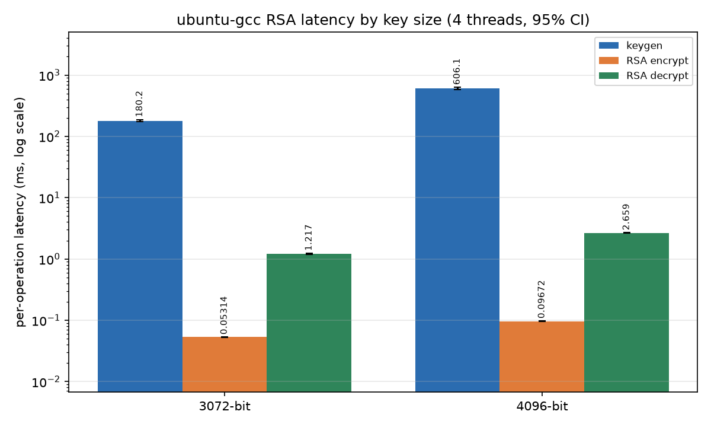
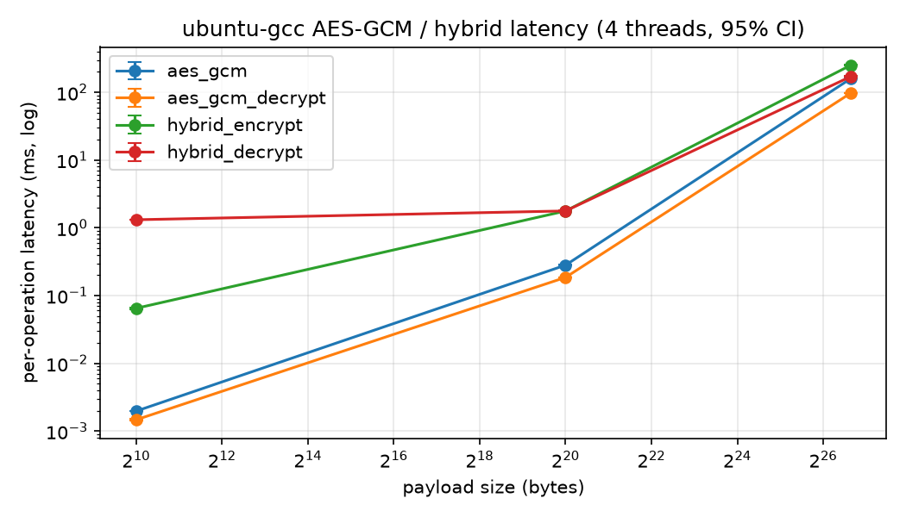
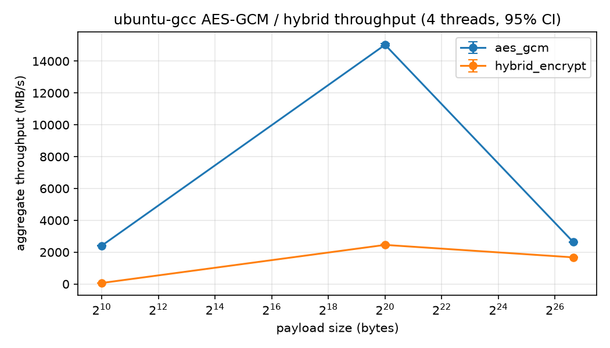
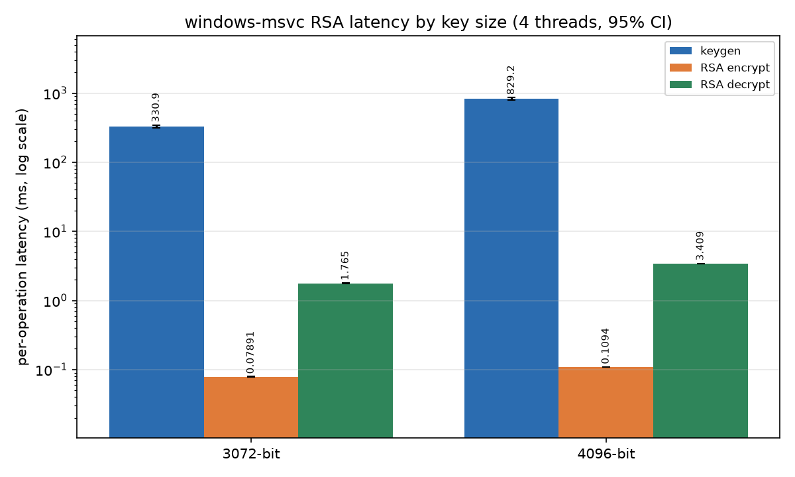
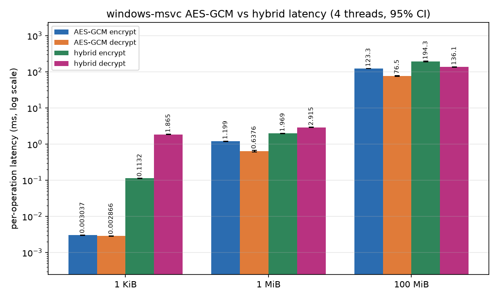
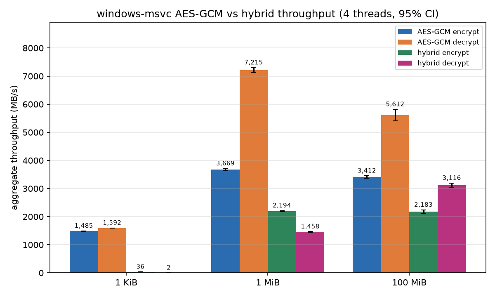

# BÁO CÁO LAB 3 — RSA-OAEP VÀ MÃ HÓA LAI

**Học phần:** NT219 — An toàn thông tin  
**Bài thực hành:** Lab 3 — RSA-OAEP và mã hóa lai  
**Sinh viên:** Nguyễn Công Tuấn  
**MSSV:** 25522012  
**Lớp:** NT219.R11.ANTT  
**Ngày hoàn thành:** 10/11/2026  
**Ngày cập nhật:** 15/11/2026

> Báo cáo giữ nguyên các số liệu đã đo và truy vết chúng về mã nguồn, nhật ký,
> CSV hoặc đồ thị trong kho lưu trữ. Những giới hạn của bằng chứng hiện có được
> nêu rõ thay vì suy diễn kết quả chưa được đo. Cụ thể: Windows không có
> run-time environment log; log MinGW GCC ngày 09/11/2026 có trước khi bổ sung
> OAEP thủ công và CTR+HMAC; benchmark Windows và Ubuntu là hai host khác nhau,
> không phải thí nghiệm có kiểm soát.

---

## Mục lục

1. Tóm tắt điều hành
2. Mục tiêu và phạm vi
3. Thiết kế và cài đặt
4. Kiểm chứng tính đúng đắn
5. Phương pháp đo hiệu năng
6. Kết quả và so sánh hiệu năng
7. Phân tích bảo mật
8. Đối chiếu yêu cầu, rubric và tự chấm điểm
9. Bài học rút ra và kết luận
10. Tài liệu tham khảo
11. Phụ lục

---

## 1. Tóm tắt điều hành

Lab 3 yêu cầu xây dựng công cụ dòng lệnh `rsatool` có khả năng tạo cặp khóa
RSA tối thiểu 3072 bit, thực hiện RSA-OAEP với SHA-256 và MGF1-SHA-256, hỗ trợ
nhãn tùy chọn, đồng thời tự chuyển sang một gói mã hóa AES-256-GCM khi bản rõ
vượt quá giới hạn của RSA. Khóa được lưu ở PEM và DER, kèm tệp JSON siêu dữ
liệu. Mọi đầu vào sai định dạng hoặc bị sửa đổi phải làm thao tác thất bại an
toàn và không làm lộ nguyên nhân chi tiết.

Sản phẩm gồm dự án C++17 dùng CMake, lõi dựa trên OpenSSL, CLI, kiểm thử
Catch2, hai vector KAT OAEP độc lập, kiểm thử âm CLI, CSV/tóm tắt/đồ thị hiệu
năng. Hai phần mở rộng tùy chọn cũng đã được cài đặt ở mức thư viện và kiểm
thử: hiện thực OAEP thủ công, và so sánh AES-256-CTR kết hợp HMAC-SHA256.

Kết quả chính:

- **RSA-OAEP:** RSA-3072/4096, SHA-256, MGF1-SHA-256, nhãn tùy chọn, giới hạn
  trực tiếp 318 byte (3072) và 446 byte (4096).
- **Envelope lai:** AES-256-GCM, IV 96 bit ngẫu nhiên, khóa AES 256 bit được
  bọc bằng RSA-OAEP; header chuẩn hóa (không gồm tag) là AAD; tag được xác
  thực trước khi ghi plaintext.
- **Định dạng khóa:** PEM (PKCS#8/SPKI) và DER (PKCS#1/SPKI), metadata JSON;
  từ chối khóa dưới 3072 bit.
- **Kiểm thử:** KAT 2/2; `ctest` 5/5 trên Ubuntu GCC, Ubuntu Clang, Windows
  MSVC và Windows MinGW GCC. Bộ test OAEP 36 assertion/9 case, hybrid
  36/6, negative 20/5 trên MSVC; log MinGW GCC cũ hơn có 24/7, 27/5, 20/5.
- **Hiệu năng Ubuntu:** RSA-3072 keygen 180.157 ms, RSA-4096 606.081 ms;
  hybrid 1 MiB mã hóa 1.817 ms và giải mã 1.674 ms mỗi thao tác dưới 4 luồng.
- **Hiệu năng Windows:** RSA-3072 keygen 369.274 ms, RSA-4096 1081.614 ms;
  hybrid 1 MiB mã hóa 2.805 ms và giải mã 4.579 ms mỗi thao tác dưới 4 luồng.
- **So sánh:** RSA giải mã chậm hơn mã hóa khoảng 21–27 lần; RSA-4096 chậm
  hơn 3072 khoảng 1.7–3.4 lần; ở 100 MiB chi phí AES-GCM chiếm ưu thế, còn ở
  1 KiB chi phí bọc/giải bọc khóa RSA chiếm ưu thế.

Điểm chưa hoàn thiện: khóa riêng chưa được mã hóa bằng mật khẩu; CLI đọc toàn
bộ payload vào bộ nhớ; chưa có thư viện mật mã thứ hai để so sánh byte-for-byte;
Windows thiếu run-time log; MinGW Clang chưa chạy lại; CTR+HMAC chưa được
benchmark và chưa có nghiên cứu timing khi xác thực thất bại; chưa có
PDF/archive nộp bài.

---

## 2. Mục tiêu và phạm vi

### 2.1 Mục tiêu của Lab 3

Theo đề bài và mục tiêu học phần, Lab 3 hướng tới các năng lực sau:

1. Tạo và lưu trữ cặp khóa RSA an toàn, tối thiểu 3072 bit.
2. Cài đặt/sử dụng RSA-OAEP với SHA-256 và MGF1-SHA-256, hỗ trợ nhãn.
3. Xử lý giới hạn kích thước bản rõ và tự động chuyển sang mã hóa lai.
4. Phát hiện và xử lý lỗi mật mã theo hướng fail-closed, không rò rỉ nguyên
   nhân.
5. Benchmark RSA theo kích thước khóa và benchmark chế độ lai.
6. Giải thích vì sao mã hóa lai là bắt buộc trong thực tế.
7. Thảo luận IND-CCA2 của OAEP, lỗi của PKCS#1 v1.5, forward secrecy và
   hướng nâng cấp ECDHE/ML-KEM.

### 2.2 Yêu cầu kỹ thuật và cách đáp ứng

| Yêu cầu từ đề bài | Cài đặt trong bài | Bằng chứng | Trạng thái |
|---|---|---|---|
| RSA modulus ≥ 3072 bit | `keygen --bits 3072/4096`; từ chối < 3072 khi load/generate | `src/rsa.cpp`, `test_negative.cpp` | Đạt |
| RSA-OAEP SHA-256 | `EVP_PKEY_CTX_set_rsa_padding(RSA_PKCS1_OAEP_PADDING)`, `rsa_oaep_md=sha256`, `rsa_mgf1_md=sha256` | `src/rsa.cpp` | Đạt |
| Nhãn OAEP tùy chọn | `--label`; label được đưa vào OAEP và header | `src/rsa.cpp`, `src/hybrid.cpp` | Đạt |
| Giới hạn `mLen <= k - 2hLen - 2` | Kiểm tra trước khi mã hóa; 318/446 byte cho 3072/4096 | `src/rsa.cpp`, `test_oaep.cpp` | Đạt |
| Tự chuyển sang hybrid | Khi vượt giới hạn, sinh AES key + IV, bọc key, mã hóa AES-GCM | `src/main.cpp`, `src/hybrid.cpp` | Đạt |
| AES-256-GCM | `EVP_aes_256_gcm`, IV 96 bit, tag 128 bit | `src/hybrid.cpp` | Đạt |
| Envelope JSON tự mô tả | `RSAENV1` + JSON header + payload nhị phân | `src/hybrid.cpp` | Đạt |
| Xác thực header | Header không gồm tag là AAD; sửa header làm tag fail | `src/hybrid.cpp`, `test_negative.cpp` | Đạt |
| Lưu PEM + DER + metadata | `keygen` ghi `.pem`, `.der`, `.json` | `src/rsa.cpp`, `tests/cli_test.*` | Đạt |
| Ciphertext raw/hex/base64 | `--encode`, `--decode`; raw mặc định cho tệp | `src/main.cpp`, `util.hpp` | Đạt |
| Kiểm tra ciphertext sai định dạng | Parser kiểm tra magic/version/mode/hash/payload_len/base64 | `src/hybrid.cpp` | Đạt |
| Sai nhãn/khóa bị từ chối | OAEP label và private key được kiểm tra | `test_oaep.cpp`, `cli_test.*` | Đạt |
| Không tạo output khi lỗi | Ghi output sau khi giải mã/xác thực thành công | `src/main.cpp` | Đạt |
| Lỗi không rò rỉ nguyên nhân | `decrypt` chỉ báo `error: decryption failed` | `src/main.cpp` | Đạt |
| Unit test Catch2 | 3 binary test + KAT + CLI | `tests/`, `ctest` 5/5 | Đạt |
| KAT | 2 vector OAEP-SHA256 độc lập | `kat/oaep_vectors.json` | Đạt |
| Benchmark RSA 3072/4096 | keygen/encrypt/decrypt, 1000 lần | `summary_gcc.csv`, `summary_msvc.csv` | Đạt |
| Benchmark hybrid 1 KiB/1 MiB/100 MiB | AES-GCM + hybrid encrypt/decrypt | CSV/summary | Đạt |
| Phân tích latency/throughput | §6 | Báo cáo này | Đạt |
| Bonus: OAEP thủ công | MGF1/XOR/validate, tương tác OpenSSL | `rsa::oaepEncryptManual`, test | Đạt |
| Bonus: phân tích bảo mật lai | §7.2–7.10 | Báo cáo này | Đạt |
| Bonus tùy chọn: CTR+HMAC | Encrypt-then-MAC, so sánh GCM | `hybrid::aesCtrHmac*`, test | Đạt một phần; chưa benchmark |

### 2.3 Phạm vi và giới hạn của báo cáo

- Bắt buộc: RSA-OAEP SHA-256, hybrid AES-256-GCM, PEM/DER/metadata, kiểm thử
  âm, benchmark.
- Bonus: OAEP thủ công, phân tích bảo mật lai, so sánh CTR+HMAC ở mức thư
  viện.
- Không làm: streaming envelope, mã hóa private key bằng mật khẩu, ECDHE/ML-KEM
  trong code, benchmark CTR+HMAC.
- OpenSSL là thư viện primitive duy nhất; không có implementation thứ hai để
  so sánh byte-for-byte. OpenSSL CLI chỉ dùng trong test để kiểm tra định dạng
  và tương tác OAEP.
- Các so sánh Windows/Ubuntu là quan sát trên hai host, không phải thí nghiệm
  nhân quả.

---

## 3. Thiết kế và cài đặt

### 3.1 Cấu trúc mã nguồn

```
lab03/
├── CMakeLists.txt          CMake C++17; OpenSSL bắt buộc
├── README.md               build, CLI, định dạng, giới hạn
├── BENCHMARKS.md           ma trận đo, môi trường, kết quả
├── REPORT.md               báo cáo này
├── src/
│   ├── rsa.hpp/.cpp        keygen, OAEP, label, PEM/DER, manual OAEP
│   ├── hybrid.hpp/.cpp     envelope AES-256-GCM, header/AAD, CTR+HMAC
│   ├── util.hpp            hex/base64/JSON/file helpers
│   ├── minijson.hpp        JSON parser tối giản
│   └── main.cpp            CLI: keygen, encrypt, decrypt, bench, --kat
├── tests/
│   ├── catch.hpp           Catch2 2.13.10 vendored
│   ├── test_oaep.cpp       OAEP, label, size limit, PEM/DER, manual OAEP
│   ├── test_hybrid.cpp     envelope, tamper, 1 KiB/1 MiB, CTR+HMAC
│   ├── test_negative.cpp   parser, key size, header, malformed input
│   ├── cli_test.sh         CLI Linux
│   └── cli_test.cmake      CLI Windows
├── kat/oaep_vectors.json   2 vector OAEP-SHA256 độc lập
├── scripts/                build, benchmark, summarize, plot
└── output/                 log, CSV, summary, biểu đồ
```

Kích thước phần code do sinh viên viết (không tính `catch.hpp`): khoảng 1.600
dòng C++ cho `src/` và khoảng 500 dòng cho test/script. `rsa.cpp` và
`hybrid.cpp` chứa toàn bộ logic mật mã/định dạng; `main.cpp` chỉ lo CLI và
benchmark.

### 3.2 Tham số mật mã

| Thành phần | Lựa chọn |
|---|---|
| Kích thước mô-đun RSA | 3072 bit; 4096 bit dùng để so sánh; từ chối nhỏ hơn 3072 bit |
| Hàm băm OAEP/MGF | SHA-256 / MGF1-SHA-256 |
| Nhãn OAEP | Tùy chọn; được ràng buộc bởi phép biến đổi OAEP |
| Mã hóa dữ liệu lai | AES-256-GCM |
| IV của GCM | 96 bit, sinh ngẫu nhiên mới cho mỗi thông điệp |
| Tag GCM | 128 bit, phải xác thực trước khi trả bản rõ |
| Định dạng khóa | PEM (PKCS#8 private, SPKI public) và DER (PKCS#1 private, SPKI public) |
| Siêu dữ liệu | `creation_time`, `modulus_bits`, `hash`, đường dẫn khóa |

OpenSSL 4.0.x được dùng vì đề bài cho phép và thư viện cung cấp OAEP, nhãn,
AES-GCM, PEM/DER và kiểm tra khóa mà không cần tự viết ASN.1. Bằng chứng Ubuntu
dùng OpenSSL 4.0.2; các script Windows hướng tới OpenSSL 4.0.3. CLI OpenSSL
4.0.2 chỉ được dùng làm công cụ đối chiếu độc lập.

### 3.3 Lý do chọn OAEP thay cho PKCS#1 v1.5

RSA không padding là tất định và có thể bị thao túng. Padding mã hóa
PKCS#1 v1.5 cũng không còn là lựa chọn phù hợp cho thiết kế mới vì các phản hồi
lỗi khác nhau có thể tạo padding oracle và dẫn tới tấn công giải mã thích nghi
Bleichenbacher. OAEP ngẫu nhiên hóa bản mã bằng seed và cấu trúc băm/MGF1.
Trong mô hình random-oracle, RSA-OAEP cung cấp tính bảo mật IND-CCA2 khi được
dùng đúng với RSA và tham số an toàn. Nhãn gắn ngữ cảnh vào phép biến đổi và
cũng được kiểm tra trong quá trình giải mã.

Cấu trúc EME-OAEP với `hLen = 32`:

```text
lHash   = SHA-256(label)
DB      = lHash || PS || 0x01 || M
dbMask  = MGF1(seed, k - hLen - 1)
seedMask= MGF1(maskedDB, hLen)
EM      = 0x00 || (seed XOR seedMask) || (DB XOR dbMask)
```

Khi giải mã, thư viện kiểm tra byte đầu `0x00`, tách seed/maskedDB, unmask,
so sánh `lHash`, tìm `0x01` và trả lỗi chung nếu bất kỳ bước nào sai. Đường
manual của bài mô phỏng đúng các bước này (§3.8).

### 3.4 Giới hạn kích thước bản rõ

Với mô-đun có độ dài `k` byte và `hLen = 32`, OAEP trực tiếp chấp nhận:

```text
mLen <= k - 2*hLen - 2
```

Do đó, RSA-3072 (`k = 384`) có giới hạn 318 byte, còn RSA-4096 (`k = 512`) có
giới hạn 446 byte. CLI kiểm tra đúng biên này trước khi mã hóa và chuyển sang
chế độ lai khi bản rõ lớn hơn. RSA không phù hợp để mã hóa tệp lớn trực tiếp vì
mỗi phép toán RSA làm việc trên một số nguyên có kích thước cố định, trong khi
OAEP đã sử dụng phần lớn không gian đó cho padding và seed.

Biên 318 byte từng là nguồn lỗi lệch một byte; test hiện kiểm tra đúng 318
byte thành công và 319 byte chuyển sang hybrid. Đây là ví dụ điển hình của
“off-by-one ở trust boundary”.

### 3.5 Gói mã hóa lai

Định dạng gói hiện tại:

```text
RSAENV1\n
{"version":1,"mode":"RSA-OAEP-AES-GCM","rsa_modulus":3072,"hash":"SHA-256",
 "label":"...","wrapped_key":"...","iv":"...","payload_len":N,"tag":"..."}\n
<bản mã AES-GCM nhị phân>
```

Quy trình mã hóa sinh khóa AES 32 byte và IV 12 byte ngẫu nhiên, bọc khóa bằng
RSA-OAEP với nhãn tùy chọn, rồi mã hóa dữ liệu bằng AES-256-GCM. Phần header
chuẩn hóa, không gồm `tag`, được dùng làm AAD. Vì vậy mọi thay đổi đối với mode,
mô-đun, hàm băm, nhãn, khóa đã bọc, IV hoặc độ dài payload đều làm xác thực GCM
thất bại. Tag được kiểm tra trước khi ghi bất kỳ bản rõ nào. Định dạng có phiên
bản và tự mô tả; khi giải mã không đoán chế độ trực tiếp/lai chỉ dựa trên độ dài.

Mô hình này tương tự TLS và PGP: mật mã bất đối xứng chỉ bảo vệ khóa phiên,
trong khi mật mã đối xứng xử lý dữ liệu. Thiết kế hiện tại không có tính bí mật
chuyển tiếp; nếu khóa RSA dài hạn bị lộ, các khóa phiên đã bọc có thể bị giải
ra. Hệ thống thực tế có thể bổ sung ECDHE hoặc KEM như ML-KEM, nhưng việc đó
ngoài phạm vi Lab 3.

### 3.6 Định dạng khóa và metadata

`keygen` ghi:

- `<pub>.pem` — SubjectPublicKeyInfo (SPKI), PEM.
- `<priv>.pem` — PKCS#8 private key, PEM.
- `<pub>.der` — SPKI, DER.
- `<priv>.der` — PKCS#1 private key, DER.
- `<priv>.json` — metadata gồm `creation_time`, `modulus_bits`, `hash` và
  đường dẫn của bốn tệp khóa.

Các đường dẫn có thể override bằng `--pub-der`, `--priv-der`, `--metadata`.
Khóa dưới 3072 bit bị từ chối khi load, không chỉ khi generate. Điều này quan
trọng vì kẻ tấn công có thể đưa một khóa yếu vào CLI; kiểm tra ở trust boundary
ngăn trường hợp đó.

Private key hiện được ghi ở dạng không mã hóa. Công cụ không tự đặt quyền
`0600`; người dùng phải tự bảo vệ tệp. Đây là giới hạn của bài lab, không phải
thiết kế production.

### 3.7 Xử lý lỗi và fail-closed

`decrypt` kiểm tra encoding, cấu trúc gói, kích thước khóa, nhãn, phép giải bọc
RSA và tag GCM, sau đó chỉ báo lỗi chung `error: decryption failed`. Khi giải
mã thất bại, tệp đầu ra không được tạo hoặc ghi đè. Cách xử lý này hạn chế việc
biến các kiểm tra riêng lẻ thành padding oracle hoặc tag oracle. So sánh tag
được thực hiện bởi thư viện OpenSSL; không có phép so sánh tag thủ công trên
đường chạy mặc định.

Các trường hợp fail-closed:

- Ciphertext RSA bị sửa → OAEP decode lỗi.
- Ciphertext/tag AES-GCM bị sửa → tag fail.
- Sai private key → OAEP decode lỗi.
- Sai nhãn → `lHash` không khớp.
- Header bị sửa → AAD khác, tag fail.
- Envelope truncated/version/mode/hash lạ/payload_len không nhất quán → parse
  lỗi.
- Hex lẻ, base64 sai padding → decode lỗi.
- Khóa < 3072 bit → từ chối.

`encrypt`/`keygen` báo lỗi đầu vào rõ hơn vì chúng không xử lý ciphertext do
kẻ tấn công kiểm soát. `decrypt` là bề mặt nhạy cảm nên chỉ trả một thông báo
chung.

### 3.8 Phần thưởng: OAEP thủ công

CLI vẫn dùng đường OAEP của OpenSSL làm mặc định. Hai hàm
`rsa::oaepEncryptManual` và `rsa::oaepDecryptManual` hiện thực trực tiếp
phép biến đổi EME-OAEP theo RFC 8017:

- `lHash = SHA-256(label)`;
- `DB = lHash || PS || 0x01 || M`;
- `dbMask = MGF1(seed, k - hLen - 1)` và `seedMask = MGF1(maskedDB, hLen)`;
- `EM = 0x00 || (seed XOR seedMask) || (DB XOR dbMask)`.

OpenSSL cung cấp SHA-256, seed ngẫu nhiên và phép lũy thừa RSA thô
(`RSA_NO_PADDING`). Kiểm thử chứng minh khả năng tương tác hai chiều: bản mã
được mã hóa thủ công giải mã được bằng OAEP của OpenSSL và ngược lại. Các biên
318 byte, nhãn sai, bản mã bị sửa và đầu vào ngắn cũng được kiểm thử.

Bộ giải mã không trả về ngay khi gặp lỗi padding. Nó so sánh `lHash` bằng
`CRYPTO_memcmp`, quét toàn bộ `DB` để tìm byte phân cách `0x01`, rồi gom lỗi
trước khi ném một lỗi chung. Đây chỉ là triển khai constant-time ở mức cố gắng:
phép RSA thô và việc sao chép bản rõ vẫn có thể phụ thuộc dữ liệu. Vì vậy đường
thủ công chỉ nhằm minh họa cấu trúc, không thay thế đường OAEP đã được thư viện
kiểm thử.

### 3.9 Phần thưởng tùy chọn: AES-CTR kết hợp HMAC

`hybrid::aesCtrHmacEncrypt` và `aesCtrHmacDecrypt` dùng khóa 64 byte, chia thành
khóa AES-256 và khóa HMAC-SHA256, mỗi phần 32 byte. Tag bao phủ IV, độ dài AAD,
AAD và ciphertext. Khi giải mã, tag được tính lại và so sánh bằng
`CRYPTO_memcmp`; chỉ sau khi tag hợp lệ mới chạy AES-CTR.

| Thuộc tính | AES-256-GCM | AES-256-CTR + HMAC-SHA256 |
|---|---|---|
| Số lượt quét dữ liệu | Một lượt AEAD | Một lượt CTR và một lượt HMAC |
| Tag / phần mở rộng | Tag 16 byte | Tag 32 byte |
| Vật liệu khóa | Một khóa 32 byte | Hai khóa 32 byte độc lập |
| IV/nonce | Nonce 12 byte; tái sử dụng rất nghiêm trọng | Khối đếm 16 byte; tái sử dụng rất nghiêm trọng |
| AAD | Được hỗ trợ trực tiếp | Được đưa tường minh vào dữ liệu MAC |
| Kiểm tra lỗi | Thư viện kiểm tra tag | So sánh HMAC constant-time |
| Hiệu năng trong bài | Có benchmark | Chưa benchmark |

GCM là chế độ mặc định vì xác thực trực tiếp header dưới dạng AAD, dùng một
primitive đã được kiểm thử rộng rãi và thường nhanh hơn. CTR+HMAC cần hai khóa,
tag lớn hơn và hai lượt xử lý. Phần so sánh đã được cài đặt và kiểm thử nhưng
không mở thành chế độ CLI, chưa có nghiên cứu phương sai thời gian khi tag sai,
nên báo cáo không đưa ra kết luận timing.

### 3.10 Những quyết định thiết kế đáng chú ý

1. **OpenSSL thay vì Crypto++.** Crypto++ 8.9.0 trong môi trường không có PEM
   helper, buộc phải tự viết ASN.1/PEM; OpenSSL cung cấp OAEP, label, GCM,
   PEM/DER và kiểm tra khóa. Đề bài cho phép OpenSSL.
2. **Header canonicalization.** Header được serialize theo thứ tự trường cố
   định trước khi làm AAD; thứ tự JSON tương đương về ngữ nghĩa không làm thay
   đổi AAD. Điều này tránh việc hai envelope “giống nhau” lại có tag khác nhau.
3. **Không đoán mode bằng độ dài.** Envelope có magic/version; ciphertext
   trực tiếp không có header. Người dùng phải biết mình đang giải mã loại nào.
4. **Không tự động fallback khi giải mã.** Nếu envelope lỗi, không thử giải mã
   như ciphertext trực tiếp; làm vậy sẽ tạo oracle và che giấu lỗi.
5. **Không thêm abstraction.** `rsa` và `hybrid` là hai module rõ ràng; CLI
   không có plugin/option thừa.

---

## 4. Kiểm chứng tính đúng đắn

### 4.1 Known Answer Tests

`kat/oaep_vectors.json` có hai vector RSA-OAEP-SHA256:

| Vector | Nhãn | Khóa | Plaintext | Nguồn |
|---|---|---|---|---|
| `oaep-sha256-empty-label` | rỗng | RSA-3072 | `Lab 3 OAEP KAT vector` | OpenSSL 4.0.2 `pkeyutl` |
| `oaep-sha256-nonempty-label` | `nt219-lab3` | RSA-3072 | `Lab 3 OAEP KAT vector` | OpenSSL 4.0.2 `pkeyutl` |

Hai vector được tạo độc lập bằng `openssl pkeyutl` với
`rsa_padding_mode:oaep`, `rsa_oaep_md:sha256`, `rsa_mgf1_md:sha256`, không
sinh từ `rsatool`. Vì OAEP dùng seed ngẫu nhiên, hai ciphertext khác nhau dù
cùng plaintext/khóa; KAT kiểm tra giải mã, không so sánh ciphertext cố định.

Kết quả:

| Nền tảng | Tệp | Kết quả |
|---|---|---|
| Ubuntu GCC 15.2 (05/11/2026) | `output/ubuntu/test_results/kat_gcc.txt` | 2 passed, 0 failed |
| Ubuntu Clang 21.1.8 | `output/ubuntu/test_results/kat_clang.txt` | 2 passed, 0 failed |
| Windows MSVC 19.51 (10/11/2026) | `output/windows/test_results/kat_msvc.txt` | 2 passed, 0 failed |
| Windows MinGW GCC 16.2.0 (09/11/2026) | `output/windows/test_results/kat_mingw_gcc.txt` | 2 passed, 0 failed |

Lệnh:

```bash
./build/ubuntu-gcc/rsatool --kat kat/oaep_vectors.json
```

### 4.2 Kiểm thử đơn vị

`test_oaep` kiểm tra:

- Round-trip OAEP cho plaintext ngắn, nhãn rỗng/không rỗng và đúng biên 318 byte.
- Nhãn khác nhau tạo ciphertext khác nhau và giải mã đúng với nhãn gốc.
- Sai nhãn, sai khóa, ciphertext bị sửa, ciphertext sai độ dài đều ném lỗi.
- 319 byte không đi qua OAEP trực tiếp.
- PEM/DER round-trip; từ chối khóa 2048 bit.
- OAEP thủ công: MGF1, XOR, tương tác hai chiều với OpenSSL, biên 318 byte,
  nhãn sai, bản mã bị sửa, đầu vào ngắn.

`test_hybrid` kiểm tra:

- Envelope 1 KiB và 1 MiB round-trip.
- Sửa payload, tag, IV, khóa đã bọc, header đều fail.
- `payload_len` không nhất quán fail.
- Label trong header được xác thực; label CLI phải khớp.
- AES-CTR+HMAC round-trip và fail khi sửa ciphertext/tag/AAD.

`test_negative` kiểm tra:

- Hex lẻ, hex ký tự lạ, base64 sai padding.
- `generateKey(1024)` và `generateKey(2048)` bị từ chối.
- Header sai version/mode/hash/payload_len.
- Ciphertext trực tiếp bị cắt một byte hoặc toàn zero.
- Nhãn hybrid sai.

Kết quả:

| Bộ test | Ubuntu | Windows MSVC | Windows MinGW GCC |
|---|---|---|---|
| `test_oaep` | Passed (ctest) | 36 assertion/9 case | 24 assertion/7 case (log cũ) |
| `test_hybrid` | Passed (ctest) | 36 assertion/6 case | 27 assertion/5 case (log cũ) |
| `test_negative` | Passed (ctest) | 20 assertion/5 case | 20 assertion/5 case (log cũ) |
| `ctest` tổng | 5/5 | 5/5 | 5/5 |

Log Ubuntu chỉ lưu tổng `ctest` 5/5, không lưu số assertion từng binary; các
con số assertion lấy từ log MSVC 10/11/2026. Log MinGW GCC 09/11/2026 có ít
case hơn vì được tạo trước khi bổ sung OAEP thủ công và CTR+HMAC. Không dùng
log MinGW cũ để tuyên bố các bonus đã được kiểm thử trên MinGW.

### 4.3 Kiểm thử âm và các trường hợp biên

| Trường hợp | Kỳ vọng | Bằng chứng |
|---|---|---|
| Sửa ciphertext RSA | Giải mã thất bại, không tạo output | `test_oaep`, `test_negative` |
| Sửa ciphertext AES-GCM | Tag fail, không tạo output | `test_hybrid`, CLI |
| Sửa tag | Tag fail | `test_hybrid`, CLI |
| Sai private key | OAEP fail | CLI |
| Sai nhãn | OAEP fail | `test_oaep`, CLI |
| Sửa header | AAD khác, tag fail | `test_negative`, CLI |
| Envelope truncated | Parse fail | CLI |
| Version/mode/hash lạ | Parse fail | `test_negative` |
| `payload_len` không khớp | Parse fail | `test_negative` |
| Hex/base64 sai | Decode fail | `test_negative`, CLI |
| Khóa 2048 bit | Từ chối | `test_negative`, CLI |
| Biên 318/319 byte | 318 trực tiếp, 319 hybrid | `test_oaep`, CLI |

Điểm quan trọng: khi giải mã thất bại, CLI không tạo tệp rỗng và không ghi đè
tệp cũ. Test CLI kiểm tra `[[ ! -e wrong.out ]]` cho trường hợp sai nhãn và
các trường hợp sửa envelope. Đây là hành vi fail-closed ở mức tệp, không chỉ
ở mức hàm.

### 4.4 Kiểm thử CLI

`tests/cli_test.sh` / `cli_test.cmake` chạy:

1. `keygen --bits 3072`; kiểm tra `.pem`, `.der`, `.json` tồn tại và metadata
   có `modulus_bits: 3072`.
2. Mã hóa/giải mã trực tiếp với label `ctx`; so sánh byte-for-byte.
3. Sai label phải fail và không tạo output.
4. Dữ liệu 4096 byte tự chuyển hybrid; round-trip.
5. Envelope base64 round-trip.
6. Sửa payload, header, ciphertext ngắn đều fail.
7. Sai private key fail.
8. `keygen --bits 2048` bị từ chối.
9. Hex lẻ bị từ chối.
10. KAT 2/2.
11. Nếu có OpenSSL CLI: kiểm tra PEM public/private và giải mã ciphertext
    OAEP do OpenSSL tạo.

Kết quả Windows MSVC: `cli_test.cmake: all Lab 3 cases passed` (10/11/2026).
Ubuntu: `ctest` 5/5, trong đó test `cli` chạy script trên.

### 4.5 Bằng chứng Ubuntu và Windows

**Ubuntu 26.04.1 LTS, GCC 15.2.0, OpenSSL 4.0.2 (05/11/2026):**

- KAT 2/2.
- `ctest` 5/5: oaep, hybrid, negative, kat, cli.
- Clang 21.1.8 cũng build và `ctest` 5/5.
- Benchmark log ghi rõ `threads=4, affinity=0-3, warmup=1.0s`.

**Windows:**

- MSVC 19.51: `ctest` 5/5 và KAT 2/2 ngày 10/11/2026; log có số assertion
  đầy đủ.
- MinGW GCC 16.2.0: `ctest` 5/5 và KAT 2/2 ngày 09/11/2026; log cũ hơn, chưa
  có OAEP thủ công/CTR+HMAC.
- MinGW Clang: chưa chạy lại cho Lab 3; không có log trong `output/windows/`.
- Không có run-time environment log cho benchmark Windows; CSV có cột
  `threads=4` nhưng không có affinity/power plan.

Lệnh tái lập Ubuntu:

```bash
cd lab03
scripts/build_linux.sh gcc
(cd build/ubuntu-gcc && ctest --output-on-failure)
./build/ubuntu-gcc/rsatool --kat kat/oaep_vectors.json
```

### 4.6 Đối chiếu yêu cầu kiểm thử của học phần

| Yêu cầu | Cách đáp ứng | Trạng thái |
|---|---|---|
| Altered RSA ciphertext → fail | `test_oaep`, `test_negative`, CLI | Đạt |
| Altered AES-GCM ciphertext/tag → fail | `test_hybrid`, CLI | Đạt |
| Wrong private key → fail | CLI | Đạt |
| Wrong OAEP label → fail | `test_oaep`, CLI | Đạt |
| Tampered envelope header → fail | `test_negative`, CLI | Đạt |
| Automated unit tests | Catch2, 3 binary + KAT + CLI | Đạt |
| Clear, non-leaky error | `error: decryption failed` | Đạt |
| Fail closed on parsing | Parser + no output on failure | Đạt |
| KAT | 2 vector độc lập | Đạt |
| Cross-check với OpenSSL CLI | PEM + OAEP interop khi có CLI | Đạt trên Ubuntu/MSVC; không phải byte-for-byte mọi ciphertext |

### 4.7 Hạn chế của phần kiểm chứng

- Chưa có thư viện mật mã thứ hai để so sánh ciphertext byte-for-byte trên
  toàn bộ không gian; OpenSSL CLI chỉ kiểm tra một số trường hợp.
- KAT chỉ có 2 vector; không phủ hết các tổ hợp label/độ dài.
- Chưa có fuzz test tự động cho parser envelope; các ca âm là hữu hạn.
- Log MinGW GCC cũ hơn code hiện tại; MinGW Clang chưa chạy lại.
- Chưa có timing study cho đường OAEP thủ công hoặc CTR+HMAC khi xác thực
  thất bại.
- Chưa có kiểm thử với khóa RSA 8192 bit hoặc modulus không chuẩn; ngoài phạm
  vi yêu cầu.

---

## 5. Phương pháp đo hiệu năng

### 5.1 Mô hình đo

`rsatool bench` chạy ma trận ca đo với 4 worker thread. Mỗi worker thực hiện
các thao tác độc lập và ghi một dòng CSV cho mỗi thao tác:

```csv
case,bits,size_bytes,threads,run,elapsed_ms,mbps
```

- `rsa_keygen`: sinh khóa 3072/4096, mỗi mẫu một lần.
- `rsa_encrypt`/`rsa_decrypt`: thông điệp 32 byte, OAEP-SHA256.
- `aes_gcm`/`aes_gcm_decrypt`: AES-256-GCM trên 1 KiB/1 MiB/100 MiB.
- `hybrid_encrypt`/`hybrid_decrypt`: envelope RSA-3072 + AES-256-GCM trên
  1 KiB/1 MiB/100 MiB.

Mỗi case có warm-up 1 giây mỗi worker trước khi đo. Số lần:
RSA 1000; AES/hybrid 1 KiB và 1 MiB 1000; 100 MiB 100. `elapsed_ms` là thời
gian một thao tác dưới 4-way concurrency, không phải tổng thời gian của cả
4 worker. Vì vậy throughput aggregate = per-op MB/s × 4.

Điểm cần nói rõ: với 1 KiB, thời gian một thao tác có thể xuống 0.002 ms; độ
phân giải timer và overhead vòng lặp chiếm tỷ lệ lớn. Với 100 MiB, mỗi thao
tác giữ cả plaintext/ciphertext trong bộ nhớ và 4 worker chạy đồng thời, nên
latency per-op tăng do tranh băng thông bộ nhớ; aggregate vẫn cao hơn.

### 5.2 Công thức thống kê

```text
mean   = (1/n) * sum(t_i)
median = giá trị giữa sau khi sắp xếp
sd     = sqrt( sum((t_i - mean)^2) / (n - 1) )
ci95   = 1.96 * sd / sqrt(n)
mbps   = (size_bytes / 1e6) / (elapsed_ms / 1000)     # per-op, MB thập phân
aggregate = mbps * threads
```

`summary_*.csv` ghi mean, median, SD mẫu, CI 95% và aggregate. Với RSA keygen,
`mbps = 0` vì `size_bytes = 0`; chỉ dùng `elapsed_ms`.

Lưu ý đơn vị: Lab 3 dùng MB thập phân (`size_bytes / 1e6`), khác Lab 2 dùng
MiB (`/ 1024^2`). Báo cáo giữ nhãn MB/s cho Lab 3 và không so sánh trực tiếp
con số tuyệt đối với Lab 2.

### 5.3 Ma trận đo

| Case | Bits | Kích thước | Runs | Ghi chú |
|---|---:|---:|---:|---|
| `rsa_keygen` | 3072, 4096 | — | 1000 | Prime search, SD lớn |
| `rsa_encrypt` | 3072, 4096 | 32 B | 1000 | Public exponent |
| `rsa_decrypt` | 3072, 4096 | 32 B | 1000 | Private exponent/CRT |
| `aes_gcm` | 256 | 1 KiB, 1 MiB | 1000 | Mã hóa |
| `aes_gcm` | 256 | 100 MiB | 100 | Mã hóa |
| `aes_gcm_decrypt` | 256 | 1 KiB, 1 MiB | 1000 | Giải mã |
| `aes_gcm_decrypt` | 256 | 100 MiB | 100 | Giải mã |
| `hybrid_encrypt` | 3072 | 1 KiB, 1 MiB | 1000 | RSA wrap + AES-GCM |
| `hybrid_encrypt` | 3072 | 100 MiB | 100 | RSA wrap + AES-GCM |
| `hybrid_decrypt` | 3072 | 1 KiB, 1 MiB | 1000 | AES-GCM + RSA unwrap |
| `hybrid_decrypt` | 3072 | 100 MiB | 100 | AES-GCM + RSA unwrap |

Không có case CTR+HMAC trong ma trận; đây là bonus tùy chọn, chỉ được unit
test.

### 5.4 Môi trường đo

**Ubuntu (07/11/2026):**

| Thành phần | Giá trị |
|---|---|
| Host | `han-sui-Vostro-3500` |
| OS | Ubuntu 26.04 LTS, kernel 7.0.0-42-generic x86_64 |
| CPU | 11th Gen Intel Core i5-1135G7 @ 2.40 GHz, 4 cores / 8 threads |
| Compiler | GCC 15.2.0, `-O3 -Wall -Wextra` |
| OpenSSL | 4.0.2 (`libcrypto.so.4`, custom prefix) |
| CMake | 4.2.3 |
| Affinity | `taskset -c 0-3` |
| Threads | 4 worker |
| Warm-up | 1 giây mỗi worker |
| Runs | RSA 1000; AES/hybrid ≤1 MiB 1000; 100 MiB 100 |
| Log | `output/ubuntu/benchmarks/bench_gcc.log` |

**Windows (10/11/2026):**

| Thành phần | Giá trị |
|---|---|
| OS | Windows 11 host; không có Lab 3 run-time log |
| Compiler | MSVC 19.51 (`build/windows-msvc`) |
| OpenSSL | 4.0.x (host install; không có version log cho Lab 3) |
| Threads | 4 (từ cột `threads` trong CSV) |
| Affinity / power | Script mặc định CPU 0-3, High performance; không được ghi log |
| Runs | Cùng ma trận 1000/1000/100 |
| Log | Không có; CSV/summary/plots là bằng chứng |

Hai host không phải cùng một máy được kiểm soát. Ubuntu có log affinity/warmup;
Windows chỉ có CSV. Vì vậy mọi so sánh Windows/Ubuntu là quan sát.

### 5.5 Các yếu tố gây nhiễu

1. **Keygen vốn ngẫu nhiên:** thời gian tìm số nguyên tố dao động lớn; SD
   117.5 ms trên mean 180.2 ms (Ubuntu 3072) và 413.8 ms trên mean 606.1 ms
   (4096). Không nên dùng mean keygen để so sánh compiler.
2. **Timer resolution ở 1 KiB:** 0.002 ms là quá nhỏ so với độ phân giải
   `high_resolution_clock` trên một số hệ thống; CV có thể cao.
3. **4-way concurrency:** 4 worker chia sẻ cache/băng thông; latency per-op
   không phải latency đơn luồng.
4. **Memory:** 100 MiB × 4 worker × (plaintext + ciphertext) tạo áp lực bộ nhớ;
   kết quả 100 MiB phụ thuộc cấu hình RAM.
5. **OpenSSL build:** Ubuntu dùng custom prefix 4.0.2; Windows dùng host
   install không rõ build flags. AES-NI/GCM có thể khác.
6. **Power/affinity Windows:** không có log, nên không thể quy chênh lệch cho
   compiler/OS.
7. **Thứ tự case:** các case chạy tuần tự; thermal và cache state có thể ảnh
   hưởng case sau.

### 5.6 Cách tái lập

Ubuntu:

```bash
cd lab03
PIN_CPU=0-3 THREADS=4 RUNS_RSA=1000 RUNS_SMALL=1000 RUNS_LARGE=100 \
  WARMUP=1 scripts/run_benchmarks.sh gcc
```

Windows:

```bat
cd lab03
set "OPENSSL_ROOT_DIR=D:\cryptolibrary"
scripts\run_benchmarks.bat msvc
```

Hoặc chạy trực tiếp:

```bat
build\windows-msvc\Release\rsatool.exe bench --runs-rsa 1000 --runs-small 1000 ^
  --runs-large 100 --threads 4 --warmup 1 ^
  --out output\windows\benchmarks\bench_windows_msvc_rsa_hybrid.csv --verbose
```

Tóm tắt và vẽ:

```bash
python3 scripts/summarize_bench.py \
  --input output/ubuntu/benchmarks/bench_ubuntu_gcc_rsa_hybrid.csv \
  --out output/ubuntu/benchmarks/summary_gcc.csv
python3 scripts/plot_bench.py \
  --input output/ubuntu/benchmarks/bench_ubuntu_gcc_rsa_hybrid.csv \
  --out-dir output/ubuntu/benchmarks/graph --platform ubuntu-gcc
```

---

## 6. Kết quả và so sánh hiệu năng

### 6.1 RSA trên Ubuntu

Nguồn: `output/ubuntu/benchmarks/summary_gcc.csv`; 4 thread, 1000 runs.

| Case | Bits | Mean (ms) | Median (ms) | SD (ms) | 95% CI (ms) |
|---|---:|---:|---:|---:|---:|
| keygen | 3072 | 180.157 | 155.273 | 117.502 | 7.283 |
| keygen | 4096 | 606.081 | 512.946 | 413.817 | 25.649 |
| encrypt | 3072 | 0.053 | 0.052 | 0.004 | 0.000 |
| encrypt | 4096 | 0.097 | 0.091 | 0.014 | 0.001 |
| decrypt | 3072 | 1.217 | 1.139 | 0.349 | 0.022 |
| decrypt | 4096 | 2.659 | 2.524 | 0.473 | 0.029 |

RSA-4096/3072 theo mean: keygen 3.36×, encrypt 1.83×, decrypt 2.19×. Keygen
có SD lớn nhất vì phụ thuộc việc tìm số nguyên tố; mean và median lệch nhau
đáng kể (180.2 vs 155.3 ms).

### 6.2 RSA trên Windows MSVC

Nguồn: `output/windows/benchmarks/summary_msvc.csv`.

| Case | Bits | Mean (ms) | Median (ms) | SD (ms) | 95% CI (ms) |
|---|---:|---:|---:|---:|---:|
| keygen | 3072 | 369.274 | 309.459 | 238.596 | 14.788 |
| keygen | 4096 | 1081.614 | 901.519 | 721.901 | 44.744 |
| encrypt | 3072 | 0.107 | 0.106 | 0.015 | 0.001 |
| encrypt | 4096 | 0.180 | 0.177 | 0.046 | 0.003 |
| decrypt | 3072 | 2.229 | 2.189 | 0.393 | 0.024 |
| decrypt | 4096 | 4.710 | 4.541 | 0.658 | 0.041 |

RSA-4096/3072 theo mean: keygen 2.93×, encrypt 1.68×, decrypt 2.11×. Cùng xu
hướng với Ubuntu; số tuyệt đối cao hơn nhưng không phải so sánh có kiểm soát.

### 6.3 AES-256-GCM

**Ubuntu:**

| Case | Size | Runs | Mean (ms) | Median (ms) | SD (ms) | 95% CI (ms) | Per-op MB/s | Aggregate MB/s |
|---|---:|---:|---:|---:|---:|---:|---:|---:|
| aes_gcm | 1 KiB | 1000 | 0.002 | 0.002 | 0.001 | 0.000 | 531.035 | 2124.142 |
| aes_gcm | 1 MiB | 1000 | 0.369 | 0.339 | 0.189 | 0.012 | 3021.524 | 12086.095 |
| aes_gcm | 100 MiB | 100 | 150.492 | 146.686 | 21.751 | 4.263 | 708.125 | 2832.500 |
| aes_gcm_decrypt | 1 KiB | 1000 | 0.002 | 0.002 | 0.001 | 0.000 | 613.850 | 2455.399 |
| aes_gcm_decrypt | 1 MiB | 1000 | 0.196 | 0.187 | 0.021 | 0.001 | 5395.621 | 21582.485 |
| aes_gcm_decrypt | 100 MiB | 100 | 81.777 | 80.274 | 5.129 | 1.005 | 1287.031 | 5148.125 |

**Windows:**

| Case | Size | Runs | Mean (ms) | Median (ms) | SD (ms) | 95% CI (ms) | Per-op MB/s | Aggregate MB/s |
|---|---:|---:|---:|---:|---:|---:|---:|---:|
| aes_gcm | 1 KiB | 1000 | 0.005 | 0.004 | 0.010 | 0.001 | 249.829 | 999.315 |
| aes_gcm | 1 MiB | 1000 | 1.590 | 1.474 | 0.456 | 0.028 | 691.486 | 2765.945 |
| aes_gcm | 100 MiB | 100 | 174.884 | 174.810 | 15.537 | 3.045 | 604.329 | 2417.314 |
| aes_gcm_decrypt | 1 KiB | 1000 | 0.003 | 0.003 | 0.001 | 0.000 | 314.057 | 1256.227 |
| aes_gcm_decrypt | 1 MiB | 1000 | 0.893 | 0.845 | 0.213 | 0.013 | 1226.992 | 4907.969 |
| aes_gcm_decrypt | 100 MiB | 100 | 105.640 | 105.602 | 9.063 | 1.776 | 1001.265 | 4005.060 |

AES-GCM đạt hàng GB/s nhờ AES-NI và GCM hardware. Con số 1 MiB Ubuntu
12.1 GB/s aggregate là throughput của 4 worker; không phải một luồng. Ở
100 MiB, throughput giảm do memory bandwidth và tranh cache.

### 6.4 Chế độ lai trên Ubuntu

Nguồn: `summary_gcc.csv`; RSA-3072 + AES-256-GCM.

| Case | Size | Runs | Mean (ms) | Median (ms) | SD (ms) | 95% CI (ms) | Per-op MB/s | Aggregate MB/s |
|---|---:|---:|---:|---:|---:|---:|---:|---:|
| hybrid_encrypt | 1 KiB | 1000 | 0.070 | 0.066 | 0.011 | 0.001 | 14.835 | 59.338 |
| hybrid_encrypt | 1 MiB | 1000 | 1.817 | 1.728 | 0.272 | 0.017 | 586.263 | 2345.052 |
| hybrid_encrypt | 100 MiB | 100 | 219.221 | 217.102 | 13.365 | 2.620 | 480.055 | 1920.221 |
| hybrid_decrypt | 1 KiB | 1000 | 1.297 | 1.237 | 0.201 | 0.012 | 0.802 | 3.206 |
| hybrid_decrypt | 1 MiB | 1000 | 1.674 | 1.578 | 0.260 | 0.016 | 637.455 | 2549.820 |
| hybrid_decrypt | 100 MiB | 100 | 152.524 | 150.847 | 10.226 | 2.004 | 690.429 | 2761.716 |

### 6.5 Chế độ lai trên Windows MSVC

| Case | Size | Runs | Mean (ms) | Median (ms) | SD (ms) | 95% CI (ms) | Per-op MB/s | Aggregate MB/s |
|---|---:|---:|---:|---:|---:|---:|---:|---:|
| hybrid_encrypt | 1 KiB | 1000 | 0.161 | 0.159 | 0.063 | 0.004 | 6.500 | 25.999 |
| hybrid_encrypt | 1 MiB | 1000 | 2.805 | 2.701 | 0.504 | 0.031 | 383.780 | 1535.120 |
| hybrid_encrypt | 100 MiB | 100 | 248.051 | 248.589 | 8.298 | 1.626 | 423.197 | 1692.790 |
| hybrid_decrypt | 1 KiB | 1000 | 2.419 | 2.326 | 0.396 | 0.025 | 0.430 | 1.720 |
| hybrid_decrypt | 1 MiB | 1000 | 4.579 | 3.688 | 2.403 | 0.149 | 258.377 | 1033.506 |
| hybrid_decrypt | 100 MiB | 100 | 161.401 | 161.691 | 6.079 | 1.191 | 650.593 | 2602.374 |

### 6.6 Nhận xét: RSA so với hybrid

- **RSA giải mã chậm hơn mã hóa:** Ubuntu 3072: 1.217 ms so với 0.053 ms
  (23×); 4096: 2.659 ms so với 0.097 ms (27×). Windows: 20.8× và 26.2×.
  Nguyên nhân là phép mũ bí mật/CRT, trong khi mã hóa dùng public exponent nhỏ.
- **RSA-4096 chậm hơn 3072:** keygen 3.36× (Ubuntu) / 2.93× (Windows),
  encrypt 1.83× / 1.68×, decrypt 2.19× / 2.11×. Đổi 3072 → 4096 tăng giới hạn
  trực tiếp từ 318 lên 446 byte nhưng tăng chi phí đáng kể; 3072 là lựa chọn
  hợp lý cho bài.
- **Ở 1 KiB, hybrid bị chi phối bởi RSA:** mã hóa 0.070 ms (Ubuntu) so với AES
  thuần 0.002 ms, khoảng 35×; giải mã 1.297 ms so với 0.002 ms, khoảng 648×.
  Con số giải mã gần bằng RSA decrypt 1.217 ms cộng AES.
- **Ở 1 MiB, AES bắt đầu chiếm ưu thế:** hybrid mã hóa 1.817 ms so với AES
  0.369 ms (4.9×); giải mã 1.674 ms so với 0.196 ms (8.5×). Chênh lệch còn lại
  là một lần RSA wrap/unwrap cộng overhead envelope.
- **Ở 100 MiB, gần như chỉ còn AES:** hybrid mã hóa 219.221 ms so với AES
  150.492 ms (1.46×); giải mã 152.524 ms so với 81.777 ms (1.87×). Đây là lý do
  thực tế dùng hybrid: RSA chỉ bảo vệ khóa, dữ liệu do AES xử lý.
- **Aggregate không phải latency đơn luồng:** 4 worker tăng throughput nhưng
  latency per-op ở 100 MiB tăng do tranh bộ nhớ. Báo cáo dùng per-op cho phân
  tích độ trễ và aggregate cho throughput hệ thống.

### 6.7 Vì sao symmetric crypto chiếm ưu thế

AES-GCM dùng AES-NI và GHASH hardware, xử lý nhiều block song song; RSA chỉ
xử lý một số nguyên nhỏ mỗi thao tác và private operation rất tốn kém. Ở
100 MiB, một lần RSA unwrap (khoảng 1.2 ms) không đáng kể so với 150 ms AES;
ở 1 KiB, một lần RSA unwrap lại lớn hơn toàn bộ AES. Đây là điểm giao nhau
(crossover) giữa hai chi phí, và là lý do envelope encryption là thiết kế
chuẩn.

### 6.8 Windows và Ubuntu

Cùng xu hướng: RSA private > public, hybrid bị RSA chi phối ở 1 KiB và AES
chi phối ở 100 MiB. Số tuyệt đối khác:

- AES-GCM 1 MiB mã hóa: 3021.5 MB/s (Ubuntu) so với 691.5 MB/s (Windows).
- RSA-3072 keygen: 180.2 ms (Ubuntu) so với 369.3 ms (Windows).
- Hybrid 1 MiB mã hóa: 1.817 ms (Ubuntu) so với 2.805 ms (Windows).

Khác OS, compiler, OpenSSL build và power plan; Windows thiếu run-time log.
Vì vậy không kết luận “Ubuntu nhanh hơn Windows” cho mọi cấu hình. Báo cáo chỉ
dùng dữ liệu để kiểm tra tính nhất quán của xu hướng.

### 6.9 Biểu đồ

Ubuntu có ba biểu đồ trong `output/ubuntu/benchmarks/graph/`:

- `rsa_latency.png` — latency keygen/encrypt/decrypt cho 3072/4096.
- `hybrid_latency.png` — latency AES-GCM và hybrid encrypt/decrypt theo 1 KiB/1 MiB/100 MiB.
- `hybrid_throughput.png` — throughput aggregate của AES-GCM và hybrid theo cùng kích thước.

Windows có bộ tương ứng trong `output/windows/benchmarks/graph/`. Biểu đồ dùng
grouped bars với 95% CI; trục thời gian nên đọc theo log nếu có nhiều bậc độ
lớn. Báo cáo không suy diễn từ hình ảnh khi CSV đã có số; hình chỉ để trình
bày. Lệnh tạo ở §5.













### 6.10 Độ ổn định

- RSA keygen có SD/mean lớn (65% ở 3072 Ubuntu; 68% ở 4096), phản ánh prime
  search; không nên so sánh mean keygen giữa hai lần chạy mà không có khoảng
  tin cậy.
- AES-GCM/hybrid ở 1 KiB có thời gian rất nhỏ; CV có thể cao nhưng sai số
  tuyệt đối nhỏ.
- 100 MiB có SD thấp hơn tương đối; đây là điểm ổn định nhất để so sánh.
- Không có outlier được đánh dấu riêng trong summary Lab 3; báo cáo dùng
  mean/median/SD/CI như CSV cung cấp, không thêm ngưỡng outlier tự tạo.

---

## 7. Phân tích bảo mật

### 7.1 Mô hình mối đe dọa

Báo cáo xét:

1. **Kẻ tấn công có ciphertext/envelope:** muốn đọc plaintext hoặc sửa dữ liệu.
2. **Kẻ tấn công chọn ciphertext:** gửi ciphertext bị sửa để quan sát lỗi
   (padding/tag oracle).
3. **Kẻ tấn công có public key:** có thể tạo ciphertext hợp lệ nhưng không
   giải mã được.
4. **Kẻ tấn công có private key:** phá toàn bộ confidentiality của các envelope
   đã ghi; không có forward secrecy.
5. **Người dùng sai:** dùng lại khóa, lưu khóa không an toàn, dùng nhãn sai,
   bỏ qua lỗi.

Ngoài phạm vi: tấn công vật lý, side-channel timing trên OpenSSL, tấn công
vào RNG của OS, và phân tích hình thức IND-CCA2. Báo cáo chỉ giải thích mô
hình bảo mật ở mức thiết kế.

### 7.2 Vì sao OAEP an toàn (IND-CCA2)

RSA thô là hàm tất định: cùng plaintext luôn cho cùng ciphertext, và có thể
bị tấn công bằng cách kiểm tra đoán. OAEP biến RSA thành lược đồ xác suất:

- Seed ngẫu nhiên làm ciphertext khác nhau mỗi lần.
- MGF1 trộn seed với `DB`, khiến quan hệ giữa plaintext và `EM` không tuyến
  tính.
- `lHash` ràng buộc label vào plaintext đã pad.
- Khi giải mã, mọi bước kiểm tra được gộp thành một lỗi chung.

Trong mô hình random-oracle, RSA-OAEP đạt IND-CCA2 với giả thiết RSA là hàm
một chiều. Đây là lý do OAEP là lựa chọn mặc định cho mã hóa bất đối xứng;
báo cáo không tuyên bố mạnh hơn mô hình này (ví dụ không tuyên bố an toàn
trong mô hình chuẩn).

### 7.3 Vì sao PKCS#1 v1.5 không còn phù hợp

PKCS#1 v1.5 dùng padding tất định `00 02 || PS || 00 || M`. Các vấn đề:

- Cấu trúc padding có thể bị phân biệt qua lỗi giải mã, tạo padding oracle.
- Bleichenbacher (1998) chỉ ra tấn công giải mã thích nghi khi kẻ tấn công
  phân biệt được “padding hợp lệ” và “padding sai”.
- Các biến thể như ROBOT cho thấy lỗi triển khai vẫn tái diễn trong thực tế.
- OAEP không loại bỏ hoàn toàn rủi ro triển khai, nhưng thiết kế và kiểm tra
  lỗi đồng nhất làm giảm bề mặt tấn công.

Bài này không cài đặt PKCS#1 v1.5; chỉ dùng nó làm so sánh để giải thích lựa
chọn OAEP.

### 7.4 Envelope và xác thực

Envelope dùng AES-256-GCM, một AEAD:

- Header canonical (không gồm tag) là AAD. Sửa bất kỳ trường nào — mode,
  modulus, hash, label, wrapped key, IV, payload_len — làm tag fail.
- Tag 128 bit được kiểm tra trước khi ghi plaintext.
- Khóa AES 256 bit và IV 96 bit sinh mới cho mỗi thông điệp.
- Không có nonce reuse trong một lần mã hóa; mỗi envelope có IV riêng.

Điểm cần lưu ý: AAD bảo vệ header khỏi sửa đổi, nhưng không bảo vệ tính bí
mật của header. Header chứa `label`, `modulus_bits`, `wrapped_key`, `iv`,
`payload_len`, `tag` — tất cả đều công khai, đúng thiết kế. Không đặt secret
trong header.

### 7.5 Xử lý lỗi và oracle

`decrypt` chỉ trả `error: decryption failed` cho mọi lỗi. Đây là biện pháp
chống oracle ở mức thông báo, nhưng không đủ để chống timing oracle:

- Thời gian giải mã OAEP phụ thuộc vào vị trí lỗi padding.
- Thời gian giải mã GCM phụ thuộc vào độ dài ciphertext, không phụ thuộc nội
  dung tag (tag được so sánh constant-time bởi thư viện).
- Đường manual OAEP cố gắng quét toàn bộ `DB` và gom lỗi, nhưng phép RSA thô
  và copy plaintext vẫn có thể phụ thuộc dữ liệu.

Báo cáo không tuyên bố chống timing oracle tuyệt đối. Trong môi trường thật,
cần thêm constant-time ở tầng thư viện, giới hạn tần suất lỗi, và không để
kẻ tấn công đo thời gian phản hồi chính xác.

### 7.6 Quản lý khóa

- Private key được ghi PEM/DER không mã hóa; công cụ không đặt quyền `0600`.
- Không có password-based encryption cho private key.
- OpenSSL quản lý bộ nhớ của `EVP_PKEY`; các buffer tạm trong manual OAEP và
  khóa AES trong hybrid được `OPENSSL_cleanse` trước khi giải phóng. Đây là
  best-effort, không chống được core dump/swap.
- Không log private key hay khóa AES.
- Metadata JSON chứa đường dẫn khóa, không chứa key material.

Khuyến nghị production: dùng KMS/HSM, mã hóa private key bằng passphrase, đặt
quyền tệp hạn chế, và không đưa khóa qua argv.

### 7.7 Forward secrecy, TLS và hướng PQC

Thiết kế hiện tại là RSA thuần + AES-GCM:

- Nếu private key RSA bị lộ, mọi envelope đã ghi có thể bị giải mã.
- Không có forward secrecy vì khóa phiên được bọc bằng khóa dài hạn.
- TLS 1.3 dùng (EC)DHE để thỏa thuận khóa phiên, chứng chỉ chỉ dùng xác thực;
  nhờ vậy lộ khóa dài hạn không làm lộ phiên cũ.
- Hướng nâng cấp: ECDHE + AES-GCM, hoặc KEM lai (ML-KEM + X25519) theo
  hướng PQC. Lab 6 sẽ đề cập ML-KEM; Lab 3 không cài đặt.

Bài này mô phỏng đúng phần “envelope encryption” của TLS/PGP ở mức khái niệm,
nhưng thiếu handshake và forward secrecy. Báo cáo nêu rõ để không tạo cảm
giác an toàn sai.

### 7.8 So sánh GCM và CTR+HMAC

| Tiêu chí | AES-256-GCM | AES-256-CTR + HMAC-SHA256 |
|---|---|---|
| Mô hình | AEAD một primitive | Encrypt-then-MAC |
| Số khóa | 1 khóa 32 byte | 2 khóa 32 byte |
| Tag | 16 byte | 32 byte |
| AAD | Hỗ trợ trực tiếp | Phải đưa vào MAC |
| Rủi ro nonce | Tái sử dụng nonce phá cả confidentiality và authenticity | Tái sử dụng counter phá confidentiality; HMAC vẫn có thể phát hiện sửa nếu MAC đúng |
| Constant-time | Thư viện đã kiểm thử | `CRYPTO_memcmp` |
| Hiệu năng | Có hardware acceleration | Chậm hơn, hai lượt |
| Trạng thái trong bài | Mặc định, có benchmark | Bonus, unit test, chưa benchmark |

GCM được chọn vì đơn giản, nhanh và đã được kiểm thử rộng rãi. CTR+HMAC là
phương án dễ hiểu hơn về mặt cấu trúc, nhưng cần quản lý hai khóa và có bề
mặt triển khai lớn hơn. Báo cáo không kết luận cái nào “an toàn hơn” tuyệt
đối; cả hai đều phụ thuộc triển khai và cách dùng nonce.

### 7.9 Kịch bản sử dụng sai

| Kịch bản | Hậu quả | Biện pháp |
|---|---|---|
| Dùng lại IV GCM | Mất confidentiality và authenticity | IV ngẫu nhiên 96 bit mỗi thông điệp |
| Dùng lại counter CTR+HMAC | Lộ keystream | Counter duy nhất, không quay vòng |
| Bỏ qua tag | Trả plaintext đã bị sửa | Luôn xác thực trước khi ghi |
| Dùng khóa 2048 bit | Yếu hơn yêu cầu | Từ chối < 3072 |
| Log private key | Lộ khóa | Không log secret |
| Dùng cùng khóa cho nhiều mục đích | Tăng bề mặt tấn công | Tách khóa wrap/data/MAC |
| Tin header là đáng tin | Sửa modulus/label | AAD bao phủ header |
| Dùng RSA trực tiếp cho file lớn | Không thể hoặc phải chunk thủ công | Hybrid envelope |

### 7.10 Khuyến nghị cho môi trường thật

1. Dùng TLS 1.3 hoặc envelope với ECDHE/ML-KEM để có forward secrecy.
2. Mã hóa private key bằng passphrase/KMS; không lưu plaintext trên đĩa.
3. Dùng AEAD (GCM/ChaCha20-Poly1305) và kiểm tra tag trước khi dùng dữ liệu.
4. Giới hạn kích thước input và stream để tránh memory exhaustion.
5. Ghi log lỗi chung, nhưng vẫn giám sát tần suất lỗi để phát hiện tấn công.
6. Kiểm thử negative/fuzz cho parser envelope trước khi triển khai.
7. Không dùng lại khóa/nonce giữa các phiên; có registry hoặc counter an toàn.

### 7.11 So sánh với Lab 1 và Lab 2

- Lab 1 dùng Crypto++ cho AEAD và có registry nonce; Lab 3 dùng OpenSSL cho
  RSA/OAEP và tự thiết kế envelope.
- Lab 2 cài đặt AES/CTR thủ công; Lab 3 dùng AES-GCM của OpenSSL, nên không
  minh hoạ lại primitive mà tập trung vào composition.
- Lab 3 là bài đầu tiên trong chuỗi có asymmetric crypto; các lab sau có thể
  mở rộng sang chữ ký, TLS, PKI.

---

## 8. Đối chiếu yêu cầu, rubric và tự chấm điểm

### 8.1 Rubric của Lab 3

Rubric từ `docs/blueprint/labs/lab3.md`: 100 điểm core + 15 điểm bonus.

| Tiêu chí | Tối đa | Tự chấm | Bằng chứng |
|---|---:|---:|---|
| RSA-OAEP đúng (SHA-256) | 20 | 20 | OAEP/MGF1-SHA256, nhãn, kiểm thử giới hạn, KAT 2/2 |
| Envelope lai đúng | 20 | 20 | Tự chuyển mode, AES-256-GCM, IV 96 bit, khóa bọc, giải mã có xác thực |
| Quản lý và định dạng khóa | 15 | 15 | PEM + DER + metadata cho 3072/4096; từ chối khóa yếu |
| Kiểm thử âm và xử lý lỗi an toàn | 15 | 15 | Các ca âm, không tạo output khi lỗi, thông báo giải mã chung |
| Nghiên cứu hiệu năng | 15 | 15 | Hai nền tảng, 4 luồng, 1000/100 lần đo, CI, CSV, đồ thị |
| Build và tài liệu đa nền tảng | 5 | 5 | Linux GCC/Clang, Windows MSVC/MinGW GCC; MinGW Clang chưa chạy lại |
| Chất lượng báo cáo | 10 | 9 | Báo cáo Markdown đầy đủ; PDF/DOCX và archive chưa có |
| **Tổng phần chính** | **100** | **99** | |
| Bonus: OAEP thủ công | +5 | 5 | MGF1/XOR, giải mã thủ công, tương tác hai chiều, biên và fail-closed |
| Bonus: phân tích bảo mật lai | +10 | 8 | Phân tích TLS/envelope/forward secrecy và CTR+HMAC; chưa có timing study |
| **Tổng cộng** | **115** | **112** | 99 phần chính + 13 bonus |

Lý do trừ điểm:

- **Report −1:** chưa xuất PDF/DOCX và chưa có archive nộp bài.
- **Bonus phân tích −2:** phân tích đã bao phủ TLS/forward secrecy/PQC và
  CTR+HMAC, nhưng chưa có đo timing khi xác thực thất bại; bonus yêu cầu
  “deeper hybrid study”, báo cáo chỉ ở mức định tính cho phần timing.
- **Cross-platform 5/5:** MSVC và MinGW GCC có log; MinGW Clang chưa chạy lại
  nhưng không phải yêu cầu bắt buộc của rubric. Nếu giảng viên yêu cầu đủ ba
  toolchain Windows, điểm này có thể bị trừ.

### 8.2 Checklist nộp bài

| Hạng mục | Trạng thái |
|---|---|
| Mã nguồn + CMake | Có |
| README | Có; đã cập nhật |
| Báo cáo | Có; tệp này |
| Unit test Catch2 | Có; 3 binary + KAT + CLI |
| KAT | Có; 2/2 trên Ubuntu GCC/Clang, Windows MSVC/MinGW GCC |
| Negative tests | Có; parser, header, key, label, ciphertext |
| Benchmark CSV | Có; Ubuntu GCC + Windows MSVC |
| Đồ thị | Có; RSA latency, hybrid latency/throughput |
| Windows binary | Có trên môi trường Windows; không commit binary |
| Linux binary | Đã build trên Ubuntu; không commit binary |
| Sinh viên/MSSV/Lớp | Đã điền trong `REPORT.md` |
| PDF/DOCX | Chưa xuất |
| Self-grade | Có; §8.1 |
| Academic integrity | Có; Phụ lục C |
| Gói nộp | Chưa tạo archive cho Lab 3 |

### 8.3 Đối chiếu yêu cầu chung của học phần

| Yêu cầu | Trạng thái |
|---|---|
| CMake, build ngoài source | Đạt |
| Ubuntu LTS | Đạt; GCC 15.2 + Clang 21.1.8, ctest 5/5 |
| Windows MSVC | Đạt; ctest 5/5, KAT 2/2 |
| Windows MinGW64 | Đạt; GCC 16.2.0, ctest 5/5 (log cũ); Clang chưa chạy lại |
| README dependency/version | Đạt; OpenSSL 4.0.x |
| README cài đặt Windows/Linux | Đạt |
| README build commands | Đạt |
| README ví dụ CLI | Đạt |
| README known limitations | Đạt |
| CLI thống nhất | Đạt; keygen/encrypt/decrypt/bench/--kat |
| UTF-8 input/output | Đạt ở mức C++/filesystem; không có test tiếng Việt riêng cho Lab 3 |
| Fail closed | Đạt |
| Không dùng `rand()`/`std::random` | Đạt; OpenSSL RNG |
| RSA ≥ 3072 | Đạt |
| OAEP SHA-256/MGF1 | Đạt |
| Hybrid AES-256-GCM | Đạt |
| KAT JSON + PASS/FAIL | Đạt |
| Negative tests | Đạt |
| Catch2/ctest | Đạt; 5/5 |
| Benchmark RSA + hybrid | Đạt |
| Thống kê mean/median/SD/CI95 | Đạt |
| So sánh Windows/Linux | Đạt; có cảnh báo |
| Phân tích RSA vs symmetric | Đạt; §6.6–6.7 |
| Threat model | Đạt; §7.1 |
| Misuse scenarios | Đạt; §7.9 |
| Forward secrecy/PQC | Đạt; §7.7 |
| Limitations | Đạt; §9.2 |

---

## 9. Bài học rút ra và kết luận

### 9.1 Bài học kỹ thuật

1. **Biên kích thước OAEP là trust boundary.** Sai một byte dẫn tới hoặc từ
   chối dữ liệu hợp lệ, hoặc gửi dữ liệu quá lớn vào OAEP. Test đúng 318/319
   byte là cần thiết.
2. **AAD phải bao phủ toàn bộ header có ý nghĩa.** Bỏ `payload_len` hoặc
   `label` khỏi AAD tạo lỗ hổng sửa header. Canonical JSON giúp AAD ổn định.
3. **Fail-closed ở mức tệp.** Không tạo output khi lỗi quan trọng hơn chỉ ném
   exception; test `[[ ! -e output ]]` kiểm tra đúng hành vi người dùng thấy.
4. **Không đoán mode khi giải mã.** Envelope có magic/version; ciphertext
   trực tiếp không có header. Đoán bằng độ dài sẽ tạo oracle và lỗi khó debug.
5. **Benchmark phải tách latency và aggregate.** 4 worker tăng throughput
   nhưng tăng latency per-op; báo cáo cần nói rõ đơn vị và cách tính.
6. **Keygen không phù hợp để so sánh compiler bằng mean.** Prime search có
   phân bố rộng; cần median/CI và nhiều mẫu.

### 9.2 Bài học bảo mật

- OAEP giải quyết tính tất định và padding oracle ở mức thiết kế, nhưng lỗi
  triển khai vẫn có thể tạo oracle.
- Mã hóa lai là bắt buộc vì RSA không xử lý dữ liệu lớn; AES-GCM cung cấp
  confidentiality + integrity với chi phí thấp.
- AAD là cách ràng buộc metadata vào AEAD; không được bỏ qua.
- Không có forward secrecy nếu khóa dài hạn bọc khóa phiên; cần ECDHE/KEM.
- Private key không mã hóa là giới hạn lớn nhất của bài lab.
- So sánh GCM và CTR+HMAC cho thấy không có lựa chọn “miễn phí”: GCM nhanh
  nhưng phụ thuộc thư viện; CTR+HMAC rõ ràng nhưng cần hai khóa và hai lượt.

### 9.3 Kết luận

RSA-OAEP với SHA-256 phù hợp cho dữ liệu ngắn trong giới hạn kích thước nghiêm
ngặt. Dữ liệu thực tế cần mã hóa lai: AES-256-GCM cung cấp tốc độ và xác thực,
trong khi RSA-OAEP chỉ bảo vệ khóa phiên. Envelope hiện tại có phiên bản, tự mô
tả, xác thực header và fail-closed trên các đường lỗi chính. Hai phần thưởng
minh họa cấu trúc OAEP và phương án encrypt-then-MAC mà không thay đổi đường
CLI mặc định.

Điểm mạnh: thiết kế envelope rõ ràng, kiểm thử âm phủ các đường sửa đổi, KAT
độc lập, benchmark đủ RSA và hybrid, phân tích bảo mật có chiều sâu. Điểm yếu:
private key không mã hóa, không streaming, thiếu oracle thứ hai, Windows thiếu
log, CTR+HMAC chưa benchmark. Các điểm yếu này được nêu rõ và có hướng khắc
phục.

### 9.4 Việc còn lại

1. **Mã hóa private key** bằng passphrase và đặt quyền tệp.
2. **Streaming envelope** để giảm peak memory.
3. **Oracle thứ hai** (Crypto++ hoặc implementation độc lập) để so sánh
   byte-for-byte.
4. **Windows run-time log** cho benchmark.
5. **MinGW Clang** chạy lại và lưu log.
6. **Benchmark + timing study** cho CTR+HMAC khi tag sai.
7. **Fuzz parser** envelope/CLI.
8. **PDF/archive** nộp bài.

---

## 10. Tài liệu tham khảo

1. J. Jonsson, B. Kaliski, *RFC 8017 — PKCS #1: RSA Cryptography
   Specifications Version 2.2*, 2016.
2. NIST, *SP 800-38D — Recommendation for Block Cipher Modes of Operation:
   Galois/Counter Mode (GCM) and GMAC*, 2007.
3. NIST, *FIPS 197 — Advanced Encryption Standard (AES)*, 2001 (updated 2023).
4. NIST, *SP 800-57 Part 1 Rev. 5 — Recommendation for Key Management*, 2020.
5. D. Bleichenbacher, “Chosen Ciphertext Attacks Against Protocols Based on
   the RSA Encryption Standard PKCS #1,” CRYPTO 1998.
6. V. Shoup, “OAEP Reconsidered,” CRYPTO 2001.
7. E. Rescorla, *RFC 8446 — The Transport Layer Security (TLS) Protocol
   Version 1.3*, 2018.
8. NIST, *FIPS 203 — Module-Lattice-Based Key-Encapsulation Mechanism
   Standard (ML-KEM)*, 2024.
9. OpenSSL 4.0 documentation, https://docs.openssl.org/.
10. Catch2 v2.13.10, https://github.com/catchorg/Catch2.
11. `docs/Lab3.txt`, `docs/blueprint/labs/lab3.md`, `lab03/README.md`,
    `lab03/BENCHMARKS.md`.

---

## 11. Phụ lục

### Phụ lục A — Tỉ lệ dẫn xuất

Tính từ mean trong `summary_gcc.csv` và `summary_msvc.csv`.

| Tỉ lệ | Ubuntu | Windows |
|---|---:|---:|
| RSA-4096 / 3072 keygen | 3.36× | 2.93× |
| RSA-4096 / 3072 encrypt | 1.83× | 1.68× |
| RSA-4096 / 3072 decrypt | 2.19× | 2.11× |
| RSA decrypt / encrypt (3072) | 22.96× | 20.83× |
| RSA decrypt / encrypt (4096) | 27.41× | 26.17× |
| Hybrid enc 1 KiB / AES enc 1 KiB | 35.0× | 32.2× |
| Hybrid enc 1 MiB / AES enc 1 MiB | 4.92× | 1.76× |
| Hybrid enc 100 MiB / AES enc 100 MiB | 1.46× | 1.42× |
| Hybrid dec 1 KiB / AES dec 1 KiB | 648.5× | 806.3× |
| Hybrid dec 1 MiB / AES dec 1 MiB | 8.54× | 5.13× |
| Hybrid dec 100 MiB / AES dec 100 MiB | 1.87× | 1.53× |

Các tỉ lệ dùng mean, không phải median; với keygen/1 KiB nên đọc kèm SD/CI.

### Phụ lục B — Danh mục bằng chứng

| Đường dẫn | Nội dung |
|---|---|
| `kat/oaep_vectors.json` | 2 vector OAEP-SHA256 độc lập |
| `output/ubuntu/test_results/kat_gcc.txt` | KAT 2/2 |
| `output/ubuntu/test_results/kat_clang.txt` | KAT 2/2 |
| `output/ubuntu/test_results/ctest_gcc.txt` | CTest 5/5 |
| `output/ubuntu/test_results/ctest_clang.txt` | CTest 5/5 |
| `output/ubuntu/test_results/environment.txt` | Môi trường Ubuntu, OpenSSL 4.0.2 |
| `output/ubuntu/test_results/build_gcc.log` | Build GCC |
| `output/ubuntu/test_results/build_clang.log` | Build Clang |
| `output/windows/test_results/ctest_msvc.txt` | CTest 5/5 + assertion counts |
| `output/windows/test_results/kat_msvc.txt` | KAT 2/2 |
| `output/windows/test_results/ctest_mingw_gcc.txt` | CTest 5/5 (log cũ) |
| `output/windows/test_results/kat_mingw_gcc.txt` | KAT 2/2 (log cũ) |
| `output/ubuntu/benchmarks/bench_gcc.log` | Log benchmark Ubuntu |
| `output/ubuntu/benchmarks/bench_ubuntu_gcc_rsa_hybrid.csv` | CSV per-run Ubuntu |
| `output/ubuntu/benchmarks/summary_gcc.csv` | Thống kê Ubuntu |
| `output/ubuntu/benchmarks/graph/*.png` | 3 biểu đồ Ubuntu |
| `output/windows/benchmarks/bench_windows_msvc_rsa_hybrid.csv` | CSV per-run Windows |
| `output/windows/benchmarks/summary_msvc.csv` | Thống kê Windows |
| `output/windows/benchmarks/graph/*.png` | 3 biểu đồ Windows |

### Phụ lục C — Cam kết liêm chính học thuật

**Tuyên bố tính nguyên bản:** Em/tôi chịu trách nhiệm về mã nguồn và nội dung
báo cáo này; không sao chép bài của sinh viên khác hoặc implementation
RSA/OAEP/envelope bên ngoài. Phần thiết kế envelope, CLI, kiểm thử và phân
tích trong bài được viết cho Lab 3. OpenSSL 4.0.x được dùng trong phạm vi đề
cho phép; Catch2 2.13.10 được vendored; các vector KAT OAEP được tạo độc lập
bằng `openssl pkeyutl` như đã mô tả.

**Khai báo hỗ trợ của AI/công cụ:** Báo cáo được soạn với sự hỗ trợ của trợ lý
AI (OpenCode/DeepSeek V4.1 Flash) trong việc tổng hợp số liệu từ CSV, diễn đạt
và rà soát tài liệu. Tác giả đã kiểm tra mã nguồn, chạy lại KAT và `ctest`, và
chịu trách nhiệm về nội dung. Không có số liệu hiệu năng nào được tạo tự động;
mọi con số đều truy vết được về CSV hoặc nhật ký trong `output/`.

**Phạm vi an toàn:** Các minh chứng tấn công/demo chỉ dùng dữ liệu test do bài
tạo, chạy offline; không thử nghiệm với dữ liệu, mạng hay dịch vụ của bên thứ
ba. Mọi khóa và secret trong repo là khóa test. Em/tôi hiểu ranh giới giữa
minh chứng lỗ hổng và khai thác độc hại, và chỉ dùng kiến thức này cho mục
đích học tập.

**Trích dẫn:** Tài liệu tham khảo ở §10; nguồn KAT ghi trong
`kat/oaep_vectors.json` và §4.1.
